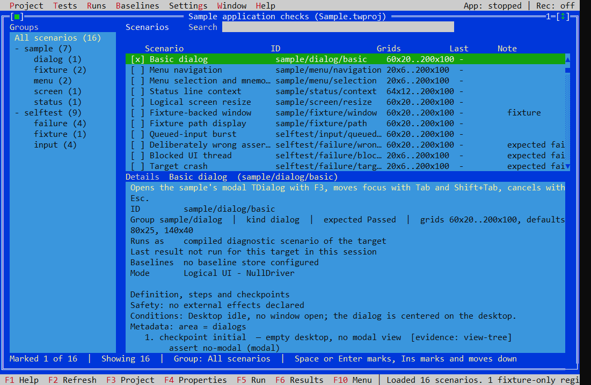
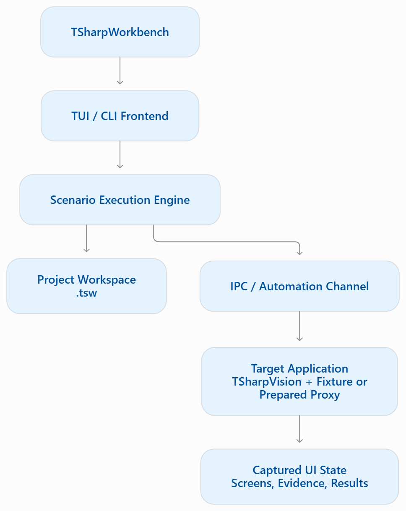

# TSharpWorkbench

**Record, test, and inspect [TSharpVision](https://github.com/lubomirklimes/TSharpVision) applications — from a classic TUI or the command line.**

TSharpWorkbench is a testing and diagnostic workbench for applications built with [TSharpVision](https://github.com/lubomirklimes/TSharpVision), the Turbo Vision-inspired .NET framework. Record user interactions, turn captured states into reviewable checkpoints and assertions, replay scenarios, compare results with baselines, and investigate rendering and layout problems.

> **Project status:** Active development. Windows is the primary tested development environment. Cross-platform components exist, but native interaction and UI coverage vary by operating system and backend. See [Platform status](#platform-status) before relying on a specific combination.



*A slideshow showcasing the workspace, Recorder Review, and layout-audit Results.*

[Quick start](#quick-start) · [Recorder](#smart-recorder) · [Layout Audit](#layout-audit) · [CLI and TUI](docs/usage.md) · [Architecture](#how-it-works) · [Manual](docs/manual/Manual.md)

## Why TSharpWorkbench?

- **Smart Recorder:** Interact with your app, capture meaningful UI changes, and review suggested checkpoints and assertions before inserting them into a scenario.
- **Interactive picking:** Select a control or screen region for an assertion using Ctrl+Shift+click/drag, or use Pick Mode where the terminal intercepts those gestures.
- **Layout Audit:** Detect out-of-bounds controls, unintended overlaps, clipped captions and labels, plus potential alignment, spacing, and proportion issues. Geometry findings and UX warnings are reported separately.
- **Repeatable automation:** Drive keyboard and mouse interactions through JSON scenarios, checkpoints, and assertions.
- **Evidence and comparison:** Inspect logical screen cells, recorded results, run history, and baseline differences. Specialized diagnostic harnesses can also inspect native output.
- **CLI and classic TUI:** Build and run scenarios interactively or integrate supported headless checks into CI.

## See it in action

Explore the [workspace screenshot](docs/images/workbench-overview.png), [Recorder Review](docs/images/smart-recorder-review.png), and [layout-audit Results](docs/images/layout-audit-results.png).

## Quick start

1. Build TSharpWorkbench with the .NET 10 SDK; see [Installation and first run](docs/installation.md).
2. Start the interactive workbench:

   ```sh
   TSharpWorkbench tui
   ```

   To reopen a saved native project:

   ```sh
   TSharpWorkbench tui --project <path-to-project.tsw>
   ```

3. Create a project, configure its target, and open **Target Diagnostics**. Prepare a target copy with compatible Workbench Proxy support when requested. This is needed for Smart Recorder features on ordinary TSharpVision applications.
4. Create or open an editable Black-Box scenario, record an interaction, and stop to review the proposed checkpoints and assertions. Accept or edit the suggestions you want to keep; then insert them into a scenario.
5. Run the scenario and inspect the results, including any Layout Audit findings.

> **Recording note:** Smart Capture is enabled by default, but an older or unprepared Proxy cannot provide Smart Recorder evidence. Prepare a compatible target copy before starting a Smart Capture recording.

## Smart Recorder

Smart Recorder observes significant states such as opened dialogs and menus. Once you stop a recording, it can suggest checkpoints and assertions tied to the state actually captured. The review step lets you accept, reject, or edit suggestions before they become part of a scenario.

A suggested assertion is not a guarantee: the workbench validates proposals against available evidence, and missing or incomplete evidence must remain visible. Ordinary input recording is still available if you do not want Smart Capture. See the [recording guide](docs/recorder.md) for preparation, picking, and review.

## Layout Audit

The composite **`layout-audit`** assertion is part of scenario schema **version 1**. It examines the captured view tree and available text/geometry evidence.

| Profile | Purpose |
| --- | --- |
| `geometry` | Objective geometry and text-fit checks. |
| `ux` | Geometry plus heuristic layout warnings. |
| `strict` | Like `ux`, but heuristic findings can also fail the assertion. |

Checks include clipping, off-screen controls, unexpected overlap, label collisions, alignment, spacing, button grouping, and disproportionate empty areas. Findings include affected controls, positions, and coverage information. Incomplete evidence is reported explicitly rather than silently treated as a clean result. See [Layout Audit](docs/layout.md) for configuration and result interpretation.

## Scenarios, projects, and results

- **Declarative JSON scenarios:** Describe input steps, checkpoints, and assertions; see [Scenario documentation](docs/scenarios.md).
- **Scenario editor:** Create and edit scenarios inside the TUI or use an external editor.
- **Projects and workspaces:** `.tsw` stores projects, scenarios, tests, environments, and results; legacy `.twproj` files describe target execution configurations.
- **Results and baselines:** Inspect individual assertions, compare runs, and review recorded artifacts.
- **Target preparation:** Diagnose the target and install or repair compatible Workbench Proxy files with explicit user approval.

## Platform status

TSharpWorkbench is designed around TSharpVision's Windows, macOS, and Linux backends, but **feature-level qualification is not yet uniform**.

| Environment | Current qualification summary |
| --- | --- |
| Windows / Console | Main development and automated integration target; some native input tests use injected events. |
| Windows / SDL | Selected renderer and recording paths tested; complete real-mouse/keyboard qualification remains in progress. |
| Windows / SDL GPU | Native recording and visual qualification pending. |
| Windows Terminal | Supported as a console host; some modifier+mouse gestures may be captured by the terminal, so use Pick Mode. |
| macOS / Linux | Components and builds exist, but the complete Recorder / Layout Audit native workflow is not yet qualified here. |

A green headless test suite does not establish native visual or real-input correctness across all platforms. See [packaging and automation](docs/release.md) for publishing from source and running the CLI in CI.

## How it works



For ordinary applications, a driver decorator provides automation and inspection without requiring application-specific test steps. The Proxy must match the capabilities required by the chosen recording workflow. Read the [architecture guide](docs/architecture.md) for execution and evidence boundaries.

## Repository structure

| Location / project | Responsibility |
| --- | --- |
| `src/TSharpWorkbench` | CLI, classic TUI, project and scenario workflows. |
| `src/TSharpWorkbench.Proxy` | Driver decorator for ordinary TSharpVision targets. |
| `src/TSharpWorkbench.Testing` | Scenarios, assertions, capture and automation protocol. |
| `src/TSharpWorkbench.Storage` | SQLite-backed `.tsw` workspace storage. |
| `src/TSharpWorkbench.Diagnostics.*` | Specialized driver, native-host, and pixel diagnostics. |
| `tests/` | Automated test suites. |
| `diagnostics/` | Small targets and utilities used to validate behavior. |
| `tools/` | Supporting development and storage tools. |

## Documentation

- [Installation and first run](docs/installation.md)
- [CLI and TUI usage](docs/usage.md)
- [Scenario format and assertions](docs/scenarios.md)
- [Repository structure](docs/structure.md)
- [TSharpVision package-based build workflow](docs/build.md)
- [Packaging and automation](docs/release.md)
- [Illustrated user manual](docs/manual/Manual.md) · [Česká příručka](docs/manual/ManualCZ.md)

## Related project

- [TSharpVision](https://github.com/lubomirklimes/TSharpVision) — a Turbo Vision-inspired .NET framework.

## License

MIT. See [LICENSE](LICENSE).
