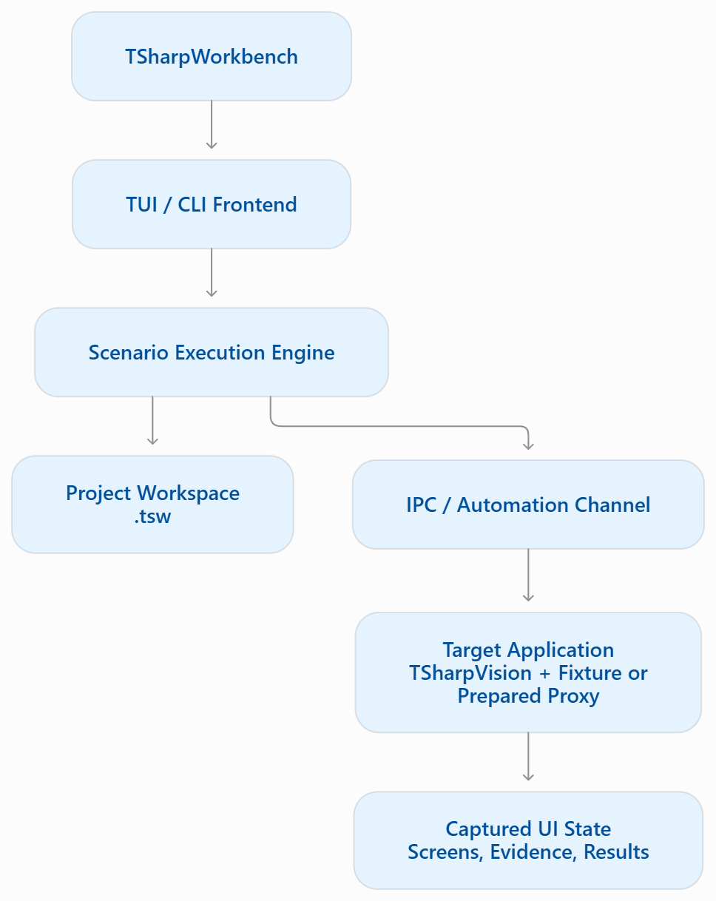

# Architecture

The TUI and CLI share scenario loading and execution. The runner launches an owned target session, sends input steps, captures checkpoints, and evaluates assertions. Results and evidence can be inspected independently of how the run was started.

## Projects and execution

A native `.tsw` workspace groups scenarios, tests, environments, and stored results. Legacy `.twproj` JSON configurations describe target execution and external scenario files. The frontend's project model and the target application's UI are separate processes and state.

## Proxy sessions

An ordinary compatible application runs through a prepared driver-decorator Proxy. Preparation deploys the current Proxy/Testing payload to a separate copy by default. The original application does not need to register test steps. The runner owns the target lifetime and communicates over a local authenticated session.

A diagnostic target instead exposes explicit compiled fixtures and their supported actions. These contracts are distinct from ordinary proxy-logical scenarios; backend selection does not make an unsupported scenario executable.

## Evidence boundaries

Logical screen cells and semantic inspection describe application state. Native captures have an explicit boundary, such as console cells or renderer pixels. A native screenshot of the Workbench itself does not qualify the target's backend. See [capture types](capture.md) and [platform status](../README.md#platform-status).

See [repository structure](structure.md) for implementation responsibilities and [scenario documents](scenarios.md) for input/checkpoint structure.
