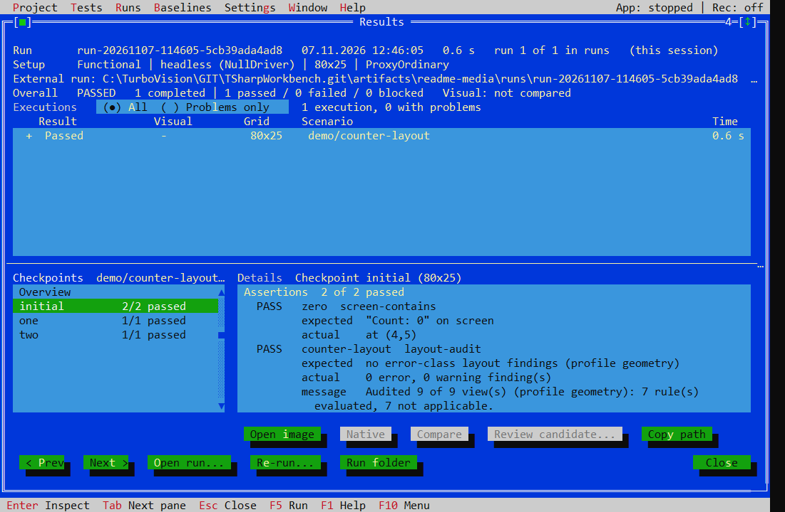

# Layout Audit

The schema-v1 `layout-audit` assertion examines captured view geometry and available text evidence. It checks containment, overlap, clipping, and text fit; optional UX rules also examine alignment, spacing, button grouping, and balance.

| Profile | Behavior |
| --- | --- |
| `geometry` | Geometry and text-fit checks; the default profile. |
| `ux` | Geometry plus heuristic UX findings, reported as warnings. |
| `strict` | Geometry and UX checks; warning findings can fail the assertion. |

## Add an audit

Put the assertion in a checkpoint with `view-tree` evidence:

```json
{
  "kind": "checkpoint",
  "id": "layout",
  "evidence": ["view-tree"],
  "assertions": [
    { "id": "layout-check", "kind": "layout-audit", "profile": "geometry" }
  ]
}
```

An optional `view` selector scopes the audit to a single matching view. Optional `rules` select named rules from the chosen profile; `suppress` entries identify a rule and view with a reason. Inspect findings and coverage before narrowing rules or suppressing a result.

## Read the result

Results shows error and warning counts, affected views, and audit coverage. A truncated tree or missing evidence can prevent a valid pass. Rules marked not applicable differ from rules that could not be evaluated; review the explanation alongside the verdict.



This example shows a clean check of a small counter fixture. It does not establish that every UI or backend combination has been qualified. See [scenarios](scenarios.md), [evidence boundaries](capture.md), and [platform status](../README.md#platform-status).
