# TSharpWorkbench — User Manual

TSharpWorkbench is used for automated user interface testing of applications built on TSharpVision. In a project you prepare scenarios, assign test environments to them, run tests, and evaluate the captured application state. Operation combines mouse and keyboard; window, field, and button names in this manual match the application.

## Contents

1. [How project, test, and scenario relate](#pojmy)
2. [Creating and configuring a project](#projekt)
3. [Preparing test environments](#prostredi)
4. [Preparing scenarios](#scenare)
5. [Scenario Editor and individual steps](#editor)
6. [Checkpoints and assertions](#assertions)
7. [Creating and selecting tests](#testy)
8. [Recording scenarios — Record Interaction](#nahravani)
9. [Running Tests](#beh)
10. [Results](#vysledky)
11. [Visual Baselines](#reference)
12. [Saving work, troubleshooting, and help](#pomoc)
13. [Your first test from start to finish](#priklad)

[Appendix A. Legacy — older project branch](#starsi-behy)

For your first test, go through project creation, environments, scenario, and test, then continue with the Running Tests chapter. Recording is an alternative to building input steps manually. Use Visual Baselines for visual regression; detailed [target diagnostics](#diagnostika) and [resolving save conflicts](#konflikty) help when you run into trouble. Advanced procedures for external results are described directly in the corresponding chapters. The appendix only preserves the older project branch, which is not part of the regular entry into a `.tsw` project.

## 1. How project, test, and scenario relate

| Term | Meaning |
| --- | --- |
| **Project** | A project in a `.tsw` archive. It groups the tested application settings, scenarios, tests, environments, and stored results. |
| **Target** | The application you will test. Its executable is set in the project properties. |
| **Scenario** | A sequence of steps: for example, open a menu, type text, and verify the displayed dialog. It has a stable ID and a readable title. |
| **Step** | A single scenario step: key, text, mouse, resize, checkpoint, or fixture action. |
| **Checkpoint** | A control point at which the application state is captured and the specified conditions are evaluated. |
| **Assertion** | A specific check condition, for example "the screen contains this text" or "these two fields do not overlap". |
| **Environment** | A run profile: operating system, display driver, character grid size, and capture method. |
| **Test** | A named test case. It references one scenario and one or more environments. It also contains a description and preconditions. |
| **Run** | Execution of selected test × environment combinations. Results are viewed in Run Explorer and Results. |
| **Evidence** | Captured material: screen, view tree, menu state, or status line state. |
| **Baseline** | An approved reference state for visual comparison of future runs. |

The scenario defines **what to do**, the environment defines **under which conditions**, and the test combines them into a repeatable case. One scenario can be used by multiple tests.

### Example: checkpoint, assertion, and baseline when opening a dialog

You want to verify that the "About" command opens the correct dialog and that its appearance has not changed compared to the approved version:

1. **Input steps** open the menu and select the "About" command.
2. A **Checkpoint** with ID `about-open` captures the screen at the moment the dialog should be open. It creates a place in the scenario to which checks and captured evidence are bound.
3. The `screen-contains` **Assertion** with the text `About` verifies that the expected title actually appeared on the screen. If you want to verify the specific modal dialog directly, you can also add `modal` with a matching selector and view-tree evidence.
4. The **Baseline** for this checkpoint and environment compares the whole logical capture with the approved appearance. It reveals, for example, a shifted button or a different color, even if the title text still matches.

| Mechanism | Which question it answers | What it cannot verify on its own in the example |
| --- | --- | --- |
| Checkpoint | When and which state to capture? | The capture itself does not say whether the dialog is correct. |
| Assertion | Does a specific requirement hold? | The presence of the title does not verify the overall layout and all cell attributes. |
| Baseline | Does the captured appearance match the approved reference? | The image alone does not replace targeted checks of application state or behavior. |

You do not have to use all three mechanisms in every test. A checkpoint without assertions can serve only for capture; a functional test can use checkpoints with assertions without visual regression. To check behavior and appearance at the same time, combine them. The first capture becomes a reference only after your explicit approval.

In **Black-Box** mode, steps control a regular application via keyboard and mouse. In **White-Box** mode, the scenario uses a diagnostic fixture exposed by the tested application. A fixture can offer named actions, checkpoints, and points for mouse input.

### Basic controls

Move between fields with **Tab** and **Shift+Tab**. In lists, use the arrow keys or the scroll bar. **Space** toggles check boxes. The highlighted letter in a label marks a local **Alt** shortcut. **F10** activates the menu and **F1** opens help for the active window.

**OK**, **Save**, **Create**, or **Choose** confirms the respective dialog. **Cancel** and usually **Esc** discard pending changes in a dialog. When closing an editor with unsaved changes, you are asked whether to save them. Closing a work window does not close the whole project.

### File selection — common controls

Workbench uses file dialogs when opening a project, attaching a scenario, or choosing an output path. The top field contains the path and file name or a mask, for example `*.tsw` or `*.json`. The mask limits the list of displayed files; a specific name selects the file to open or save.

Browse files and folders in **Files**. Opening a folder takes you into its contents; `..` goes one level up. You can also type a path directly into the top field. Tab moves between the field, the list, and the buttons. The bottom part shows information about the current item.

**Open** confirms opening or selecting an existing file. **OK** in a save dialog confirms the target path. **Cancel** or Esc cancels the selection. The **Add scenario files** dialog instead has **Add** for adding files one by one and **Done** to finish the selection. Specific uses and screenshots follow with the individual workflows.

## 2. Creating and configuring a project

### 2.1 Start Page

When started without an open project, the **Start Page** is displayed. In the **Recent projects** list, select a previously used project and choose **Open**, or press Enter. **Open project…** opens another `.tsw` archive; **New project…** creates a new project.

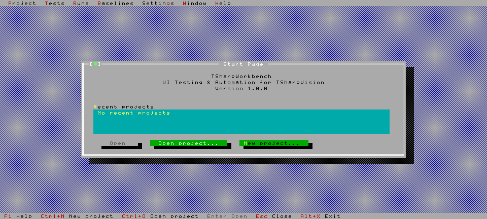

The same operations are available via **Project → New…** (**Ctrl+N**) and **Project → Open…** (**Ctrl+O**). Save a new project under the chosen name to a `.tsw` file.

#### Open project — selecting a project archive

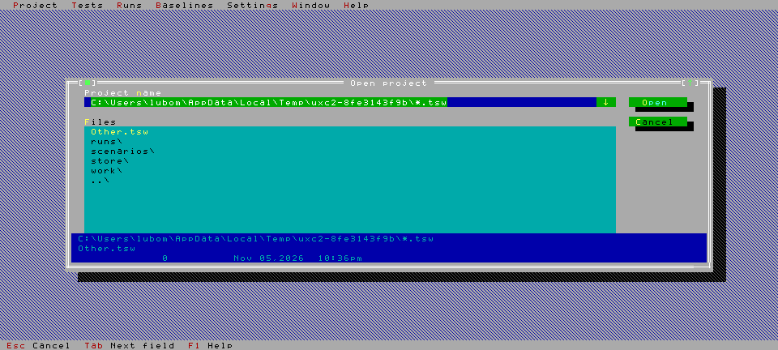

In the **Project name** field, navigate to the folder containing the project and select the `.tsw` file. **Open** passes it to the application to open; the archive contents are then validated. The `*.tsw` mask only filters the offered files. **Cancel** keeps your current work without opening another project.

### 2.2 Project Information — project overview

After opening or creating a project, **Project Information** is displayed. Reopen it via **Project → Properties…**, **F3**, or **Alt+1**. It is an informational overview; the actual settings are edited in a different dialog, Project Properties.

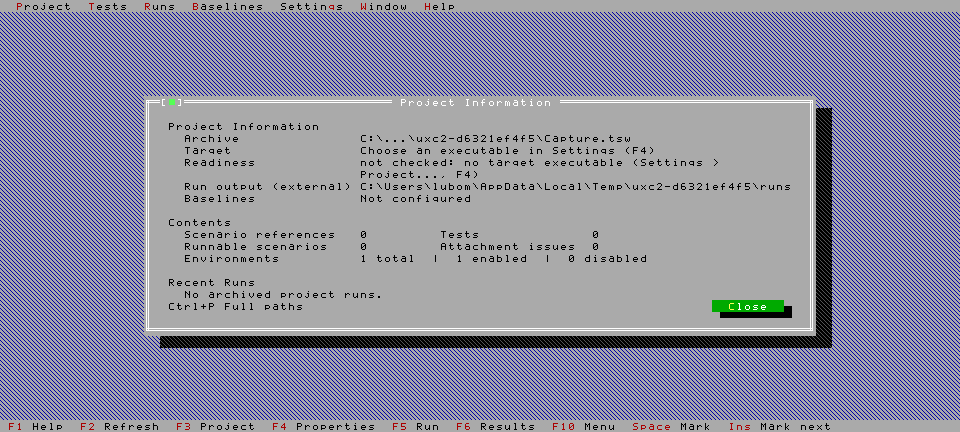

Check in particular:

- **Archive**: which project is open.
- **Target** and **Readiness**: the tested application and its readiness to run.
- **Runs** and **Baselines**: the location of results and the state of reference data.
- **Contents**: counts of scenarios, tests, environments, and any problems with attached scenarios.
- **Recent Runs**: an overview of the latest stored runs.

**Ctrl+P** shows long paths. Close the overview with **Close** or Esc.

### 2.3 Project Properties — application and run settings

Open **Settings → Project…** or press **F4**.

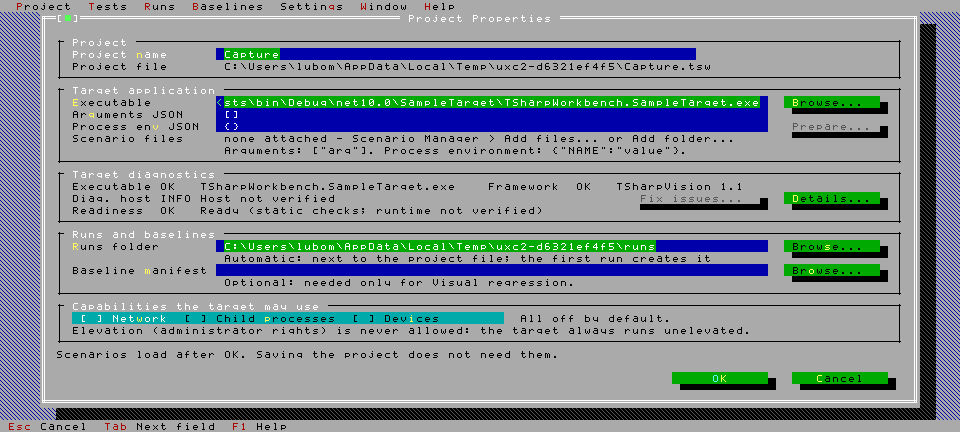

1. In the **Project** section, edit the project name.
2. In the **Target application** section, use **Browse…** to select the executable of the tested application.
3. If the application needs arguments or process environment variables, fill in **Arguments JSON** and **Process env JSON**.
4. Review the diagnostic summary in **Target diagnostics**. **Details…** opens the details.
5. In **Runs and baselines**, set the runs directory and, optionally, the baseline manifest.
6. Confirm with **OK**. After the catalog loads, check scenario availability.

Arguments are entered as a JSON array of strings, for example `["--verbose", "--demo"]`. Process variables take the form of a JSON object, for example `{"LANG":"cs_CZ"}`. These fields configure the launched process; Environment profiles are managed separately.

In the **Capabilities the target may use** section, enable only the capabilities required for the given test, such as network access or child processes. **Cancel** keeps the original settings.

If diagnostics report that the application is not ready, use **Settings → Target Diagnostics…** and **Verify target**. **Prepare Target Copy…** prepares a separate copy of the application with Workbench support; **Fix Original Target…** adds missing support to the original location and requires confirmation. After preparation, verify the target again and refresh the scenario catalog with **F2**.

#### Select target executable — selecting the tested application

**Browse…** next to **Executable** opens the executable selection:

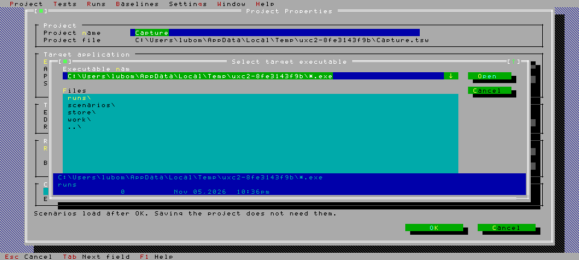

Select the executable of the tested application itself and confirm with **Open**. On Windows the dialog offers files matching the `*.exe` mask. The selected path is inserted into the Executable field; then confirm all settings with **OK** in Project Properties. Selecting the file does not launch the application.

The older branch of direct target work also uses a standalone variant of the same selection:

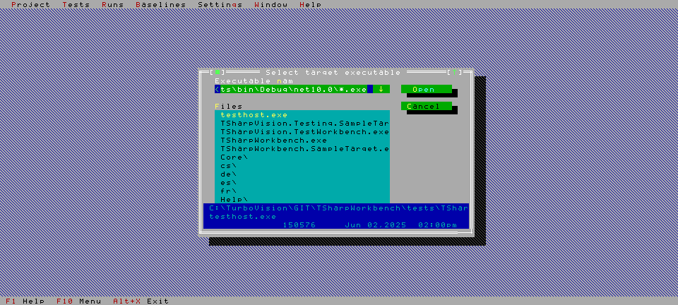

The meaning of the **Executable name** field, the list, and the Open/Cancel buttons is the same. In a regular `.tsw` project, start via F4 and Browse in Project Properties.

#### Baseline manifest (.json) — path to reference data

**Browse…** next to **Baseline manifest** opens the manifest selection:

In **Manifest file**, select the store manifest, usually `visual-baselines.json`, and confirm with **OK**. The `.json` extension alone is not enough: the file must contain a visual baseline manifest. When you confirm changed settings in the project, an offer to adopt the store may follow; the procedure is described in section 11.1. **Cancel** in the file dialog keeps the original field value.

### 2.4 Target diagnostics and repair

Before troubleshooting scenario errors, verify that Workbench can communicate with the tested application. **Settings → Target Diagnostics…** or **Details…** in Project Properties opens the **Target Diagnostics** report.

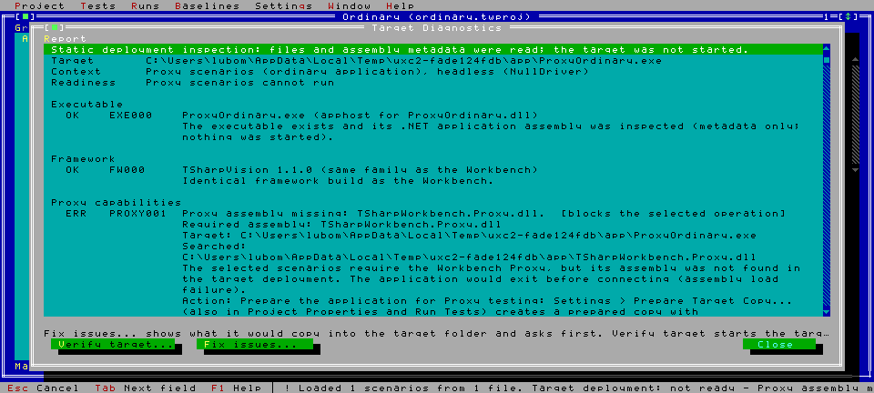

The report shows the target path, check context, readiness, and individual findings. The static check reads files and assembly metadata; it does not launch the target itself. Each finding's explanation includes the missing file or incompatibility and the recommended next step. For example, a missing `TSharpWorkbench.Proxy.dll` blocks scenarios that need the Proxy.

#### Verify Target — actual connection verification

Choose **Verify target…**. A confirmation is shown before launch:

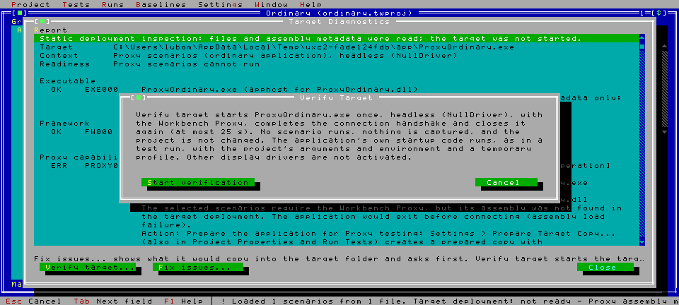

**Start verification** launches the target once in headless mode, waits for the connection, and then terminates the process. It does not execute a scenario or capture the screen. Read the conditions in the dialog: on startup the application runs its regular initialization code. **Cancel** returns without launching. After verification, read the updated diagnostic result.

#### Fix Issues — plan for adding support

**Settings → Fix Original Target…** or **Fix issues…** opens the plan of changes to the target installation. The top option distinguishes the recommended copy preparation from repairing the original location.

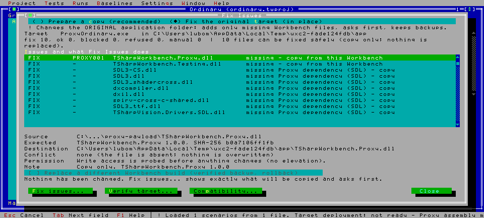

First review the list, source, expected version, and target path. Displaying the plan does not change any files yet. For an in-place repair, close the target and choose **Fix issues…**. The special option to replace another Workbench build applies only to situations the plan allows; follow the stated backup and restore conditions.

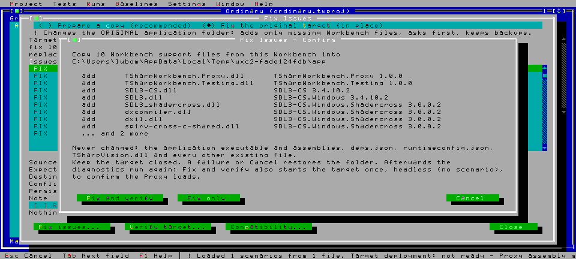

The confirmation summarizes the actual files to change and the files that will be preserved. **Fix and verify** executes the plan and then verifies the connection; **Fix only** just adds the support. **Cancel** does not execute the plan. After a successful repair, check readiness again and refresh the scenario catalog.

#### Target Compatibility — compatibility explanation

**Compatibility…** shows a comparison of the target's libraries with Workbench support.

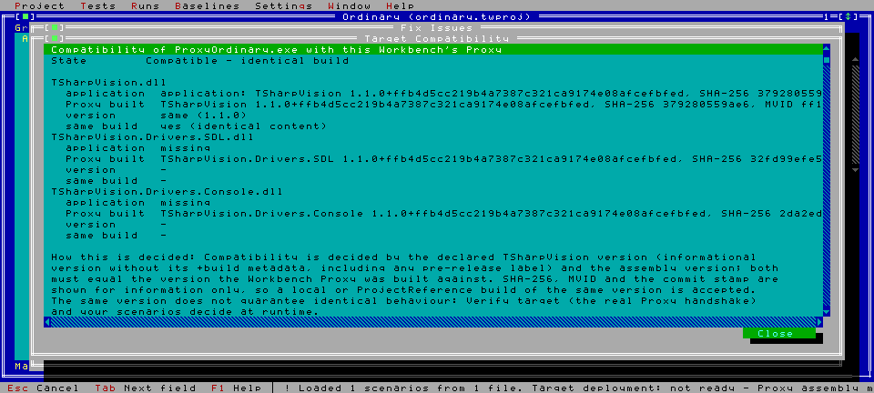

The report explains whether the declared TSharpVision version matches, which libraries are missing, and which assembly details are merely informational. A different build of the same supported version requires verifying the actual connection; a mere difference in the build identifier does not by itself confirm an operational error. Do not swap libraries manually based only on file names.

#### Test mode capabilities — available modes

**Help → Black-Box / White-Box modes** opens the **Test mode capabilities** overview.

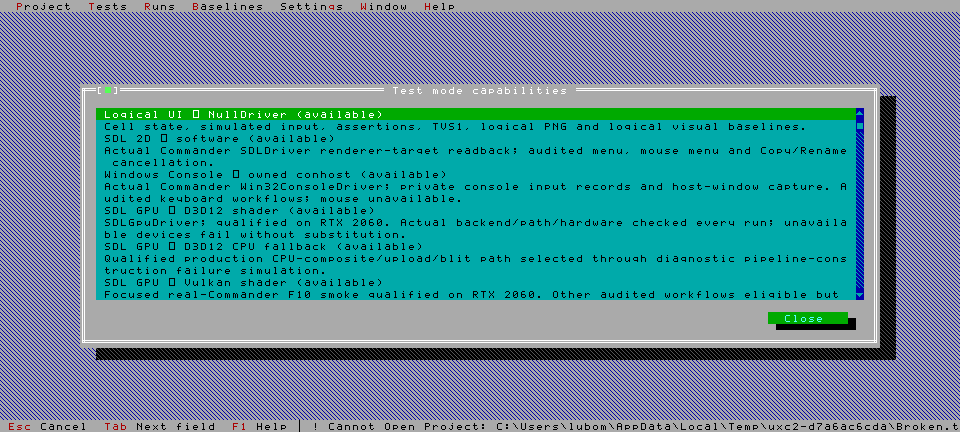

The overview helps you choose a suitable driver and capture method. It distinguishes logical runs, native windows, and available or limited paths. The specific options depend on the installed build and environment; verify the availability of your run through its diagnostics.

### 2.5 Full paths and problems opening a project

**Ctrl+P** in Project Information shows the full project paths. The **Project Paths** overview lets you read even longer locations of the project, target, and runs directory.

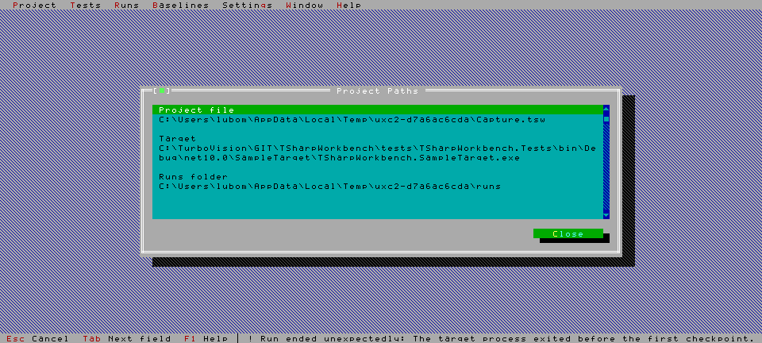

If the archive cannot be opened, **Cannot Open Project** states the reason and offers **Show messages**.

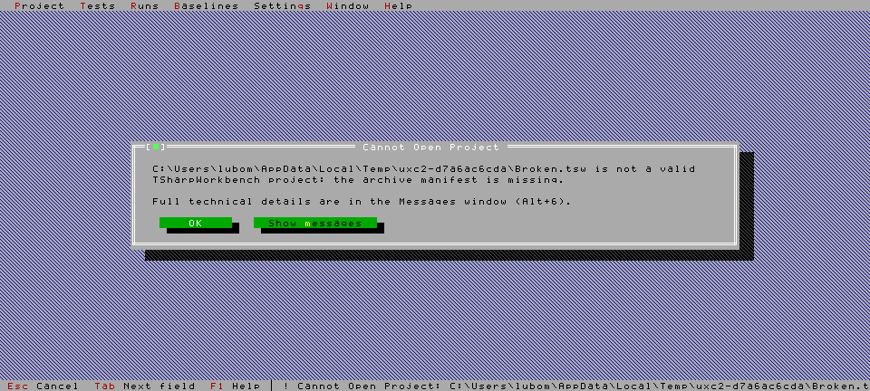

Make sure you are opening the correct `.tsw` file and read the details in Messages. The screenshot shows an archive without the required manifest. After closing the message you can choose another project, or fix the cause and try opening again.

## 3. Preparing test environments

### 3.1 Environment Manager

Open **Settings → Environments…**. Each row represents one profile, which you later assign to tests.

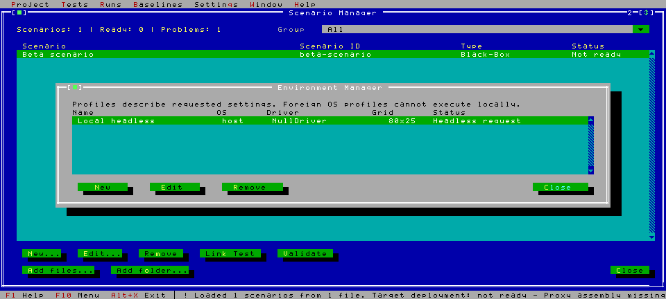

**New** creates a profile, **Edit** edits the selected profile, and **Remove** removes it. Before removing, consider which tests use the profile. For regular local testing you can start with the default **Local headless** profile.

### 3.2 Environment Properties

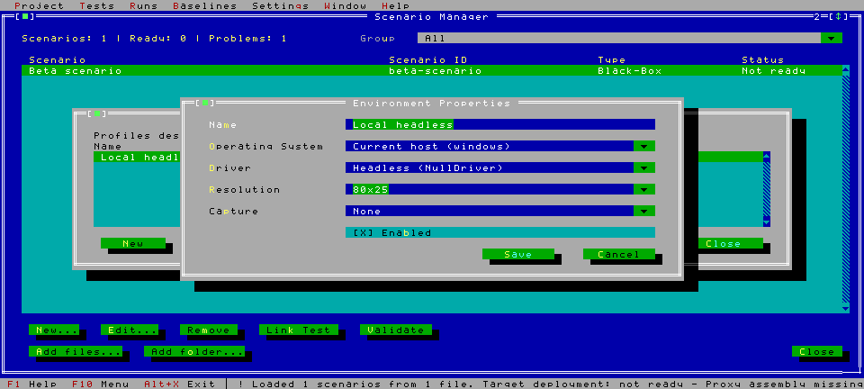

| Field | How to fill it in |
| --- | --- |
| **Name** | A descriptive name, for example `Windows SDL 100x30`. |
| **Operating System** | **Current host** for the system currently in use, or a specific platform. A profile for a different system cannot be executed locally. |
| **Driver** | The required driver, for example the headless NullDriver or an available graphical or console driver. |
| **Resolution** | The number of columns and rows of the character grid, for example `80x25`. Choose a preset or enter your own valid size. |
| **Capture** | The image capture method from the options available for the selected driver. |
| **Enabled** | Whether the profile is enabled for use. |

Save the profile with the **Save** button. Sizes are in text cells; for example, `100x30` means 100 columns and 30 rows. The profile name itself does not determine the visual reference: comparison uses the actual system, driver, capture kind, and grid.

### 3.3 Rejected change and environment removal

**Environment Not Changed** explains why the profile was not saved. For example, the name may already be used by another profile. Close the message and adjust the respective value.

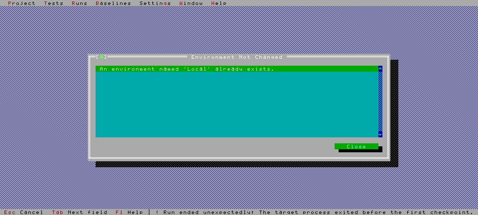

**Remove** is followed by the **Remove Environment** confirmation. First edit the tests that use the profile and assign them a different one. **Remove** confirms the removal available under these rules; **Cancel** keeps the profile.

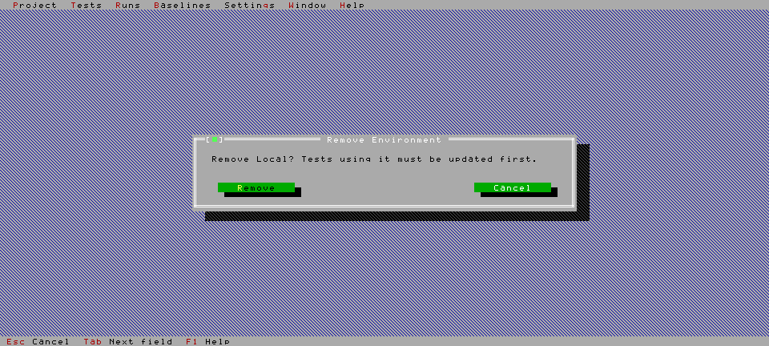

## 4. Preparing scenarios

### 4.1 Scenario Manager

Open **Tests → Scenario Manager…**, **Window → Scenario Manager**, or **Alt+2**. The list shows the scenario's title, stable ID, type, and availability. **Group** limits the view to a group.

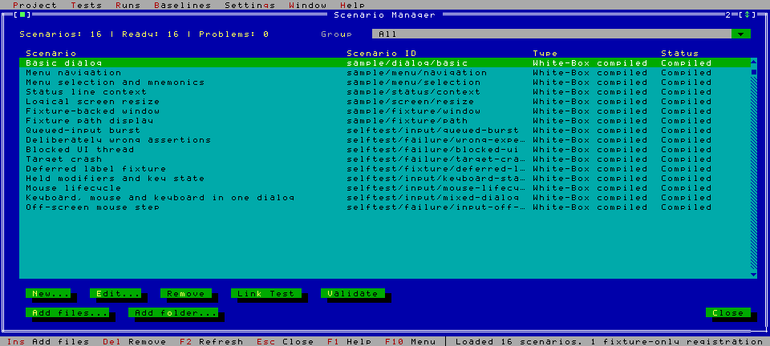

| Action | Use |
| --- | --- |
| **New…** | Create a new editable scenario. |
| **Edit…**, Enter, or double-click | Open the selected scenario. For a compiled scenario, information is shown; its source is not edited here. |
| **Remove** | Remove the scenario from the list of attached scenarios; the original source file is not deleted. |
| **Link Test** | Open New Test with the scenario preselected. |
| **Validate** | Check scenarios and their bindings; problem details are in Messages. |
| **Add files…** | Attach existing scenario JSON documents. |
| **Add folder…** | Scan a folder and select found scenarios to attach. |

If a scenario is not ready, first read the reason in Messages. The cause may be an invalid document, an unavailable fixture, or a target that is not ready. After the application changes, refresh the catalog with **F2**.

### 4.2 New Scenario

In Scenario Manager, choose **New…**.

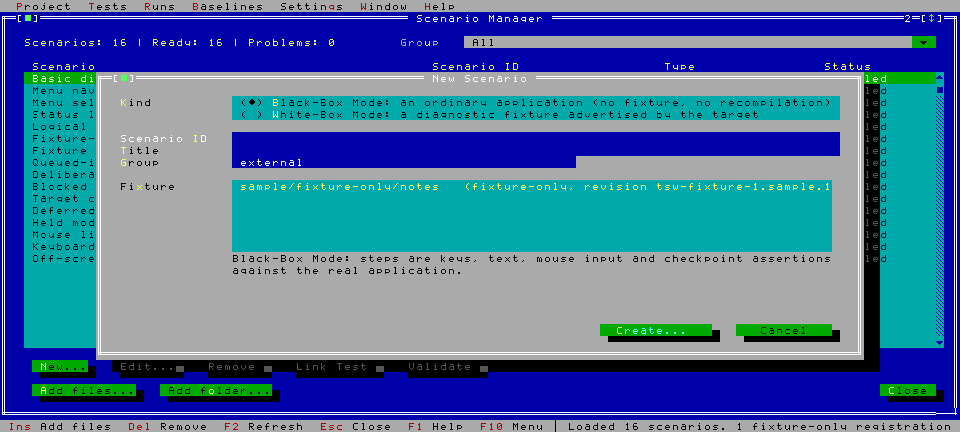

1. Select **Black-Box Mode** for controlling a regular application or **White-Box Mode** for a diagnostic fixture.
2. Enter a **Scenario ID**, for example `menu/open-about`. Keep the ID stable, because tests and results refer to it.
3. Fill in a readable **Title** and a **Group** for sorting.
4. For White-Box, select an available **Fixture**. A fixture-only registration on its own may need an external scenario that builds on it.
5. Choose **Create…** and continue in the scenario editor.

### 4.3 Attaching existing scenarios from a folder

After **Add folder…**, select a directory. The **Add Scenario Folder** dialog shows the found files, their state, and a summary.

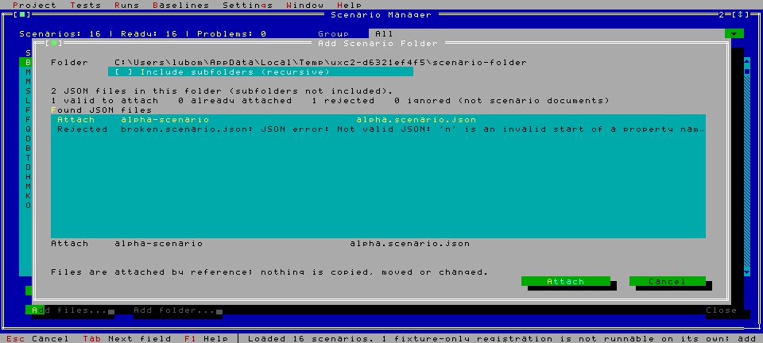

Check **Include subfolders** to include subfolders. Before **Attach**, review in particular the rejected files (**Rejected**) and the rejection reason, such as a JSON error. Already attached and ignored items are not new scenarios to add. In the displayed dialog, attaching is done by reference; source files are not overwritten.

### 4.4 Attaching, compiled scenarios, and removal

After saving a new document, **Attach Scenario?** may appear. **Attach** attaches it to the project so it is available in the catalog. **Cancel** declines the attachment; the already saved file does not disappear.

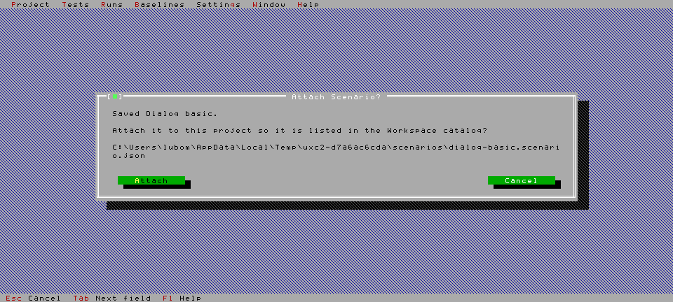

**Compiled Scenario** shows information about a scenario shipped in the tested application. Its ID can be assigned to a test via **Link Test**, but Workbench does not overwrite the compiled implementation itself.

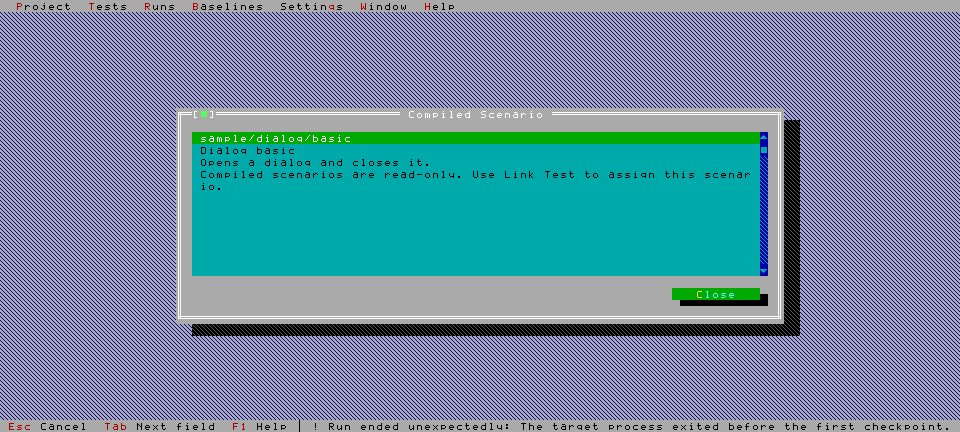

When you try to open such a scenario for editing, **Scenario Editor** may show a short read-only notice. Return to the manager and create an editable scenario for your own sequence of steps.

**Remove Scenario from Project** confirms removal of an attached scenario. Check the name and path; **Remove** removes the binding in the project, the source file stays on disk. **Cancel** keeps the binding.

### 4.5 Add scenario files — attaching files one by one

In Scenario Manager, choose **Add files…**.

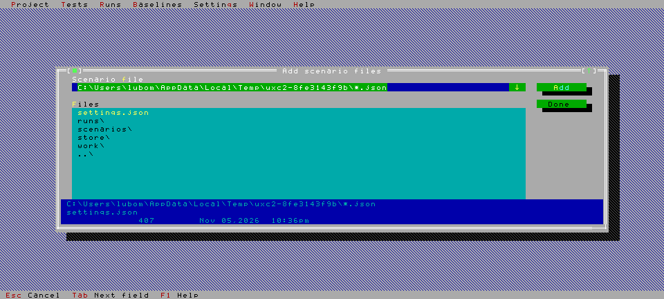

Navigate to the folder with scenarios, select a specific document in **Scenario file**, and choose **Add**. Workbench verifies its content and whether it can be attached. An ordinary configuration JSON does not become a scenario just because it matches the `*.json` mask. If attaching fails, read the reason and select a valid document.

After a successful addition, the selection reopens; the title shows the number of files added so far.

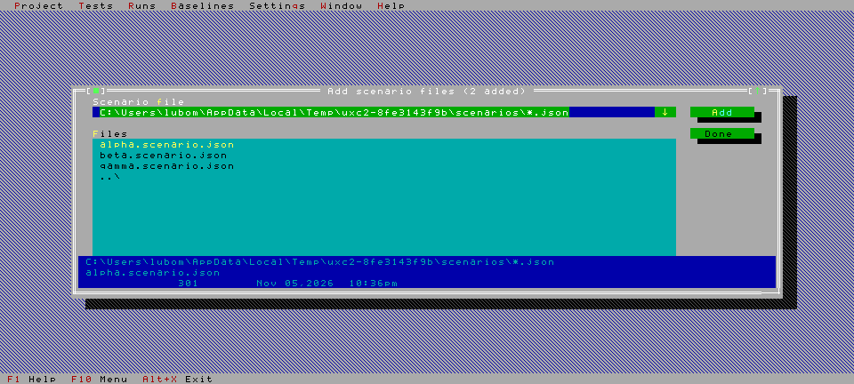

Use **Add** to attach further documents one by one, and finally choose **Done**. Successfully added files remain attached even after the selection ends. Check them in the manager and save the project. For bulk scanning of a folder, including an overview of rejected items, use **Add folder…** instead.

## 5. Scenario Editor and individual steps

### 5.1 Getting around the editor

Open an editable scenario in Scenario Manager by double-clicking, pressing Enter, or via **Edit…**. The editor can also be opened with the **Scenario** button of a test.

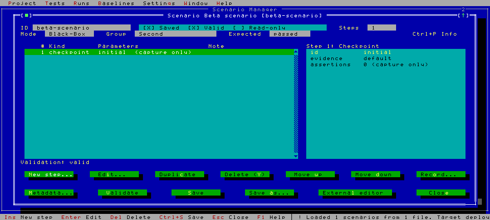

At the top are the **ID**, **Mode**, **Group**, **Expected**, and **Steps** details. The **Saved**, **Valid**, and **Read-only** indicators show the document state and cannot be toggled manually. The full path and other information are available via **Ctrl+P**.

The left panel contains the steps in execution order: number, kind, parameters, and note. The right panel shows the properties of the currently selected step; long content can be scrolled. Validation messages are below the list. A long value truncated in the list remains available in the details or in the step editor.

Step operations:

| Action | Shortcut | Result |
| --- | --- | --- |
| **New step…** | Ins | Opens Add Step with a choice of step kind. |
| **Edit…** | Enter or double-click | Edits the selected step. |
| **Duplicate** | Alt+C | Copies the selected step or selection. |
| **Delete** | Del / Alt+Y | Deletes the selected steps. |
| **Move up / Move down** | Alt+U / Alt+D | Changes the order of steps. |
| Selecting multiple steps | Shift+↑ / Shift+↓ | Extends the selection of a contiguous range. |
| **Record…** | Button in the editor | Opens recording of interaction with the application. |

Document operations are on a separate row: **Metadata…**, **Validate**, **Save**, **Save as…**, **External editor**, and **Close**. **Alt+V** runs validation; **Ctrl+S** saves the scenario, **Alt+A** opens Save As, and **Alt+L** the external editor.

In **Add Step**, select the step kind and confirm with **Choose**, Enter, or double-click. In the step editor, **OK** accepts the changes and **Cancel** discards them. The common **Note** field is a note for readers of the scenario. **Change kind…** lets you choose a different kind; when the kind changes, the note is preserved and the parameters of the new kind must be filled in again.

### 5.2 Scenario Metadata

Open **Metadata…** or press **Alt+M**.

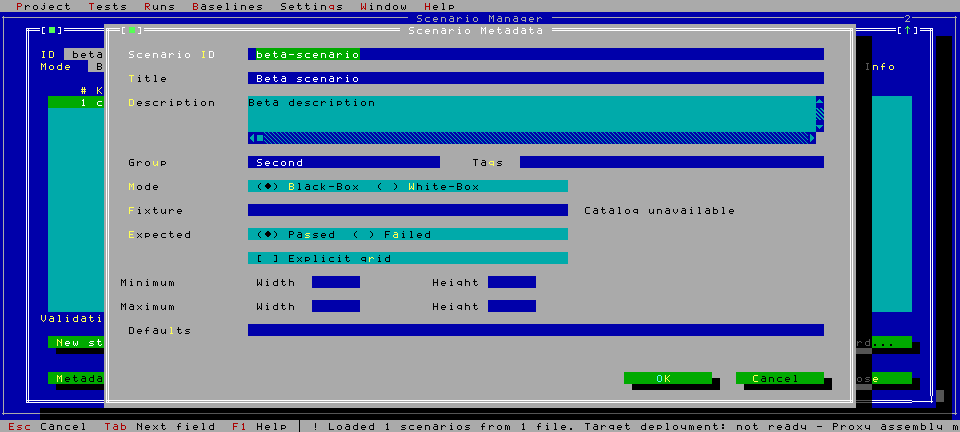

Here you edit the ID, title, multi-line **Description**, group, tags, mode, and optional fixture. **Expected** determines the expected result: **Passed** for a regular successful scenario, **Failed** for an intentionally failing case. It is not a switch for the actually measured result.

**Explicit grid** enables an explicit range of supported grids. **Minimum** and **Maximum** contain a positive width and height; **Defaults** is a comma-separated list of default sizes, for example `80x25, 100x30`. Without an explicit range, the fixture rules or the standard range apply. Confirm the metadata with **OK** and then save the scenario.

### 5.3 Key press — a single key press (`key`)

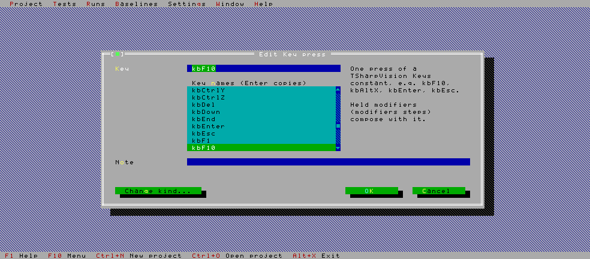

In **Key**, enter the name of a TSharpVision constant, for example `kbEnter`, `kbEsc`, or `kbF10`. The **Key names** helper list can be browsed; Enter copies the selected name into the field. The step sends a single key press. It is useful for confirming a dialog, opening a menu, or moving focus. Previously held modifiers also apply to this step.

### 5.4 Type text — entering text (`text`)

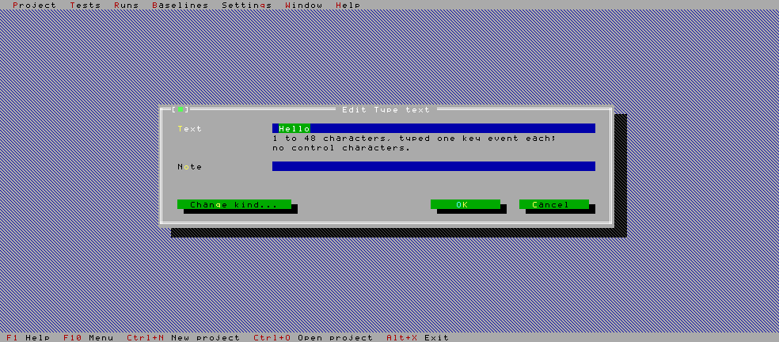

In **Text**, enter 1 to 48 characters without control characters. Each character is sent as keyboard input to the currently active field of the tested application. Split longer text into multiple steps; enter Enter or Tab with a separate Key press step.

### 5.5 Mouse input — mouse input (`mouse`)

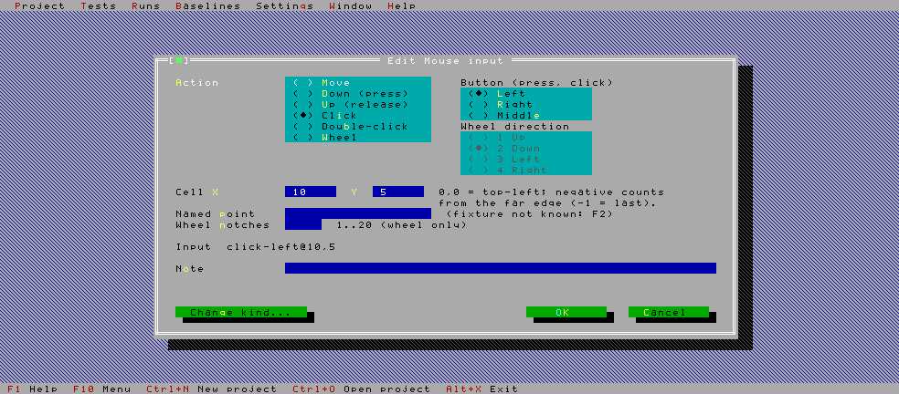

In **Action**, choose move (**Move**), press (**Down**), release (**Up**), click (**Click**), double-click (**Double-click**), or wheel (**Wheel**). Depending on the action kind, the respective button or wheel direction becomes available.

- **Cell X / Y** are screen cell coordinates. The top-left corner is `0,0`; a negative value counts from the opposite edge, `-1` denotes the last column or row.
- **Button** selects the left, right, or middle button.
- **Wheel direction** sets the direction and **Wheel notches** the number of wheel steps from 1 to 20.
- **Named point** is used for named fixture points in White-Box mode. In Black-Box, use X/Y coordinates.
- The **Input** row continuously shows the composed input, for example `click-left@10,5`.

For dragging, compose a Down → Move → Up sequence. You can add a checkpoint after it to verify the resulting position.

### 5.6 Key down — holding a key (`keyDown`)

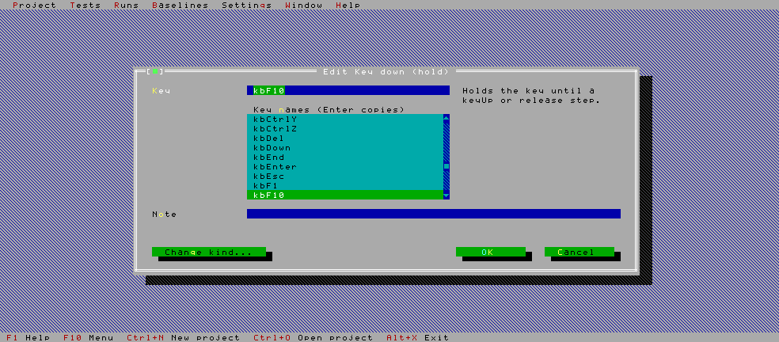

The **Key** field and the list of names work the same as for Key press. The key stays pressed in subsequent steps. Release it later with a Key up or Release all held input step.

### 5.7 Key up — releasing a key (`keyUp`)

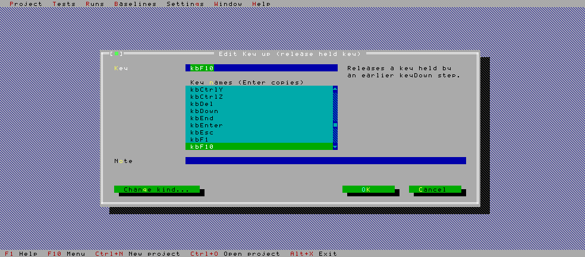

Enter the same key name as in the preceding Key down. The step ends holding the key. Use it where the exact order of presses and releases matters.

### 5.8 Modifier down/up — Shift, Ctrl, and Alt (`modifiers`)

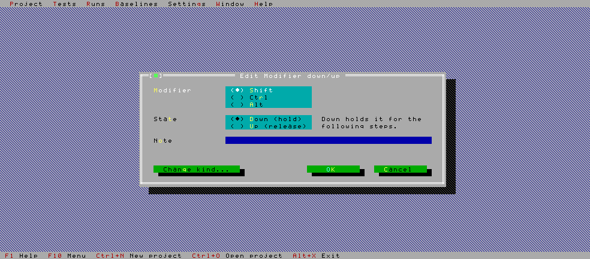

In **Modifier**, select Shift, Ctrl, or Alt. **Down (hold)** starts holding the modifier for subsequent steps; **Up (release)** releases it. For example, for a Ctrl+key combination create Modifiers Ctrl Down → Key press → Modifiers Ctrl Up.

### 5.9 Release all held input — releasing inputs (`release`)

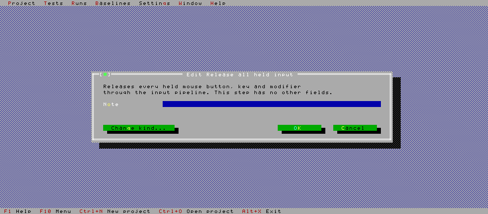

Releases all held keys, modifiers, and mouse buttons. Apart from Note, it has no other parameters. It is useful after a more complex input combination so that the next part of the scenario starts with no buttons held.

### 5.10 Resize grid — changing size (`resize`)

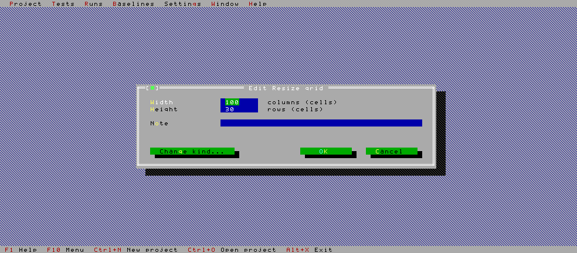

In **Width**, enter the number of columns and in **Height** the number of rows. Both values must be positive integers within the scenario's supported range. This step tests how the application reacts to a size change. Add a checkpoint after Resize, for example with within-screen and not-clipped checks.

### 5.11 Fixture action — fixture action (`action`)

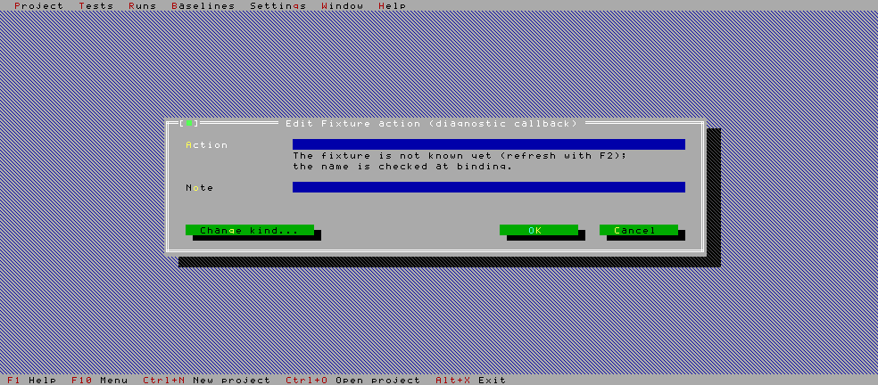

This kind is intended for **White-Box** scenarios. **Action** contains the name of an action the fixture actually offers. If the catalog is available, the name can be selected from a list. If it is missing, refresh it with F2 and verify the fixture binding. An action can, for example, prepare a specific application state; its meaning is determined by the fixture implementation.

### 5.12 Checkpoint — capture and verification (`checkpoint`)

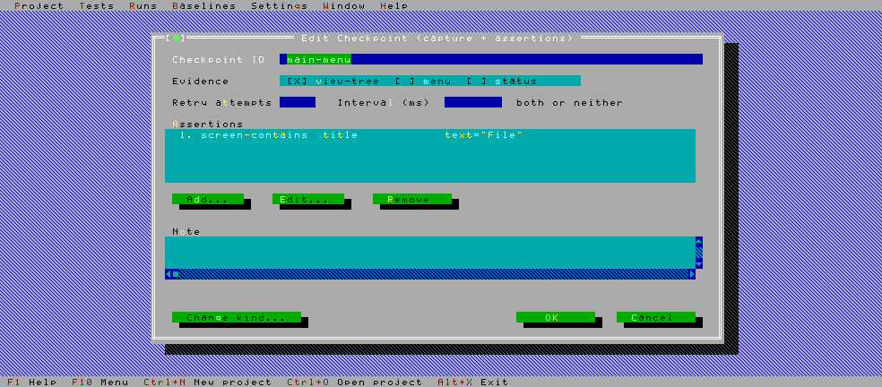

Insert a checkpoint after the steps whose result you want to verify.

1. Enter a stable **Checkpoint ID**, unique within the scenario, for example `main-menu-open`.
2. Depending on the checks, choose additional **Evidence**: view-tree, menu, or status.
3. Optionally adjust **Retry attempts** and **Interval (ms)**.
4. Use **Add…** to add one or more assertions. **Edit…** edits the selected one and **Remove** removes it. Ins, Enter, and Del also work in the list.
5. In the multi-line **Note**, describe the purpose of the checkpoint and confirm with **OK**.

In Black-Box, the ID can denote any stable screen state. For a contract White-Box fixture, choose from the checkpoints it offers if the dialog shows them.

Leave both retry fields empty for the default **5 attempts with a 250 ms interval**. For custom settings, fill in both: attempts **1–20**, interval **0–30000 ms**. Retrying helps wait until the expected state is reached.

An empty list **No assertions (capture only)** means capture only, without explicit check conditions. Assertions are not added automatically. Note preserves lines of text; Enter inserts a new line in it and Tab moves focus.

## 6. Checkpoints and assertions

### 6.1 Adding and common fields

In the Checkpoint editor, choose **Add…**, select the condition kind, and fill in its form. Open an existing assertion via **Edit…** or Enter. All kinds have:

- **Assertion ID**: a stable identifier, unique within the checkpoint; for example `dialog-title`.
- **Severity**: **error** for an error or **warning** for a warning. The severity is recorded together with the check result.
- Parameters specific to the given kind.

**OK** accepts the assertion into the checkpoint being edited. Then confirm the checkpoint as well and save the scenario. **Cancel** in any nested edit discards its pending changes.

### 6.2 Evidence and element selection

| What you verify | Required evidence |
| --- | --- |
| Cell text and attributes | The checkpoint's logical screen. |
| Views, focus, modality, and geometry | **view-tree**. |
| Menu and its items | **menu**. |
| Status line | **status**. |

Workbench also requests the required kinds of evidence based on the specified assertions; the check boxes in the checkpoint let you request additional evidence independently. If the required evidence is not available, the check may end as **UNSUPPORTED**. This state means the condition could not be evaluated.

**View selector** selects a view using at least one of the **type**, **id**, **text**, **path** fields. Values come from the captured view tree of the tested application. Type specifies the view type, id its diagnostic identity, text the exact model text, and path the path in the tree. Filled-in criteria are combined; for single-view checks, use a sufficiently precise selection. Multiple matches may indicate ambiguity. **Other view** selects the second or reference view for mutual relationships.

X/Y coordinates are zero-based and distances are given in cells. First capture the actual application state and derive stable selectors and expected values from it.

### 6.3 Text and cell appearance

#### screen-contains — text on the screen

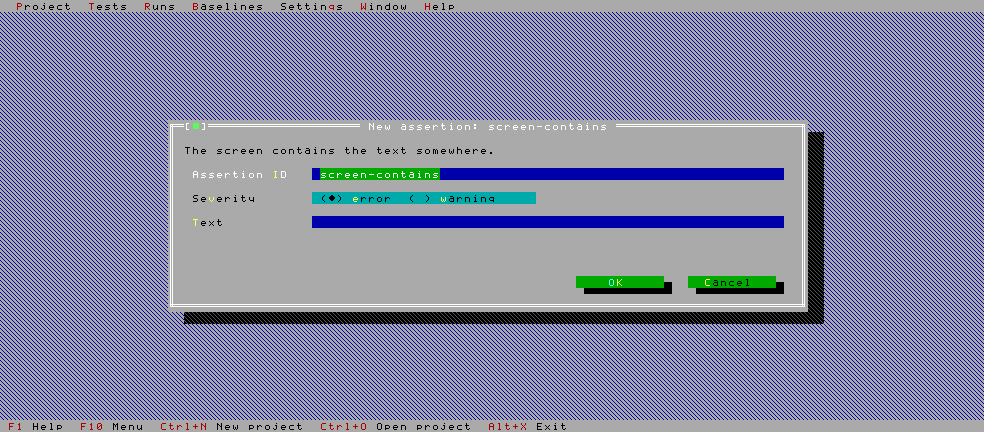

In **Text**, write the expected text. The check searches for it on the logical screen without a fixed coordinate. Use it, for example, to verify the title of an opened dialog or a message after an operation.

#### text-at — text at a specific position

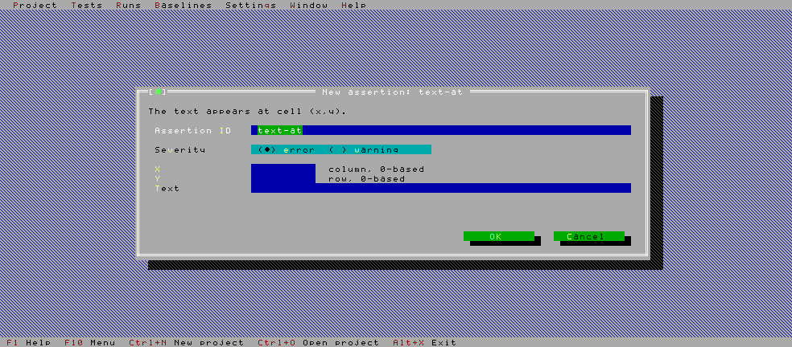

Fill in **X**, **Y**, and **Text**. The expected text must start in the specified cell. This check suits fixed layouts; when the window size changes, consider whether the verified text might move.

#### attribute-at — cell color attribute

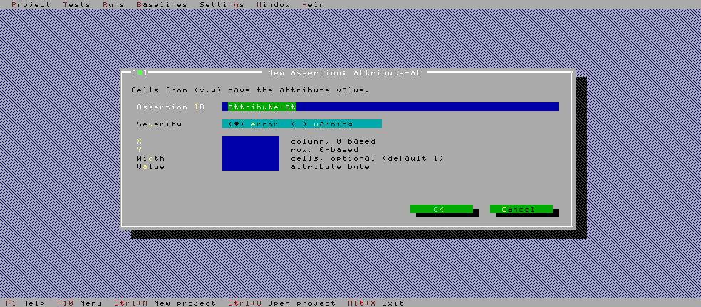

**X/Y** specifies the start of the segment, **Width** the number of cells on the row, and **Value** the expected logical color attribute. An empty Width means one cell. The attribute combines background and foreground color; use a value that matches the tested application. The check is suitable, for example, for highlighting of a selected item.

### 6.4 View existence, visibility, and focus

#### view-exists — view exists

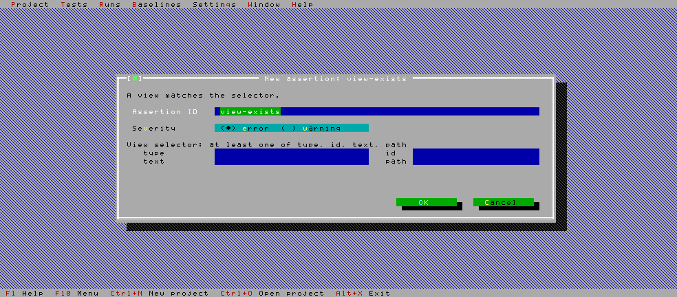

Fill in **View selector**. The check passes if at least one matching view is found in the tree. Existence alone does not verify its visibility.

#### view-absent — view does not exist

Use the selector to specify a view that must not be present in the tree. Use it, for example, after closing a dialog or removing a control.

#### view-visible — view is visible

Verifies that the selected view has at least part of its area visible and is not hidden, including its owners. For full visibility without clipping, add not-clipped.

#### view-focused — view has focus

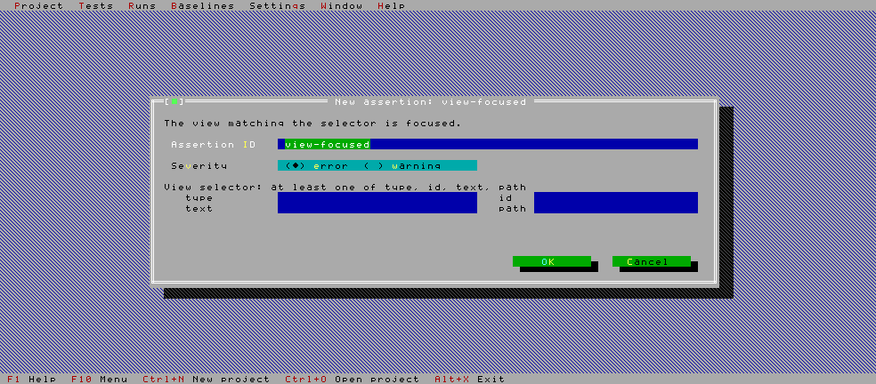

Verifies that focus belongs exactly to the selected view. It is suitable, for example, after opening a form or after moving with Tab.

#### modal — active modal window

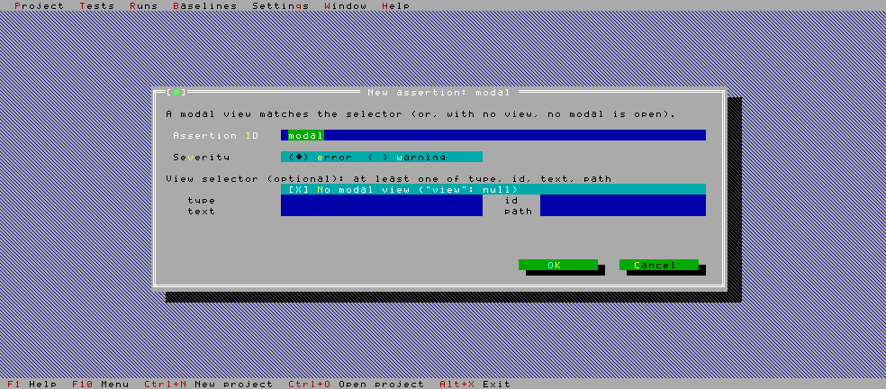

A filled-in selector specifies the expected executing modal window. Checking **No modal view** instead verifies that no modal window is open. It is useful for checking confirmation dialogs as well as the return to regular work.

### 6.5 Layout and geometry

#### within-screen — inside the screen

Verifies that the whole rectangle of the selected view lies within the screen bounds. It is useful after Resize or when moving a window to the edge.

#### not-clipped — without clipping

Verifies that the visible area of the view matches its whole rectangle. It reveals clipping by the screen or by any owner, as well as hiding of the view.

#### within-view — inside another area

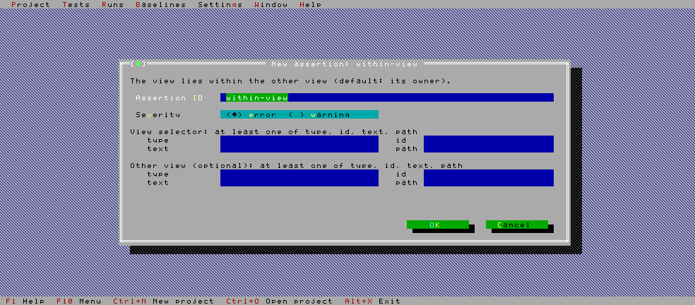

**View selector** specifies the checked view, **Other view** the enclosing view. The whole first rectangle must lie inside the second. If Other view is not filled in, the evaluation uses the desktop work area. Use it, for example, to verify the placement of a dialog in the work area.

#### disjoint — views do not overlap

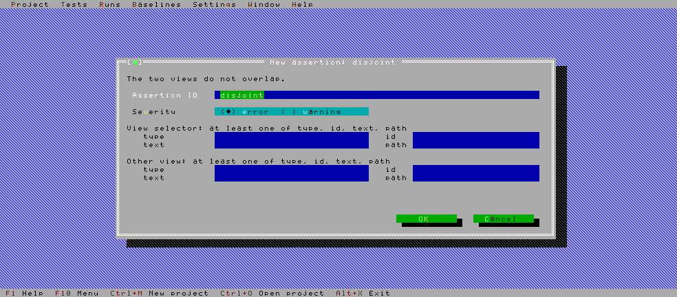

Enter both selectors. The check verifies that their rectangles have no common area. It is useful for the relationship of adjacent fields, panels, or buttons.

#### aligned — common alignment

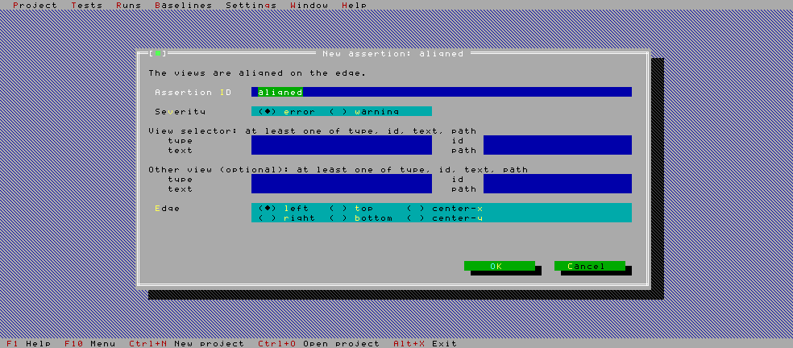

In **Edge**, choose the left, right, top, or bottom edge, or the center on the X/Y axis. Views selected by View selector must have this coordinate equal to the **Other view** reference. Without a reference, they are compared with each other. This way you can check, for example, a common left edge of input fields.

#### spacing — gap between views

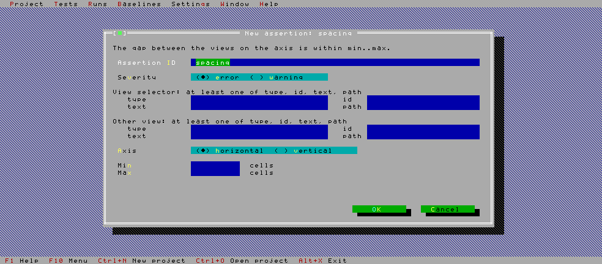

Select two views, the horizontal or vertical direction in **Axis**, and the allowed gap in cells in **Min/Max**. Min must not be greater than Max. A negative distance means overlap on the given axis. For example, Min = Max = 1 requires exactly one free cell between the rectangles in the respective direction.

#### shadow — view shadow

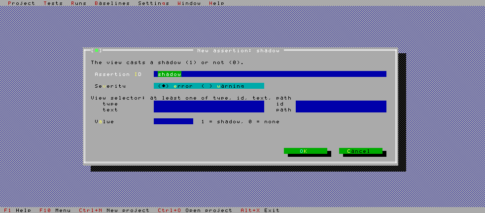

Select the view casting the shadow. The evaluation checks the shadow flag as well as the cell attribute in its right and bottom bands. **Value** is the expected color attribute of these cells. In the screenshot, the field has a simplified label `1 = shadow, 0 = none`; when entering the value, use the actual shadow attribute of the tested application. Overlapping of the shadow by another view can cause a difference.

### 6.6 Menu checks

These conditions require **menu** evidence. In the **Text** fields, enter the item text. The optional **Level** specifies the level: `0` is the main bar; an empty value uses the deepest open level.

#### menu-depth — number of open levels

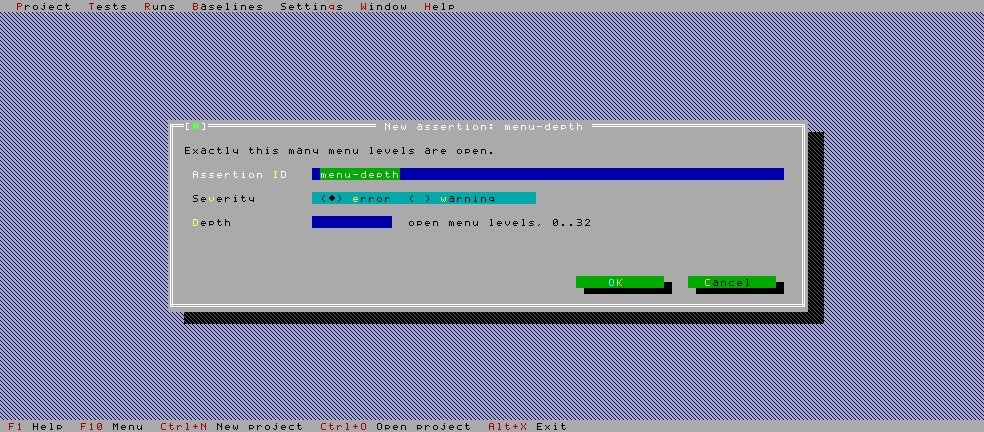

**Depth** contains the expected number of open menu levels in the range 0–32. Use it to verify whether a submenu opened or the menu closed.

#### menu-selected — selected item

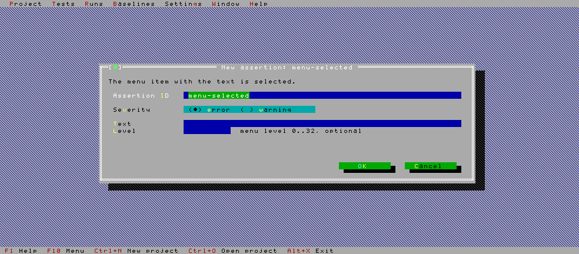

Fill in **Text** and optionally **Level**. Verifies the selected item and its highlighting. Useful after navigating with arrows or a mnemonic.

#### menu-item-state — item availability

Enter **Text**, optionally **Level**, and in **State** choose **enabled** or **disabled**. This way you verify, for example, that the Save command is available in the required state.

#### submenu-open — open submenu

In **Text**, enter the name of the parent item. The check verifies that the submenu belonging to this item is open.

### 6.7 Status line checks

These checks require **status** evidence.

#### status-item — status line item

Enter **Text** and the state **visible**, **absent**, **enabled**, or **disabled**. You verify the presence, visibility, or availability of a specific status line command.

#### status-context — status line context

In **Context**, enter the expected help context number. The check is useful for applications where the status line offer changes depending on the active window or field.

#### status-hint — hint text

In **Text**, enter the text the current status line hint should contain. Use it, for example, after moving focus to a view with its own help.

## 7. Creating and selecting tests

### 7.1 Test Explorer

Once you have a scenario and an environment, open **Tests → Test Explorer…** or **Window → Test Explorer**.

**Query**, **Group**, and **Mode** limit the displayed tests. After a change, use **Apply filter**. Mode distinguishes Black-Box and White-Box. Rows show the test title, mode, number of environments, and state.

- **New** creates a test; **Edit** or double-click opens the selected test for editing.
- **Delete** deletes the selected test; the scenario is a separate project item.
- **Scenario** opens the assigned scenario.
- Clicking `[ ]` or pressing Space toggles the test's run mark to `[X]` and back.
- **Mark All / Clear Marks** marks or unmarks tests in the whole project, including tests hidden by the filter.
- **Configure** or F5 opens the selection of combinations to execute.

Highlighting of the current row and the `[X]` mark serve different purposes: the highlight determines the item for editing, the mark the selection for running.

### 7.2 New Test / Edit Test

1. Enter a **Title**, for example `Opening the About dialog`.
2. In **Description**, write what the case verifies.
3. In **Preconditions**, record the preconditions, for example a required input file. This field documents the preconditions; it does not carry them out.
4. In **Scenario**, select one scenario. The label also contains its stable ID.
5. In **Environments**, click a row or use Space to mark one or more environments. The number of selected profiles is shown in the heading.
6. Confirm with **Save** or **Alt+S**.

Description and Preconditions are multi-line fields. Enter inserts a line and Tab moves to the next field. **Cancel**, **Alt+C**, or Esc discards the changes. The same form opens via **Link Test** in Scenario Manager, where the scenario is already preselected.

### 7.3 Assignment, rejected change, and test removal

**Test Needs Assignments** warns that assignments required to create or use the test are missing. First prepare a scenario and at least one environment, then create or complete the test.

**Test Not Changed** states the reason the save was rejected, for example an already existing test title. Correct the stated value; a failed save does not create a second test.

**Remove Test** is displayed when deleting a test from Test Explorer. **Remove** removes the selected test; its scenario remains available. **Cancel** cancels the removal.

## 8. Recording scenarios — Record Interaction

The recorder converts interaction in the actual target window into scenario input steps. It is useful when you want to go through a task manually first and only then add checks to its recording. The result of recording is a proposed sequence that you review and edit before running the test.

### 8.1 Preparing a recording

1. Set an existing target in the project and verify its readiness via **Target Diagnostics**. The deployed Proxy support must support recording.
2. Create or open an editable **Black-Box** scenario. Recording is intended for a regular application via the Proxy; a compiled diagnostic fixture or a read-only document is not a suitable target.
3. In Scenario Editor, choose **Record…**. Only one recording can be open at a time.
4. Check the target, the initial grid, and the visible driver: **Console window**, **SDL window**, or **SDL GPU window** depending on target support. The headless NullDriver has no window for manual input. Physical recording is currently available on Windows.

### 8.2 Starting, pausing, and stopping

1. Choose **Start**. Workbench launches the target in its own window.
2. Switch to the target window and perform the task: for example, open a dialog, fill in a field, and confirm with a button. Input in the Workbench window is not recorded.
3. To control the recording, return to Workbench by clicking or with Alt+Tab. **Pause** pauses recording and **Resume** resumes it. During a pause, the target may still accept input, but that input will not be part of the scenario; its state changes may therefore be missing during later playback.
4. When finished, choose **Stop**. Workbench ends the recording and closes the target. Only then review the proposed steps and decide whether to insert them. A session is limited to 30 minutes.

### 8.3 What is recorded and what you must add

| Area | Recorder behavior |
| --- | --- |
| Keys and text | Converts supported physical input delivered to the target into key and text steps; continuous typing may be grouped into text steps. |
| Mouse | Converts supported presses and releases, clicks, double-clicks, movement with a held button, and the wheel into steps with cell coordinates. |
| Resize | A recorded grid change is converted to Resize. |
| Standalone key releases and modifier transitions | Not written as a separate complete hold record. Check and add the required Key down, Key up, or Modifiers manually if needed. |
| Mouse movement without a held button and mouse auto-repeat | These events are not recorded separately. |
| Input in Workbench, in other applications, or during Pause | Not part of the recorded sequence. Internal events injected by the application itself are also not considered manual recording. |
| Length of delays between inputs | Time pauses are not converted to wait steps. The recording therefore does not promise playback at the same pace. |
| Checkpoints, assertions, and baselines | Smart Capture suggests checkpoints and assertions from captured states for review. Baselines still require explicit approval. |

Smart Capture is enabled by default and can propose checkpoints for captured dialogs and other meaningful states. Review the suggestions and add checks for behavior they do not cover. With Smart Capture disabled, add checkpoints manually. Use checkpoint retry when playback must wait for a required state. See the [Smart Recorder guide](../recorder.md).

### 8.4 Review and insertion into the scenario

In **Review Proposals**, inspect checkpoint placement, evidence, confidence, and suggested assertions. Accept, reject, or edit them before inserting the recording. Go through the proposal from the beginning. Verify key names, coordinates, grid changes, and any warnings about unrecorded input or delays. Remove mistakes from manual operation and add missing steps in the editor as needed.

| Action | Where it inserts the recorded steps |
| --- | --- |
| **Append** | At the end of the scenario. |
| **Insert at selection** | At the current selection in the editor. |
| **Replace selection** | In place of the selected range of steps. Check the selection before confirming. |
| **Discard** | Discards the unused recording. |

If the recording contains steps you have not yet inserted, **Discard Recording?** may be shown when discarding.

**Cancel** in the confirmation lets you return to the recording and use it. Inserting steps into the scenario does not yet replace saving the document and the project.

### 8.5 From recording to a runnable test

1. **Insert the recording** into the scenario and review the resulting order in Scenario Editor.
2. **Review suggested checkpoints and add missing checks** after important state changes. For example, after opening a dialog insert an `about-open` checkpoint and an assertion checking its title. Use stable unique IDs.
3. **Add the required evidence and synchronization.** View selectors need view-tree; to wait for the expected state, use checkpoint retry. Also check the state after the last recorded step.
4. **Run Validate and Save** in the editor. Fix reported document and binding problems.
5. **Create a test** via Link Test or Test Explorer → New. Assign the recorded scenario and at least one supported environment. For the first verification, use the same grid as during recording; mouse coordinates may depend on the layout.
6. **Mark the test and run F5 → Start.** Play it back from the initial state the scenario actually creates, and check Results.
7. **For visual regression, review the candidate and approve the baseline if appropriate.** First fix the functional check so that it verifies the intended behavior. Then start a new run and save the project.

Example: you record opening a dialog and closing it. Before the step that closes the dialog, you manually insert a checkpoint with a title check. During playback, the scenario then not only repeats your clicks but also verifies that the dialog really opened.

## 9. Running Tests

### 9.1 Selecting combinations and running

1. In Test Explorer, mark the required tests.
2. Press **F5**, choose **Configure**, or **Runs → New Run…**.
3. In **Configure Test Run**, review the test × environment combinations. Space or a click toggles their selection.
4. Choose **Start**.

Only the selected combinations run. An unselected combination is not a skipped run. A selected profile for a foreign operating system may be recorded as **Skipped** with an explanation of why it cannot be executed locally.

### 9.2 Run Explorer — run progress and history

**Runs → Run Explorer…** or **Alt+3** opens the run overview. Follow the current combination, completed items, and the overall result. **Cancel Run** requests cancellation and cleanup of the launched target. Closing the overview does not stop the run by itself.

The columns separate **Overall**, **Functional**, and **Visual**. A single test can thus pass functionally but still show a visual problem overall. **Test / Environment** identifies the executed combination.

| Action | When to use it |
| --- | --- |
| **Open run…** | Select an external `run.json` report on disk and open it in Results; see section 10.5. |
| **Previous / Next** | Move between available runs. |
| **Details**, Enter | Read the details of the selected execution. |
| **Re-run…** | Prepare a new execution of the respective test. |
| **Show in Scenarios** | Find the related scenario. |
| **New run…** | Prepare another run. |
| **Cancel run** | Request stopping the currently running run. |

When finished, save the project so that the history and evidence remain in its archive.

### 9.3 Cancellation and unexpected termination

When exiting the application during a run, **Tests Are Running** may be displayed.

**Keep running** cancels the intended exit and keeps the tests running. **Cancel run and exit** requests stopping, waits for target cleanup, and then exits the application. Already completed executions may remain in the run directory; check what was saved when you next open it.

**Run Ended Unexpectedly** reports an interruption before proper completion and writing of results.

Read **Cause**, **Kept**, and **Next**: they state the cause, the evidence actually preserved, and the next step. **Show messages** opens technical details; **Refresh scenarios** refreshes the catalog after a target change. Fix the cause and only then repeat the run.

In error details you may also encounter the **Technical Details** window. It contains diagnostic text, possibly a call stack; for the specific cause, read the beginning of the message and the following details.

### 9.4 Run Tests — direct scenario re-run

This procedure is an advanced feature for external results. In **Run Explorer** or **Results**, choose **Open run…**, load an external `run.json`, select an execution, and choose **Re-run…**. If the result is not associated with an archived project test execution, the direct scenario run configuration opens. The current target's catalog must contain the matching scenario; refresh it with F2 if needed.

For regular project tests, continue to use test marking and **F5 → Configure Test Run**. What matters is the result's binding to a project test and environment, not the appearance of the Results window. For a direct re-run, check the prefilled scenario, grid, and settings of the original execution.

**What to run** selects marked scenarios, a group, or all runnable scenarios. **Screen sizes** specifies grids, **Target display** the driver, and **Test mode** the kind of run. The summary shows the number of executions and readiness. **Run** starts the configured set, **Target details…** opens diagnostics, and **Advanced** the extended settings. The **Save these settings as project defaults** option saves the settings as defaults if you confirm it.

Re-run uses a special scope for the original scenario; the available options therefore depend on the context. Re-running an external result creates a new run and does not by itself overwrite the project defaults or the original report. The screenshot shows the same form in the preserved scenario branch with the general scope options.

### 9.5 Run Configuration — extended direct run configuration

Besides selecting scenarios and sizes, it lets you configure candidate handling, time limits, inspection, and native evidence. Read the resulting combination of options in the summary before launching. **Basic** returns to the basic form, **Run** starts the run, and **Cancel** closes the configuration without launching.

Switch between the basic and extended form via **Advanced / Basic**. The application remembers the last chosen form, so the next direct re-run may open Run Configuration right away. Switching forms preserves the pending settings.

### 9.6 Run Monitor — progress and completion of a direct run

After **Run** in either of the previous configurations, **Run Monitor** opens. It is intended for this launch path; follow project test × environment combinations in Run Explorer.

The monitor shows the current scenario, grid, counts of completed and failed executions, the visual summary, and the results directory. **Cancel run** requests stopping; Esc returns to the desktop and the run continues in the background.

When finished, check the resulting state and open **Results**. In the example, the functional part passed, but the visual part lacks a reference.

## 10. Results

### 10.1 Functional, Visual, and Overall — how to read a result

A result has several layers. Always first determine **which layer the state describes**:

| Layer | What it expresses | Example |
| --- | --- | --- |
| **Functional** | Whether the execution and functional checks match the scenario's expected result. For a regular scenario the goal is Passed; an intentionally failing scenario must have Expected set correctly. | The dialog opened and the title check passed. |
| **Visual** | Whether the captured appearance matches a usable approved reference, if comparison was requested. | The title is correct, but a button is shifted compared to the reference. |
| **Overall** | A summary verdict considering both the functional and the requested visual part. | Functional Passed + Visual Mismatch leads to Overall Visual failed. |

**Functional Passed alone does not guarantee Overall Passed.** When visual comparison is requested, a missing or non-matching reference prevents a successful overall visual result. If visual comparison is not requested, the Visual Not requested state does not block functional success.

| UI state | Where you encounter it | Meaning | Recommended next step |
| --- | --- | --- | --- |
| **Passed / PASS** | Execution, functional result, or an individual assertion | The expectation is met in the given layer. For assertions, PASS means the condition is satisfied. | Also check the other layers and any warnings; save the project results. |
| **Failed / FAIL** | Execution, functional result, or assertion | The requirement was not met, or the execution did not turn out as expected. | Open the failed checkpoint and its Expected/Actual, message, and evidence; distinguish an application bug from a faulty scenario. |
| **Skipped / SKIPPED** | Test × environment combination or result item | The combination or check was not executed; the reason is in the details. A foreign OS profile is a typical example. | Read the reason, choose a supported environment or meet the stated condition, and run again. An unselected pair in the configuration is not Skipped. |
| **Unsupported / UNSUPPORTED** | Assertion or unsupported check | The condition cannot be evaluated, for example the view tree or required diagnostic support is missing. | Verify the required evidence, target capabilities, and check parameters. This state does not confirm the application is correct. |
| **Missing / MISSING / BaselineMissing** | Visual comparison | There is no usable approved reference for the specific slot. | Verify the environment identity and the store; keep and review the candidate and explicitly approve the correct state. Then run again. |
| **Mismatch / MISMATCH** | Visual comparison | The capture differs from the approved reference in cell characters or attributes. | Open Compare, go through Diff/Expected/Actual; fix a bug, or approve an intentional change as the new reference after review. |
| **Match / MATCH** | Visual comparison | The capture matches the used reference according to the comparison rules. | Still check Functional and Overall. |
| **Visual failed / VISUAL FAILED** | Overall or run summary | The functional part may pass, but the requested visual part does not have a successful result. | Read the specific Visual state, such as Missing or Mismatch, and continue resolving it. |
| **Not requested** | Visual | Visual comparison was not requested for this run. | If you need visual regression, check the project settings, store, and run mode. Otherwise assess the functional result. |
| **Error / Blocked** | Execution or summary | An error or unmet condition prevented the run, for example a launch or readiness problem. | Read the specific reason in Execution Details and Messages; first remove the launch obstacle. |
| **Cancelled** | Progress or final run state | The run was cancelled. Already completed executions may have their own results. | Verify the preserved items and target cleanup completion, and start a new run if needed. |

In the dialog example, the title assertion may end PASS and Functional Passed, while Visual is MISSING. Overall then reports a visual failure. Approving the correct candidate creates a reference for **future** comparisons; the original result remains a historical record.

### 10.2 From the overall result to a specific error

**Results**, **F6**, or **Alt+4** shows the results. First select an execution in the top list. Then move to the list of checkpoints and to the details of the selected checkpoint or its evidence.

The **All / Problems only** switch helps limit the overview to problem items. Enter opens the details of the selected item, Tab moves between panels. Review the actual and expected values of assertions and the captured evidence.

Distinguish the functional result, the visual comparison result, and the overall **Overall**. Successful execution of steps with a missing or different visual reference does not necessarily mean Overall Passed. **UNSUPPORTED** means a lack of required evidence or support; **Skipped** means a combination not executed, with a stated reason.

Depending on the available evidence, use:

- **Open image** for the image evidence of the selected checkpoint.
- **Native** for available native evidence.
- **Compare** for the difference against the approved reference.
- **Review candidate…** to assess a candidate for a new reference.
- **Copy path** or **Run folder** for the evidence path and the directory of the selected run.

An inactive button means the respective action or evidence is not available for the current selection. The logical PNG is rendered from character cells; the native screenshot captures a specific display path.

### 10.3 Execution Details — details of a single combination

Check the test ID and title, the scenario, the requested and actually used environment, the initial grid, and the result explanation. For a skipped combination you will find the reason here. **Open results** opens the report if one was created for the execution; **Close** returns to the run overview.

### 10.4 Re-running and working with history

#### Re-run — new test execution

**Re-run…** on a project result returns the combination configuration for a new launch. Select environments, check the marks, and choose **Start**.

A new run with a new result is created. The historical report and its original verdict are preserved. Use **Runs → History…** or navigation in Run Explorer to return to older project runs; **Open run…** opens an external report as described in the next section. **Runs → Open Output Folder** opens the configured output root; **Run folder** in Results refers to the selected run.

### 10.5 Open completed run — selecting an external report

Choose **Open run…** in **Run Explorer** or **Results**. The **Open completed run** file dialog opens; it is available even when working with a regular `.tsw` project. It is used to load an external report from disk; move between archived project runs using history and run navigation.

Navigate to the directory of the respective run and select its `run.json` file in **Run metadata**. **Open** loads and validates the report for displaying results. Select the metadata of a completed run, not a checkpoint image or any other JSON. **Cancel** returns without loading another report.

### 10.6 External run Results

After loading an external report, the same **Results** window is used as for project results. The following screenshot shows its state over external data.

An external report may not contain the project test ID or its assignment. You recognize it by the **External run** label and the details. Browse checkpoints, assertions, images, and comparisons the same way as for a project result. **Re-run…** of a result without a binding to a project execution opens the [direct scenario configuration](#primy-beh), i.e. Run Tests or Run Configuration. A new direct run does not replace test and environment assignment in the project.

## 11. Visual Baselines

### 11.1 Baseline Explorer — finding a visual reference

Open **Baselines → Baseline Explorer…**. **Search** filters by scenario, checkpoint, size, or captured environment identity; after typing, use **Apply filter**. Select the respective row and continue via **Details** to its information or to candidate review.

A **Missing** row marks a missing approved reference; **Candidate** marks available captured evidence for review. A reference slot uses the actual system, driver, capture kind, and grid. For scenarios that change sizes, the initial grid also matters; the Environment profile name alone does not select the slot.

#### Adopting an existing store

**Adopt store…** lets you select a manifest and adopt existing references. The **Adopt Baseline Store** confirmation follows.

In the **Manifest** field, select an existing reference manifest and choose **Open**. This selects the source whose content is to be adopted into the project. After the selection, a separate copy confirmation follows:

**Adopt** copies the manifest and approved evidence into the project. The source is preserved; future project runs use the adopted store. **Cancel** cancels the adoption. When finished, save the project.

#### Baseline Details — reason for the state

The details help distinguish a missing, invalid, or otherwise unusable reference. If the reference is missing, run with candidates preserved, review the captured state, and go through its approval.

### 11.2 Baseline Comparison — reviewing differences

Use **Compare** in Results or **Baselines → Compare…** to open a comparison of the selected checkpoint. The top part identifies the scenario, checkpoint, store, and state. On the left is the image area; on the right are the coordinates, the expected and actual values of the selected cell, and the list of differences.

**Diff** highlights differences, **Expected** shows the approved state, and **Actual** the current capture. Arrows and PgUp/PgDn scroll the image; **Next / Previous** or N/P move between differences. **Alt+D/E/A** switches the view.

The **MISMATCH** state can mean a different character, cell attribute, or both. Assess whether it is an application bug or an intentional change of the expected appearance.

With **MISSING** there is nothing to compare against. An empty list of differences in this state does not mean a match. You can review Actual and continue via **Review candidate…** if a candidate is available.

### 11.3 Approving a new reference and replacing an existing one

#### Approve Baseline Candidate — first approval

Use **Review candidate…** or select a candidate in Baseline Explorer to open the details.

1. Verify the scenario, checkpoint, grid, environment, store, and source run.
2. Review **Open candidate image**, or the comparison in Results.
3. If the capture matches the required state, check the **I inspected this candidate…** confirmation.
4. Choose **Approve** and confirm the final **Approve Baseline?**.

**Cancel** at any approval step leaves the store unchanged. Supported logical cell references can be approved; native screenshots remain evidence.

#### Replace Approved Baseline — changing a reference

If the slot already has an approved state, **Replace Approved Baseline** is displayed.

Compare the original and the new state. The dialog states which reference will be replaced and how it affects further runs. After checking the confirmation, choose **Replace**.

The final confirmation states the specific store and candidate. For an external store, pay attention to the warning that no copy of the replaced file is kept. Approve the change based on the required application behavior; for a real bug, fix the application and repeat the test.

After approving or adopting references, **save the project and start a new run**. Approval does not retroactively recompute the verdict of a historical result.

### 11.4 Approval in an external store

In the **Results** of an external run, select a checkpoint with an available candidate and choose **Review candidate…**. The same approval procedure is used as for project results, but the dialog shows the external **Store** path. The target store is determined by the loaded result and its references.

When approving a candidate from an external result, check the **Store** path in particular. The change applies to this store. Review the image, check the confirmation, and choose **Approve**.

The final confirmation states the slot and manifest once more. Approval writes to the stated external store; saving the open project does not take over this external content by itself. The next run must use the same matching store to make use of the newly approved reference. If you want to manage references inside the project, use **Adopt store…** as described in section 11.1. After approval, always perform a new comparison.

## 12. Saving work, troubleshooting, and help

### 12.1 Saving the scenario and the project

**Save / Ctrl+S in Scenario Editor** saves the working scenario document. **Project → Save / Ctrl+S in the project context** saves the project archive, including managed documents, stored results, and adopted references. Therefore, after finishing edits, save the project too. **Project → Save As…** saves the project under a new path and switches to it.

When closing a project with unsaved changes, choose **Save**, **Discard**, or **Cancel**. Cancel lets you continue working. If recoverable working changes remained when opening, the recovery dialog offers to restore them; first check whether you want to keep them.

When using **External editor**, work with the opened external copy, save and close the changes in the external editor, and then explicitly import them back. An invalid source may open as read-only. When the file is changed concurrently, use the offered reload or Save As.

#### Save project as — naming and copying a project

Choose the target folder and type a name in **Project name**, for example `MyProject.tsw`. **OK** confirms the save path; without an extension, `.tsw` is added. After a successful Save As, you work with the project at the new path. **Cancel** does not perform this save.

#### Save new scenario as — first save of a new scenario

If creating a scenario requires a file path, select a folder and keep or edit the prefilled name, for example `new-scenario.scenario.json`. **OK** accepts the path. The file name and Scenario ID are separate details; the `.scenario.json` extension is recommended for file naming. After saving, an offer to attach it to the project may follow.

#### Save scenario as — saving the document under another path

Via **Save as…** in Scenario Editor, enter a different name or path and confirm with **OK**. Also use this option to keep a pending version when the original file changes concurrently. Entering a different file name does not by itself change the stable scenario ID; before attaching another document to the project, check the uniqueness of its ID. If the target exists, an overwrite confirmation may follow.

#### Unsaved Project Changes — project changes

The dialog lists the changed parts and the save target. **Save** saves them and continues with the requested operation, **Discard** discards them, and **Cancel** abandons the operation so you can continue working. Before deciding, also check changes to settings and attached scenarios.

#### Unsaved Scenario — scenario changes

This confirmation applies to a specific scenario being edited. **Save** saves the document, **Discard** discards its unsaved edits, and **Cancel** keeps the editor open. Follow saving the working scenario by saving the project.

#### File Changed on Disk — concurrent file change

When an open file changes outside the editor, choose based on which work you need to keep:

| Option | Consequence |
| --- | --- |
| **Reload** | Loads the version from disk and discards pending edits in this editor. |
| **Save as…** | Keeps pending edits by saving them to another file. |
| **Cancel** | Interrupts the decision and returns you to the editor. |

#### Replace File — existing target file

If the target path already exists, **Replace** confirms overwriting it with new content. Verify the full path before confirming. To keep the original file, choose **Cancel** and use a different name.

#### Import External Scenario — returning from the external editor

First save the changes and close the external editor. Then confirm adopting the working copy from the stated path via **Import**. **Cancel** does not import; the external working copy is preserved. After the import, check the scenario validation and save the project.

### 12.2 Messages — problem details

Open **Window → Messages** or **Alt+6**.

The top list contains time, severity, and a short message. Select a row and read the details at the bottom, for example the reason a scenario is unavailable, a validation error, or a problem launching the target. **Copy details** copies the details; **Clear** clears the message list of the current session.

| Situation | Recommended procedure |
| --- | --- |
| No scenarios are available | Check the target, attached files, and filters; refresh the catalog with F2 and read Messages. |
| Scenario is not ready | Run Validate and fix the specific document, fixture binding, or target preparation. |
| Assertion is UNSUPPORTED | Verify the availability of the required evidence and support in the tested application. |
| Selector is ambiguous | Refine it according to the captured view-tree. |
| Test is Skipped | Read the reason, especially the system and support for the selected driver. |
| Baseline is missing or the image does not match | Review Results and Compare; approve only the correct expected state. |
| Scenario cannot be saved | Check the read-only state and any external change; use Reload or Save As. |

### 12.3 Practical solutions to the most common problems

Work from the specific message to the cause. After a fix, repeat the respective verification or run; merely closing the message does not solve the problem. The meaning of result states is summarized in the [Results chapter](#vysledky).

#### The target cannot be launched or exits immediately

1. Open **F4 → Project Properties** and verify the Executable path, arguments, and Process env JSON. The file must exist and correspond to the application you want to test.
2. Via **Settings → Target Diagnostics…**, read the specific findings: missing dependencies, Proxy support, or an incompatible framework. Prepare support via Prepare Target Copy or according to the Fix Issues plan, and set the correct resulting target path.
3. Run **Verify target** and read the result. On further failure, open **Messages** and the launch error details; if the application exited with its own error, fix its startup and dependencies. Only then refresh the catalog and repeat the test.

#### The fixture is not in the catalog or the scenario cannot use it

1. Check that the project points to the correct diagnostic application and refresh the catalog with **F2**. In Messages, verify that loading succeeded.
2. In **Scenario Metadata**, verify White-Box mode and the exact fixture ID. Select it from the offered catalog if available; use the action and checkpoint names the fixture actually advertises.
3. If the item is only a fixture-only registration, attach or create an external scenario that builds on it, and add its actual actions and checkpoints. Run **Validate**. If the registration is missing even after the correct target loads successfully, the tested application must provide it.

#### The scenario has the Not ready state

1. Select the scenario in **Scenario Manager**, choose **Validate**, and open **Messages**. Not ready is a summary state; the cause is determined by the specific message.
2. Fix the stated document or binding problem: for example invalid JSON, a duplicate ID, a missing checkpoint, an unknown fixture or action, or an unsupported grid range. For a deployment error, use target diagnostics.
3. Save the document; after files or the target change, refresh the catalog and validate again. Then verify the scenario and environment assignment of the test. Merely changing the list filter does not fix readiness.

#### Evidence is missing for a checkpoint

1. In **Results**, open the respective checkpoint and read which evidence is missing and whether it was captured at all. Also check the actually used driver and capture.
2. In the checkpoint editor, check the **view-tree**, **menu**, and **status** options and the assertion requirements. Workbench also requests the required evidence based on assertions, but the target must be able to provide it. For a native image, verify support of the selected environment and capture kind.
3. Verify the target's Proxy/diagnostic support and any capture error in Messages. After a fix, perform a **new run**; missing evidence is not retroactively added to a historical report.

#### An assertion ends UNSUPPORTED

1. Open the assertion details and read the explanation. Distinguish missing evidence, an unsupported target capability, and incomplete check parameters.
2. For selectors and geometry, verify view-tree; for menus, menu evidence; and for the status line, status. Also check the required fields of the selected assertion kind. If the message reports multiple selector matches, refine it according to the captured tree.
3. Fix the parameters or target support and repeat the test. If the target does not provide the required state, choose a meaningful supported check or modify the target; switching severity to warning does not supply the missing evidence.

#### No approved baseline exists

1. Open **Baseline Explorer** and **Baseline Details**. Verify the manifest, scenario, checkpoint, actual OS, driver, logical capture, and grid, including the initial grid for resize scenarios. A reference for a different slot may not be usable.
2. If you have a matching store, adopt it via **Adopt store…**. Otherwise create a run with candidates preserved, review the captured state, and approve the correct candidate via **Review candidate…**. If the application result is wrong, fix the application or scenario first.
3. Save the project and run the test again. Expect a new visual comparison; the original MISSING state and its Overall do not change retroactively upon approval.

#### Recording is not available or the recording plays back differently

Verify an editable Black-Box document, a supported system, a visible driver, and a current Proxy with recording support. Playback differences are often caused by a different grid, a state change during Pause, or missing waiting for the result of an operation. Go through the recording according to the [Recording scenarios chapter](#nahravani) and add checkpoints that verify the state before the next input.

### 12.4 Context help

**F1** opens the topic related to the active window. **Help → Index** opens the topic index.

In help, scroll the text with arrows and PgUp/PgDn. Tab and Shift+Tab select links, Enter opens them. Backspace returns to the previous topic, F1 or Alt+I to the index, and Esc closes help.

#### Help unavailable — help not available

The message reports a missing, corrupted, or incompatible file. Restore the full Workbench installation, including `Help/TSharpWorkbench.hlp` and its `.sha256` file; copying only the executable is not enough. Other project operations remain available.

#### About TSharpWorkbench — application version

**Help → About TSharpWorkbench** shows the Workbench and TSharpVision versions, the author, and license information.

When reporting a problem, note both versions and attach the details from Messages. The version in the screenshot is illustrative; for a specific installation, use the details from its own About dialog.

### 12.5 Main shortcuts overview

| Shortcut | Function |
| --- | --- |
| Ctrl+N / Ctrl+O | New project / open project. |
| Ctrl+S | Save in the active project or editor context. |
| F1 / F10 | Context help / menu. |
| F2 | Refresh the scenario catalog where the command is available. |
| F3 / Alt+1 | Project Information. |
| F4 | Project Properties. |
| F5 / F6 | Configure a new run / Results. |
| Alt+2 / Alt+3 / Alt+4 | Scenario Manager / Run Explorer / Results. |
| Alt+6 | Messages. |
| Alt+F3 | Close the active work window. |
| Alt+X | Exit the application. |

The local meaning of Enter, Space, Ins, and Del depends on the active list. Always watch the status line and the highlighted mnemonics of the current dialog.

## 13. Your first test from start to finish

The following example verifies opening the menu with the F10 key. Adapt the expected text to your own tested application.

1. **Create a project** on the Start Page and save it as `.tsw`.
2. **Set the target** via F4 and verify its readiness. If needed, prepare a copy with Workbench support.
3. **Check environments** in Settings → Environments. Start with one supported local profile and an `80x25` grid.
4. **Create a Black-Box scenario** in Scenario Manager, for example with the ID `menu/open-main`.
5. **Add a Key press** with the value `kbF10`.
6. **Add a Checkpoint** with the ID `main-menu-open`. Via Add, create `screen-contains` and in Text write a stable text your application displays after opening the menu. For structured menu checks, also choose the required evidence and the respective menu assertion.
7. **Add a Key press** with `kbEsc` if the scenario should close the menu at the end.
8. **Run Validate** and save the scenario.
9. **Create a test** via Link Test or New in Test Explorer. Select the scenario and mark a prepared environment.
10. **Mark the test and press F5**. Check the combination and choose Start.
11. **Review Results**: the checkpoint result, the assertion, and the captured screen. Review any visual reference first and only then approve it.
12. **Save the project**. For another size, add an environment or extend the scenario with Resize and the corresponding layout checks.

## Appendix A. Legacy — older project branch

This appendix preserves documentation of the branch without a native project archive. The current regular application entry uses the Start Page and `.tsw` projects; there, the window below is replaced by Baseline Explorer. It is not an additional step you should look for in the menu during regular work. The screenshot comes from a direct invocation of the preserved older project branch.

Direct re-running of an external result, by contrast, is still available. Its configuration and Run Monitor are in the Running Tests chapter, opening an external report in Results, and approving its reference in Visual Baselines.

### A.1 Baseline Store Status

**Baseline Store Status** summarizes the manifest, store validity, and the state of individual keys. For an invalid or missing manifest, first read the reason; its mere existence does not mean an available reference for every checkpoint.

---

This manual covers the regular `.tsw` project workflow; external results, their re-running, and references are described in chapters 9–11. Appendix A documents only the preserved older project branch. Screenshots come from the `main-windows`, `editor-dialogs`, `target-windows`, `runs-windows`, `shared-dialogs`, and `file-pickers` folders next to this file. Some show an empty project, a form in progress, or a sample error; adapt names, paths, and results in them to your own project. The order of presentation follows the workflow.
