# TSharpWorkbench — uživatelská příručka

TSharpWorkbench slouží k automatizovanému testování uživatelského rozhraní aplikací postavených na TSharpVision. V projektu připravíte scénáře, přiřadíte jim testovací prostředí, spustíte testy a vyhodnotíte zachycený stav aplikace. Ovládání kombinuje myš a klávesnici; názvy oken, polí a tlačítek jsou v této příručce ponechány anglicky podle aplikace.

## Obsah

1. [Jak spolu souvisejí projekt, test a scénář](#pojmy)
2. [Založení a nastavení projektu](#projekt)
3. [Příprava testovacích prostředí](#prostredi)
4. [Příprava scénářů](#scenare)
5. [Scenario Editor a jednotlivé kroky](#editor)
6. [Checkpoint a kontrolní podmínky — assertions](#assertions)
7. [Vytvoření testu a výběr testů](#testy)
8. [Nahrávání scénářů — Record Interaction](#nahravani)
9. [Running Tests — spouštění testů](#beh)
10. [Results — výsledky testů](#vysledky)
11. [Visual Baselines — vizuální reference](#reference)
12. [Uložení práce, řešení problémů a nápověda](#pomoc)
13. [První test od začátku do konce](#priklad)

[Příloha A. Legacy — starší projektová větev](#starsi-behy)

Pro první test projděte založení projektu, prostředí, scénář a test a pokračujte kapitolou Running Tests. Nahrávání je alternativou k ručnímu sestavení vstupních kroků. Visual Baselines použijte při vizuální regresi; podrobná [diagnostika targetu](#diagnostika) a [řešení konfliktů při ukládání](#konflikty) pomohou při potížích. Pokročilé postupy pro externí výsledky jsou přímo v odpovídajících kapitolách. Příloha zachovává pouze starší projektovou větev, která není součástí běžného vstupu do projektu `.tsw`.

## 1. Jak spolu souvisejí projekt, test a scénář

| Pojem | Význam |
| --- | --- |
| **Project** | Projekt v archivu `.tsw`. Sdružuje nastavení testované aplikace, scénáře, testy, prostředí a uložené výsledky. |
| **Target** | Aplikace, kterou budete testovat. Její spustitelný soubor nastavíte ve vlastnostech projektu. |
| **Scenario** | Posloupnost kroků: například otevřít menu, zadat text a ověřit zobrazený dialog. Má stabilní ID a čitelný název. |
| **Step** | Jeden krok scénáře: klávesa, text, myš, změna rozměrů, kontrolní bod nebo akce fixture. |
| **Checkpoint** | Kontrolní bod, ve kterém se zachytí stav aplikace a vyhodnotí zadané podmínky. |
| **Assertion** | Konkrétní kontrolní podmínka, například „obrazovka obsahuje tento text“ nebo „tato dvě pole se nepřekrývají“. |
| **Environment** | Profil běhu: operační systém, ovladač zobrazení, rozměry znakové mřížky a způsob zachycení obrazu. |
| **Test** | Pojmenovaný testovací případ. Odkazuje na jeden scénář a jedno nebo více prostředí. Obsahuje také popis a předpoklady. |
| **Run** | Spuštění vybraných kombinací test × prostředí. Výsledky se prohlížejí v Run Explorer a Results. |
| **Evidence** | Zachycené podklady: obrazovka, strom prvků, stav menu nebo stavového řádku. |
| **Baseline** | Schválený referenční stav pro vizuální porovnání budoucích běhů. |

Scénář určuje **co provést**, prostředí určuje **v jakých podmínkách**, test je spojuje do opakovatelného případu. Jeden scénář může používat více testů.

### Příklad: checkpoint, assertion a baseline při otevření dialogu

Chcete ověřit, že příkaz „O aplikaci“ otevře správný dialog a jeho vzhled se proti schválené verzi nezměnil:

1. **Vstupní kroky** otevřou menu a vyberou příkaz „O aplikaci“.
2. **Checkpoint** s ID `about-open` zachytí obrazovku v okamžiku, kdy má být dialog otevřený. Vytváří místo ve scénáři, ke kterému se vážou kontroly i zachycené podklady.
3. **Assertion** `screen-contains` s textem `O aplikaci` ověří, že se očekávaný titulek na obrazovce skutečně objevil. Chcete-li ověřit přímo konkrétní modální dialog, můžete přidat také `modal` s odpovídajícím selektorem a podklady view-tree.
4. **Baseline** pro tento checkpoint a prostředí porovná celé logické zachycení se schváleným vzhledem. Odhalí například posunuté tlačítko nebo jinou barvu, i když text titulku stále souhlasí.

| Mechanismus | Na jakou otázku odpovídá | Co v příkladu nestačí sám ověřit |
| --- | --- | --- |
| Checkpoint | Kdy a jaký stav zachytit? | Samotné zachycení neříká, zda je dialog správný. |
| Assertion | Platí konkrétní požadavek? | Přítomnost titulku neověřuje celkové rozložení a všechny atributy buněk. |
| Baseline | Odpovídá zachycený vzhled schválené referenci? | Samotný obraz nenahrazuje cílené kontroly stavu či chování aplikace. |

Všechny tři mechanismy nemusíte používat v každém testu. Checkpoint bez assertions může sloužit jen k zachycení, funkční test může používat checkpointy s assertions bez vizuální regrese. Pro současnou kontrolu chování a vzhledu je zkombinujte. První zachycení se referencí stane až po vašem výslovném schválení.

V režimu **Black-Box** kroky ovládají běžnou aplikaci prostřednictvím klávesnice a myši. V režimu **White-Box** scénář používá diagnostickou fixture, kterou testovaná aplikace zpřístupňuje. Fixture může nabízet pojmenované akce, kontrolní body a body pro vstup myší.

### Základní ovládání

Mezi poli přecházejte pomocí **Tab** a **Shift+Tab**. V seznamech používejte šipky, případně posuvník. **Space** přepíná zaškrtávací volby. Zvýrazněné písmeno v popisku označuje místní zkratku s **Alt**. **F10** zpřístupní menu a **F1** otevře nápovědu k aktivnímu oknu.

**OK**, **Save**, **Create** nebo **Choose** potvrzuje příslušný dialog. **Cancel** a zpravidla **Esc** zruší rozepsanou změnu v dialogu. U editoru s neuloženými změnami se při zavření zobrazí rozhodnutí o jejich uložení. Zavření pracovního okna nezavírá celý projekt.

### Výběr souborů — společné ovládání

Při otevření projektu, připojení scénáře nebo výběru výstupní cesty používá Workbench souborové dialogy. Horní pole obsahuje cestu a název souboru nebo masku, například `*.tsw` či `*.json`. Maska omezuje seznam zobrazených souborů; konkrétní název vybírá soubor k otevření nebo uložení.

V **Files** procházejte soubory a složky. Otevřením složky přejdete do jejího obsahu, `..` vede o úroveň výš. Cestu můžete zadat také přímo do horního pole. Tab přechází mezi polem, seznamem a tlačítky. Dolní část zobrazuje informace o aktuální položce.

**Open** potvrzuje otevření nebo výběr existujícího souboru. **OK** v ukládacím dialogu potvrzuje cílovou cestu. **Cancel** nebo Esc výběr zruší. Dialog **Add scenario files** má místo toho **Add** pro postupné přidávání a **Done** pro ukončení výběru. Konkrétní použití a snímky následují u jednotlivých pracovních postupů.

## 2. Založení a nastavení projektu

### 2.1 Start Page

Po spuštění bez otevřeného projektu se zobrazí **Start Page**. V seznamu **Recent projects** vyberte dříve používaný projekt a zvolte **Open**, případně stiskněte Enter. **Open project…** otevře jiný archiv `.tsw`; **New project…** založí nový projekt.

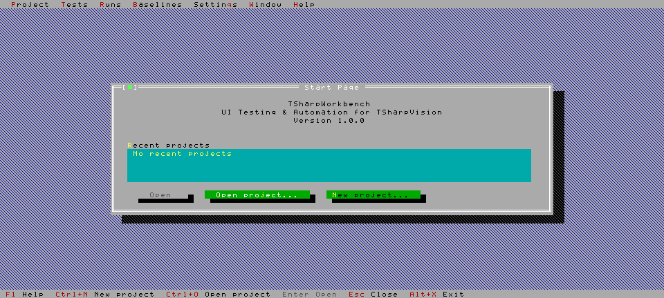

Stejné operace jsou dostupné přes **Project → New…** (**Ctrl+N**) a **Project → Open…** (**Ctrl+O**). Nový projekt uložte pod zvoleným názvem do souboru `.tsw`.

#### Open project — výběr projektového archivu

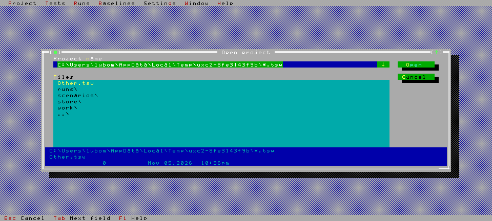

V poli **Project name** přejděte do složky s projektem a vyberte soubor `.tsw`. **Open** jej předá aplikaci k otevření; obsah archivu se následně ověří. Maska `*.tsw` pouze filtruje nabídku souborů. **Cancel** ponechá dosavadní práci bez otevření jiného projektu.

### 2.2 Project Information — přehled projektu

Po otevření nebo vytvoření projektu se zobrazí **Project Information**. Znovu jej otevřete přes **Project → Properties…**, klávesou **F3** nebo **Alt+1**. Jde o informační přehled; vlastní nastavení se upravuje v jiném dialogu, Project Properties.

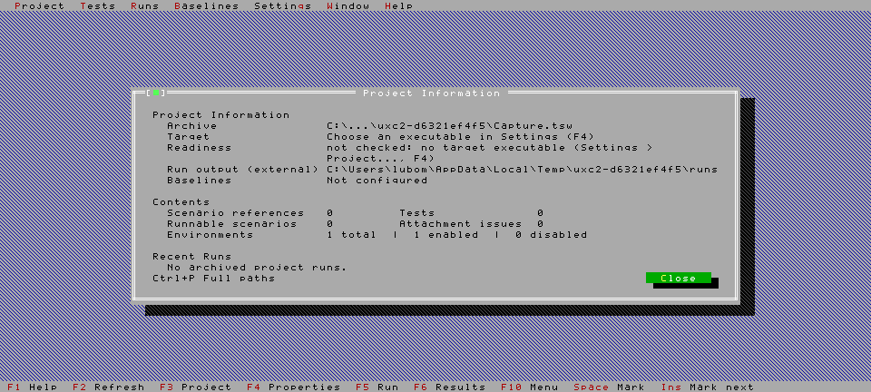

Zkontrolujte zejména:

- **Archive**: který projekt je otevřený.
- **Target** a **Readiness**: testovanou aplikaci a její připravenost ke spuštění.
- **Runs** a **Baselines**: umístění výsledků a stav referenčních dat.
- **Contents**: počty scénářů, testů, prostředí a případné problémy s připojením scénářů.
- **Recent Runs**: přehled posledních uložených běhů.

Dlouhé cesty zpřístupní **Ctrl+P**. Přehled zavřete pomocí **Close** nebo Esc.

### 2.3 Project Properties — nastavení aplikace a běhů

Otevřete **Settings → Project…** nebo stiskněte **F4**.

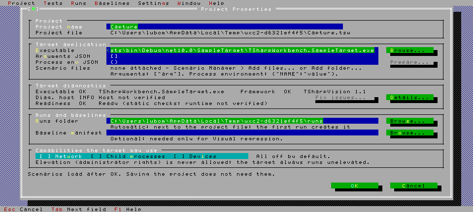

1. V části **Project** upravte název projektu.
2. V části **Target application** vyberte přes **Browse…** spustitelný soubor testované aplikace.
3. Potřebuje-li aplikace argumenty nebo proměnné prostředí procesu, vyplňte **Arguments JSON** a **Process env JSON**.
4. Zkontrolujte diagnostický souhrn v **Target diagnostics**. **Details…** otevře podrobnosti.
5. V **Runs and baselines** nastavte adresář běhů a případně manifest referenčních dat.
6. Potvrďte pomocí **OK**. Po načtení katalogu zkontrolujte dostupnost scénářů.

Argumenty se zadávají jako JSON pole řetězců, například `["--verbose", "--demo"]`. Proměnné procesu mají podobu JSON objektu, například `{"LANG":"cs_CZ"}`. Tato pole nastavují spouštěný proces; profily Environment se spravují samostatně.

V části **Capabilities the target may use** povolte jen schopnosti potřebné pro daný test, například síť nebo podřízené procesy. **Cancel** ponechá původní nastavení.

Pokud diagnostika hlásí nepřipravenou aplikaci, použijte **Settings → Target Diagnostics…** a ověření **Verify target**. **Prepare Target Copy…** připravuje samostatnou kopii aplikace s podporou Workbenche; **Fix Original Target…** slouží k doplnění chybějící podpory do původního umístění a vyžaduje potvrzení. Po přípravě znovu ověřte target a obnovte katalog scénářů pomocí **F2**.

#### Select target executable — výběr testované aplikace

**Browse…** vedle **Executable** otevře výběr spustitelného souboru:

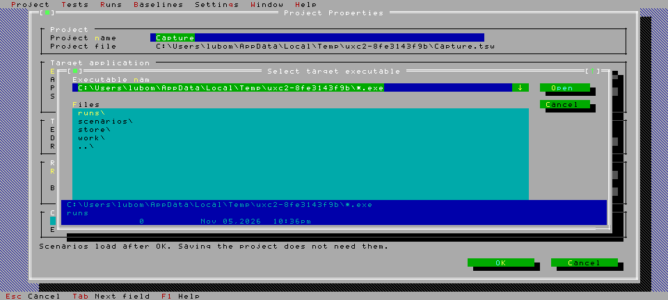

Vyberte spustitelný soubor vlastní testované aplikace a potvrďte **Open**. Na Windows dialog nabízí soubory podle masky `*.exe`. Vybraná cesta se vloží do pole Executable; celé nastavení poté potvrďte **OK** v Project Properties. Výběr souboru sám aplikaci nespouští.

Ve starší větvi přímé práce s targetem se používá také samostatná varianta stejného výběru:

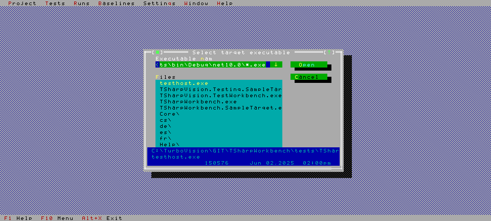

Význam pole **Executable name**, seznamu a tlačítek Open/Cancel je stejný. V běžném projektu `.tsw` začněte přes F4 a Browse v Project Properties.

#### Baseline manifest (.json) — cesta k referenčním datům

**Browse…** vedle **Baseline manifest** otevře výběr manifestu:

Do **Manifest file** vyberte manifest úložiště, obvykle `visual-baselines.json`, a potvrďte **OK**. Samotná přípona `.json` nestačí: soubor musí mít obsah manifestu vizuálních referencí. Při potvrzení změněného nastavení v projektu může následovat nabídka převzetí úložiště; postup je popsaný v oddílu 11.1. **Cancel** v souborovém dialogu ponechá původní hodnotu pole.

### 2.4 Diagnostika a oprava targetu

Než začnete řešit chyby scénáře, ověřte, že Workbench dokáže s testovanou aplikací komunikovat. **Settings → Target Diagnostics…** nebo **Details…** v Project Properties otevře report **Target Diagnostics**.

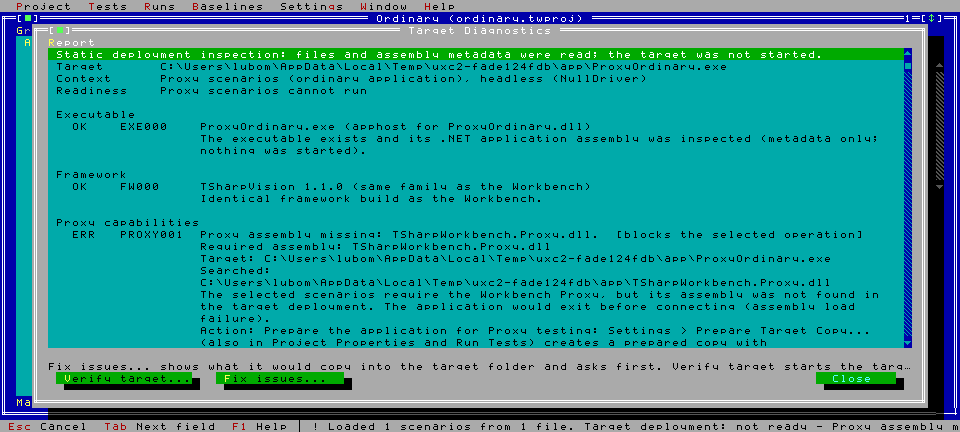

Report uvádí cestu k targetu, kontext kontroly, připravenost a jednotlivé nálezy. Statická kontrola čte soubory a metadata sestav; samotný target přitom ještě nespouští. Vysvětlení nálezu obsahuje chybějící soubor nebo nekompatibilitu a doporučený další krok. Například chybějící `TSharpWorkbench.Proxy.dll` blokuje scénáře, které Proxy potřebují.

#### Verify Target — skutečné ověření spojení

Zvolte **Verify target…**. Před spuštěním se zobrazí potvrzení:

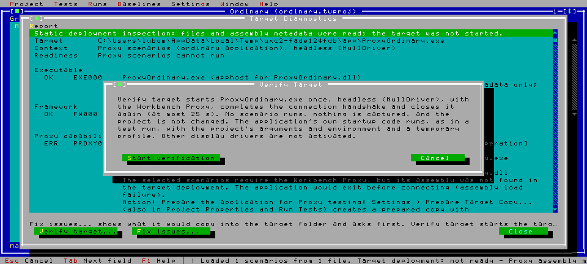

**Start verification** jednou spustí target v headless režimu, vyčká na spojení a proces opět ukončí. Neprovádí scénář ani zachycení obrazovky. Přečtěte podmínky v dialogu: aplikace při startu vykoná svůj běžný inicializační kód. **Cancel** se vrátí bez spuštění. Po ověření přečtěte aktualizovaný výsledek diagnostiky.

#### Fix Issues — plán doplnění podpory

**Settings → Fix Original Target…** nebo **Fix issues…** otevře plán změn v instalaci targetu. Horní volba rozlišuje doporučenou přípravu kopie a opravu původního umístění.

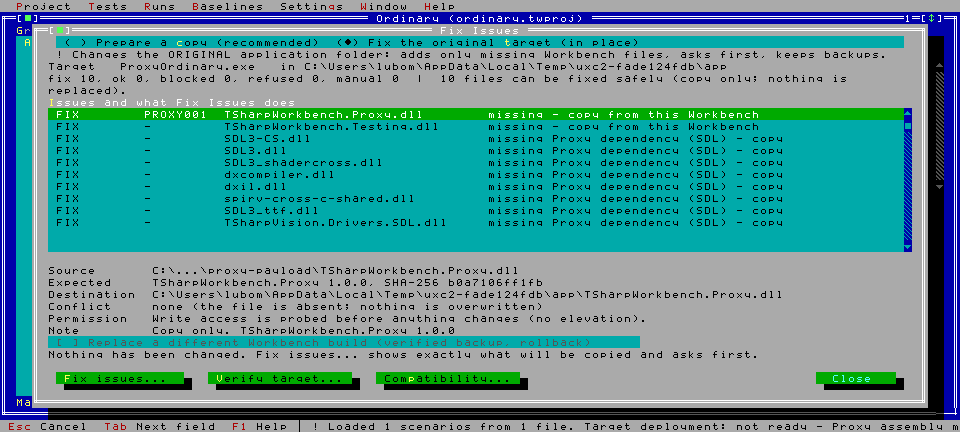

Nejprve prohlédněte seznam, zdroj, očekávanou verzi a cílovou cestu. Zobrazení plánu ještě soubory nemění. Pro opravu na místě zavřete target a zvolte **Fix issues…**. Zvláštní volba nahrazení jiné sestavy Workbenche se týká jen situací, které plán dovolí; řiďte se uvedenými podmínkami zálohy a obnovy.

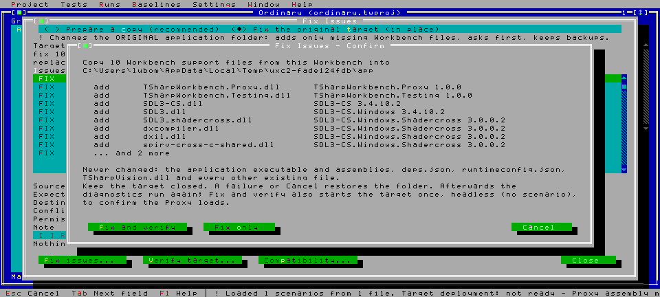

Potvrzení shrnuje skutečné soubory ke změně a soubory, které zůstanou zachované. **Fix and verify** provede plán a následně ověření spojení; **Fix only** provede jen doplnění podpory. **Cancel** plán neprovede. Po úspěšné opravě znovu zkontrolujte připravenost a obnovte katalog scénářů.

#### Target Compatibility — vysvětlení kompatibility

Přes **Compatibility…** zobrazíte porovnání knihoven targetu s podporou Workbenche.

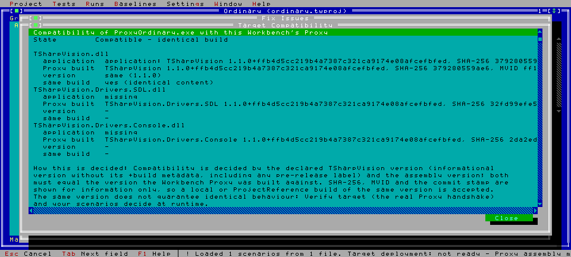

Report vysvětluje, zda odpovídá deklarovaná verze TSharpVision, které knihovny chybějí a které údaje o sestavách jsou pouze informativní. Rozdílná sestava stejné podporované verze vyžaduje ověření skutečného spojení; pouhý rozdíl identifikátoru sestavy sám nepotvrzuje provozní chybu. Nezaměňujte knihovny ručně jen podle názvů souborů.

#### Test mode capabilities — dostupné režimy

Přes **Help → Black-Box / White-Box modes** otevřete přehled **Test mode capabilities**.

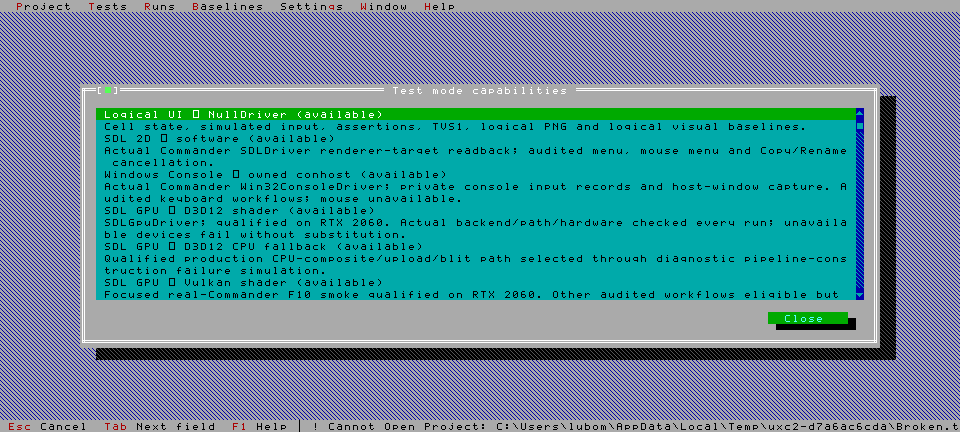

Přehled pomáhá vybrat vhodný ovladač a způsob zachycení. Rozlišuje logický běh, nativní okna a dostupné či omezené cesty. Konkrétní možnosti závisejí na nainstalované sestavě a prostředí; dostupnost svého běhu ověřte jeho diagnostikou.

### 2.5 Úplné cesty a problém s otevřením projektu

**Ctrl+P** v Project Information zpřístupní úplné projektové cesty. V přehledu **Project Paths** lze číst i delší umístění projektu, targetu a adresáře běhů.

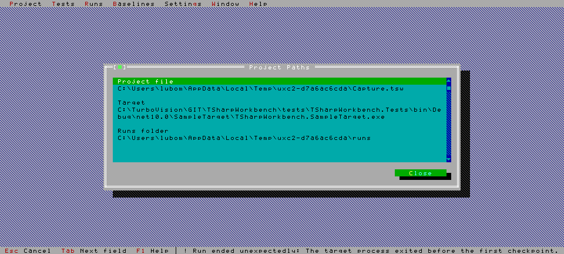

Pokud se archiv nepodaří otevřít, **Cannot Open Project** uvede důvod a nabídne **Show messages**.

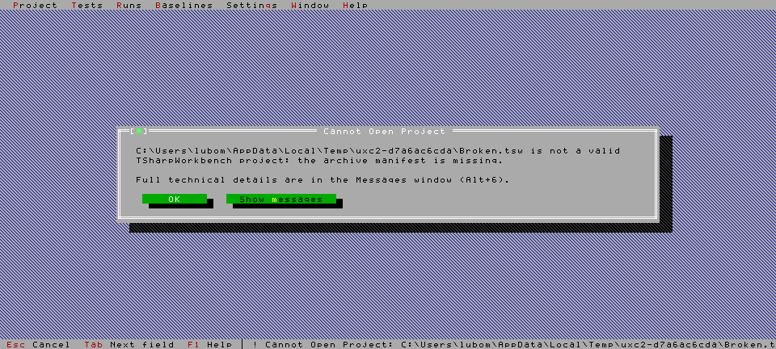

Ověřte, že otevíráte správný soubor `.tsw`, a přečtěte detail v Messages. Snímek ukazuje archiv bez požadovaného manifestu. Po zavření hlášení můžete vybrat jiný projekt nebo opravit příčinu a otevření zopakovat.

## 3. Příprava testovacích prostředí

### 3.1 Environment Manager

Otevřete **Settings → Environments…**. Každý řádek představuje jeden profil, který později přiřadíte testům.

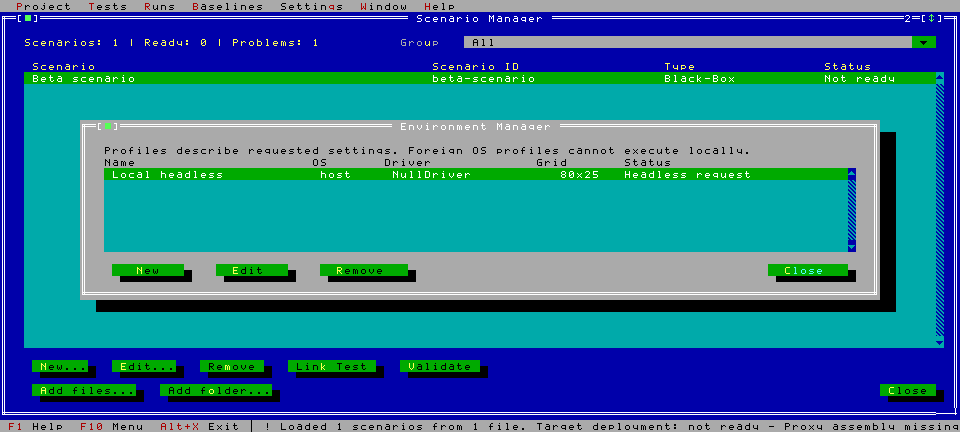

Pomocí **New** vytvoříte profil, **Edit** upraví vybraný profil a **Remove** jej odstraní. Před odstraněním zvažte, které testy profil používají. Pro běžné místní testování lze začít s výchozím profilem **Local headless**.

### 3.2 Environment Properties

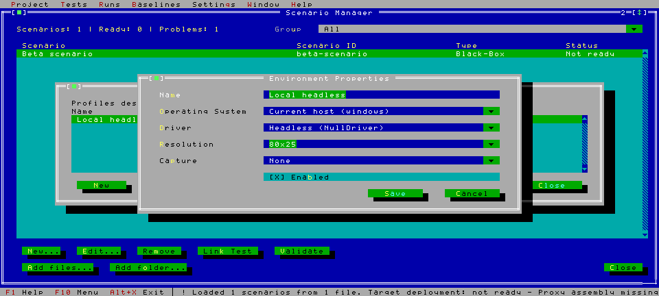

| Pole | Jak je vyplnit |
| --- | --- |
| **Name** | Srozumitelný název, například `Windows SDL 100x30`. |
| **Operating System** | **Current host** pro právě používaný systém, nebo konkrétní platforma. Profil jiného systému nelze lokálně vykonat. |
| **Driver** | Požadovaný ovladač, například headless NullDriver nebo dostupný grafický či konzolový ovladač. |
| **Resolution** | Počet sloupců a řádků znakové mřížky, například `80x25`. Vyberte předvolbu nebo zadejte vlastní platný rozměr. |
| **Capture** | Způsob zachycení obrazu z nabídky dostupné pro zvolený ovladač. |
| **Enabled** | Zda je profil povolený pro použití. |

Profil uložte tlačítkem **Save**. Rozměry jsou v textových buňkách; například `100x30` znamená 100 sloupců a 30 řádků. Jméno profilu samo neurčuje vizuální referenci: při porovnávání se používá skutečný systém, ovladač, druh capture a mřížka.

### 3.3 Odmítnutá změna a odstranění prostředí

**Environment Not Changed** vysvětluje, proč profil nebyl uložen. Například název už může používat jiný profil. Zavřete hlášení a upravte příslušnou hodnotu.

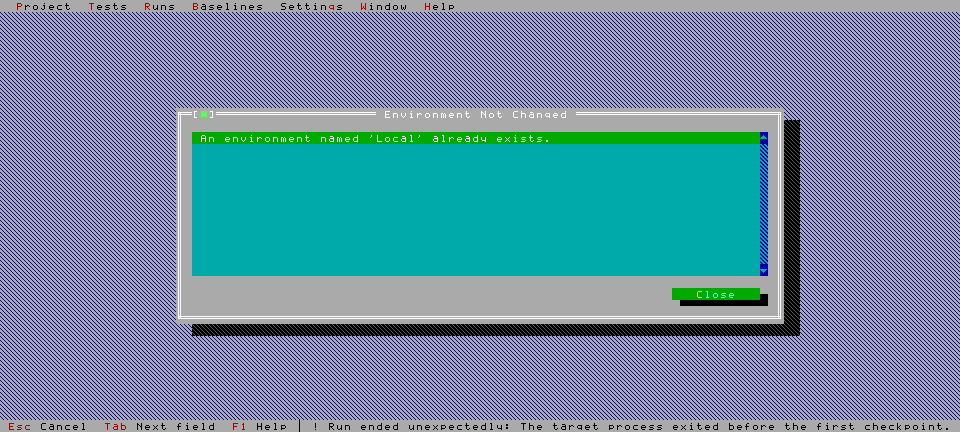

Po **Remove** následuje potvrzení **Remove Environment**. Nejprve upravte testy, které profil používají, a přiřaďte jim jiný. **Remove** potvrdí odstranění dostupné podle těchto pravidel; **Cancel** profil zachová.

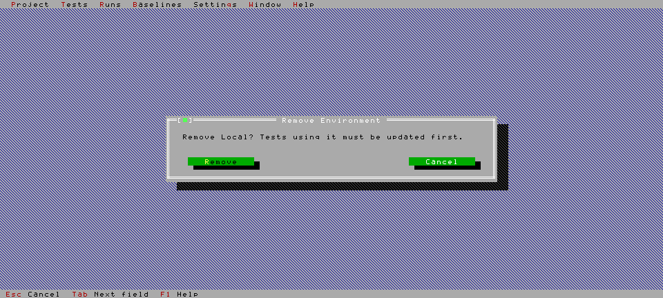

## 4. Příprava scénářů

### 4.1 Scenario Manager

Otevřete **Tests → Scenario Manager…**, **Window → Scenario Manager** nebo **Alt+2**. Seznam ukazuje název, stabilní ID, typ a dostupnost scénáře. Pomocí **Group** omezíte zobrazení na skupinu.

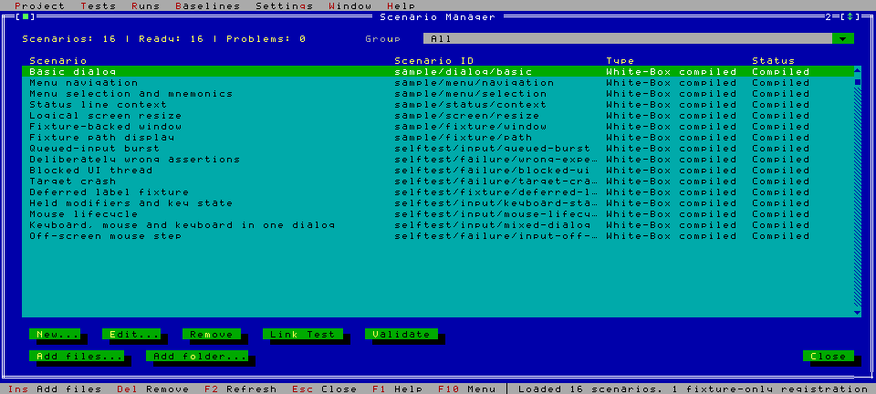

| Akce | Použití |
| --- | --- |
| **New…** | Vytvořit nový editovatelný scénář. |
| **Edit…**, Enter nebo dvojklik | Otevřít vybraný scénář. U kompilovaného scénáře se zobrazí informace; jeho zdroj se zde neupravuje. |
| **Remove** | Odebrat scénář ze seznamu připojených scénářů; původní zdrojový soubor se tím nemaže. |
| **Link Test** | Otevřít New Test s předvoleným scénářem. |
| **Validate** | Prověřit scénáře a jejich vazby; podrobnosti problémů jsou v Messages. |
| **Add files…** | Připojit existující JSON dokumenty scénářů. |
| **Add folder…** | Prohledat složku a vybrat nalezené scénáře k připojení. |

Pokud scénář není připravený, nejprve přečtěte důvod v Messages. Příčinou může být neplatný dokument, nedostupná fixture nebo nepřipravený target. Po změně aplikace obnovte katalog klávesou **F2**.

### 4.2 New Scenario

V Scenario Manageru zvolte **New…**.

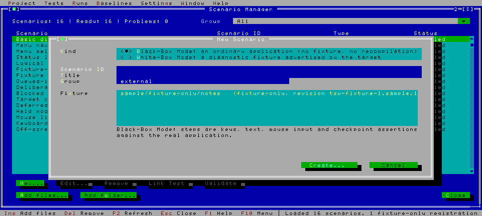

1. Vyberte **Black-Box Mode** pro ovládání běžné aplikace nebo **White-Box Mode** pro diagnostickou fixture.
2. Zadejte **Scenario ID**, například `menu/open-about`. ID používejte stabilně, protože na něj odkazují testy i výsledky.
3. Doplňte čitelný **Title** a **Group** pro třídění.
4. U White-Box vyberte dostupnou **Fixture**. Samotná fixture-only registrace může potřebovat externí scénář, který na ni naváže.
5. Zvolte **Create…** a pokračujte v editoru scénáře.

### 4.3 Připojení existujících scénářů ze složky

Po **Add folder…** vyberte adresář. Dialog **Add Scenario Folder** zobrazí nalezené soubory, jejich stav a souhrn.

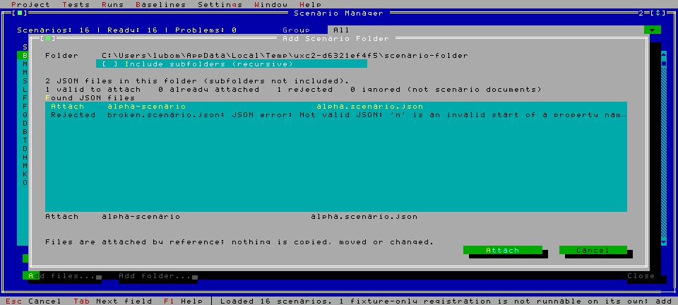

Zaškrtnutím **Include subfolders** zahrnete podsložky. Před **Attach** zkontrolujte zejména odmítnuté soubory (**Rejected**) a důvod odmítnutí, například chybu JSON. Již připojené a ignorované položky nejsou nové scénáře k přidání. Ve zobrazeném dialogu se připojení provádí odkazem; zdrojové soubory se nepřepisují.

### 4.4 Připojení, kompilované scénáře a odebrání

Po uložení nového dokumentu se může objevit **Attach Scenario?**. **Attach** jej připojí k projektu, aby byl dostupný v katalogu. **Cancel** odmítne toto připojení; již uložený soubor tím nezmizí.

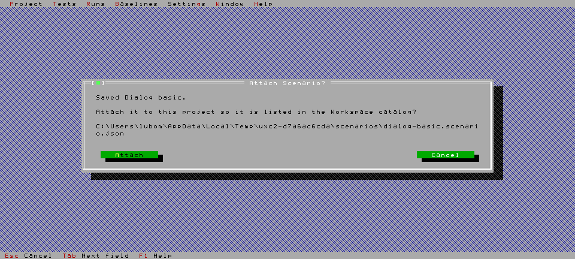

**Compiled Scenario** zobrazuje informace o scénáři dodaném v testované aplikaci. Jeho ID lze přiřadit testu přes **Link Test**, ale vlastní kompilovanou implementaci Workbench nepřepisuje.

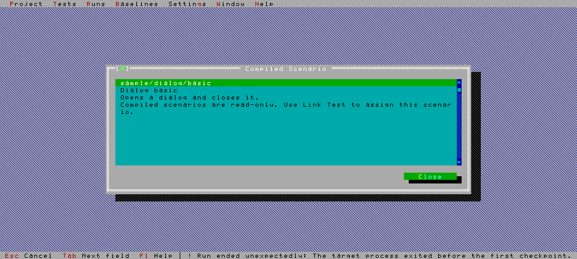

Při pokusu otevřít takový scénář k úpravě může **Scenario Editor** zobrazit krátkou informaci o stavu read-only. Vraťte se do správce a pro vlastní posloupnost kroků vytvořte editovatelný scénář.

**Remove Scenario from Project** potvrzuje odebrání připojeného scénáře. Zkontrolujte název a cestu; **Remove** odebere vazbu v projektu, zdrojový soubor zůstává na disku. **Cancel** vazbu ponechá.

### 4.5 Add scenario files — postupné připojování souborů

V Scenario Manageru zvolte **Add files…**.

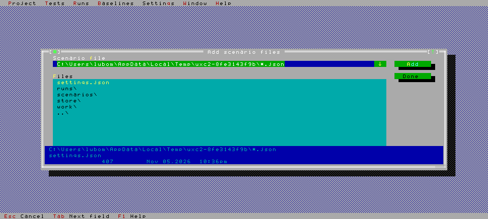

Přejděte do složky se scénáři, vyberte konkrétní dokument v **Scenario file** a zvolte **Add**. Workbench ověří jeho obsah a možnost připojení. Běžný konfigurační JSON se nestává scénářem jen proto, že odpovídá masce `*.json`. Pokud připojení selže, přečtěte důvod a vyberte platný dokument.

Po úspěšném přidání se výběr otevře znovu; titulek udává dosavadní počet přidaných souborů.

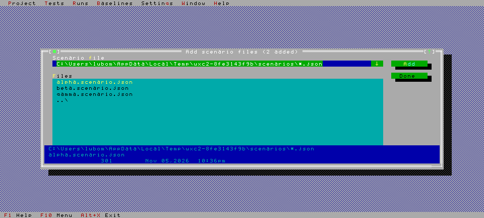

Přes **Add** postupně připojte další dokumenty a nakonec zvolte **Done**. Již úspěšně přidané soubory zůstávají připojené i po ukončení výběru. Zkontrolujte je ve správci a uložte projekt. Pro hromadné prohledání složky včetně přehledu odmítnutých položek použijte místo toho **Add folder…**.

## 5. Scenario Editor a jednotlivé kroky

### 5.1 Orientace v editoru

Editovatelný scénář otevřete v Scenario Manageru dvojklikem, Enterem nebo přes **Edit…**. Editor lze vyvolat také tlačítkem **Scenario** u testu.

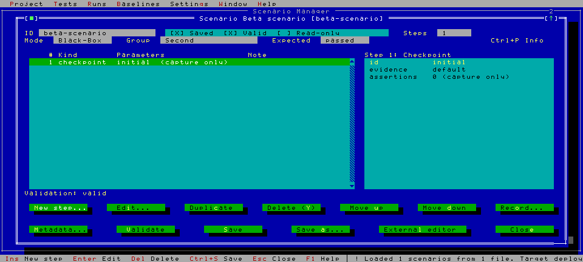

Nahoře jsou údaje **ID**, **Mode**, **Group**, **Expected** a **Steps**. Indikátory **Saved**, **Valid** a **Read-only** ukazují stav dokumentu a nelze je ručně přepínat. Úplná cesta a další informace jsou dostupné přes **Ctrl+P**.

Levý panel obsahuje kroky v pořadí vykonávání: číslo, druh, parametry a poznámku. Pravý panel zobrazuje vlastnosti právě vybraného kroku; dlouhý obsah lze posouvat. Pod seznamem jsou validační zprávy. Dlouhá hodnota zkrácená v seznamu zůstává dostupná v detailu nebo v editoru kroku.

Operace s kroky:

| Akce | Zkratka | Výsledek |
| --- | --- | --- |
| **New step…** | Ins | Otevře Add Step s výběrem druhu kroku. |
| **Edit…** | Enter nebo dvojklik | Upraví vybraný krok. |
| **Duplicate** | Alt+C | Zkopíruje vybraný krok nebo výběr. |
| **Delete** | Del / Alt+Y | Odstraní vybrané kroky. |
| **Move up / Move down** | Alt+U / Alt+D | Změní pořadí kroků. |
| Výběr více kroků | Shift+↑ / Shift+↓ | Rozšíří výběr souvislého rozsahu. |
| **Record…** | Tlačítko v editoru | Otevře nahrávání interakce s aplikací. |

Operace s dokumentem jsou na samostatném řádku: **Metadata…**, **Validate**, **Save**, **Save as…**, **External editor** a **Close**. **Alt+V** provede validaci; **Ctrl+S** uloží scénář, **Alt+A** otevře Save As a **Alt+L** externí editor.

V **Add Step** vyberte druh kroku a potvrďte **Choose**, Enterem nebo dvojklikem. V editoru kroku **OK** přijme změny, **Cancel** je zahodí. Společné pole **Note** je poznámka pro čtenáře scénáře. **Change kind…** umožní zvolit jiný druh; při změně druhu se zachová poznámka a parametry nového druhu je třeba vyplnit znovu.

### 5.2 Scenario Metadata

Otevřete **Metadata…** nebo stiskněte **Alt+M**.

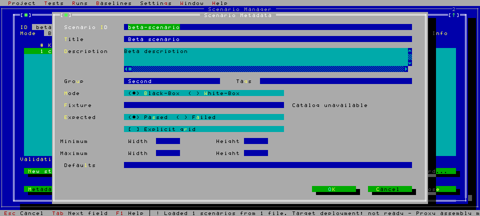

Upravíte zde ID, název, víceřádkový **Description**, skupinu, tagy, režim a případnou fixture. **Expected** určuje očekávaný výsledek: **Passed** pro běžný úspěšný scénář, **Failed** pro záměrně chybový případ. Nejde o přepínač skutečně naměřeného výsledku.

**Explicit grid** zapíná explicitní rozsah podporovaných mřížek. **Minimum** a **Maximum** obsahují kladnou šířku a výšku; **Defaults** je seznam výchozích rozměrů oddělených čárkou, například `80x25, 100x30`. Bez explicitního rozsahu se použijí pravidla fixture nebo standardního rozsahu. Metadata potvrďte **OK** a následně uložte scénář.

### 5.3 Key press — jeden stisk klávesy (`key`)

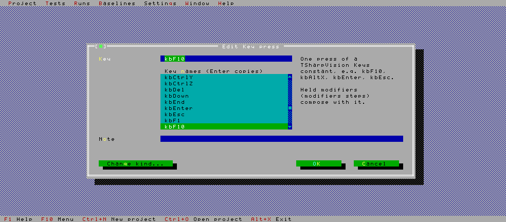

Do **Key** zadejte název konstanty TSharpVision, například `kbEnter`, `kbEsc` nebo `kbF10`. Pomocný seznam **Key names** lze procházet; Enter kopíruje vybraný název do pole. Krok odešle jeden stisk. Hodí se pro potvrzení dialogu, otevření menu nebo přesun fokusu. Dříve držené modifikátory se uplatní i při tomto kroku.

### 5.4 Type text — zadání textu (`text`)

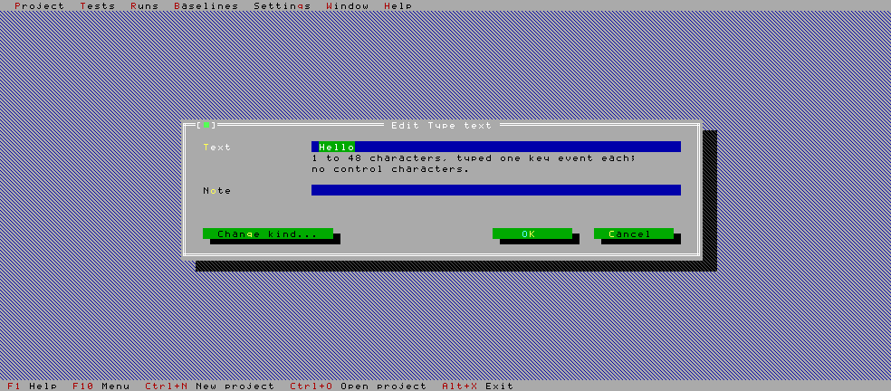

Do **Text** zadejte 1 až 48 znaků bez řídicích znaků. Každý znak se odešle jako klávesový vstup do právě aktivního pole testované aplikace. Delší text rozdělte do více kroků; Enter nebo Tab zadávejte samostatným krokem Key press.

### 5.5 Mouse input — vstup myší (`mouse`)

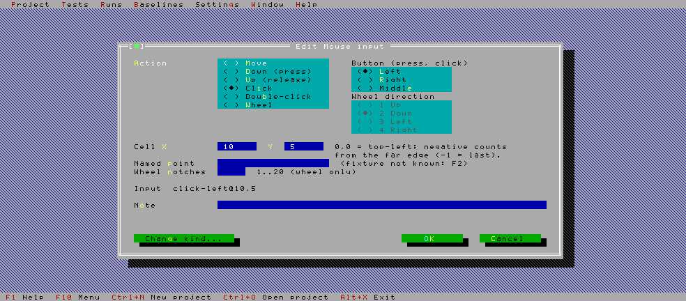

V **Action** vyberte pohyb (**Move**), stisk (**Down**), uvolnění (**Up**), kliknutí (**Click**), dvojklik (**Double-click**) nebo kolečko (**Wheel**). Podle druhu akce se zpřístupní příslušné tlačítko nebo směr kolečka.

- **Cell X / Y** jsou souřadnice buněk obrazovky. Levý horní roh je `0,0`; záporná hodnota počítá od protějšího okraje, `-1` označuje poslední sloupec nebo řádek.
- **Button** volí levé, pravé nebo prostřední tlačítko.
- **Wheel direction** určuje směr a **Wheel notches** počet kroků kolečka od 1 do 20.
- **Named point** slouží pojmenovaným bodům fixture ve White-Box režimu. V Black-Box používejte souřadnice X/Y.
- Řádek **Input** průběžně ukazuje sestavený vstup, například `click-left@10,5`.

Pro přetažení sestavte posloupnost Down → Move → Up. Za ní lze přidat checkpoint k ověření výsledné polohy.

### 5.6 Key down — podržení klávesy (`keyDown`)

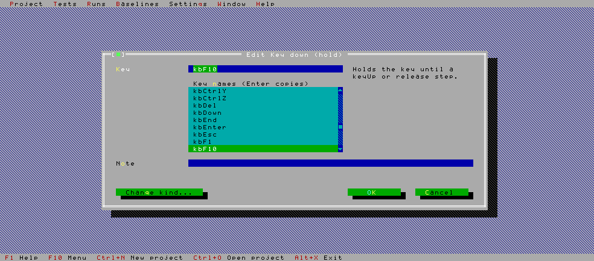

Pole **Key** a seznam názvů fungují stejně jako u Key press. Klávesa zůstane stisknutá i v následujících krocích. Uvolněte ji později krokem Key up nebo Release all held input.

### 5.7 Key up — uvolnění klávesy (`keyUp`)

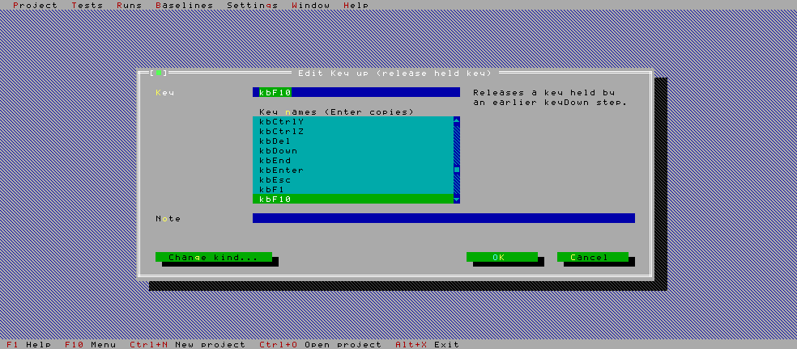

Zadejte stejný název klávesy jako v předchozím Key down. Krok ukončí její držení. Použijte jej tam, kde záleží na přesném pořadí stisků a uvolnění.

### 5.8 Modifier down/up — Shift, Ctrl a Alt (`modifiers`)

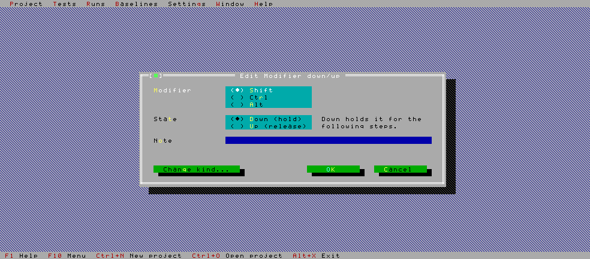

V **Modifier** vyberte Shift, Ctrl nebo Alt. **Down (hold)** začne modifikátor držet pro následující kroky; **Up (release)** jej uvolní. Například pro kombinaci Ctrl+klávesa vytvořte Modifiers Ctrl Down → Key press → Modifiers Ctrl Up.

### 5.9 Release all held input — uvolnění vstupů (`release`)

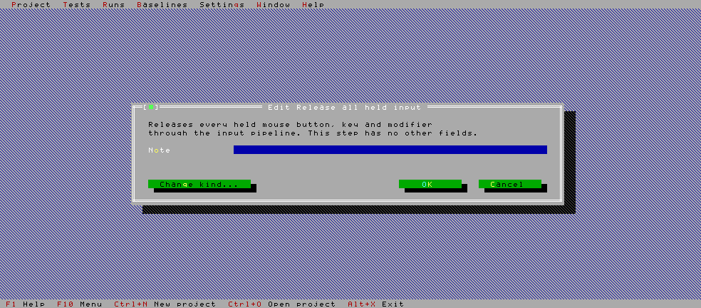

Uvolní všechny držené klávesy, modifikátory a tlačítka myši. Kromě Note nemá další parametry. Je užitečný po složitější kombinaci vstupů, aby další část scénáře začínala bez držených tlačítek.

### 5.10 Resize grid — změna rozměrů (`resize`)

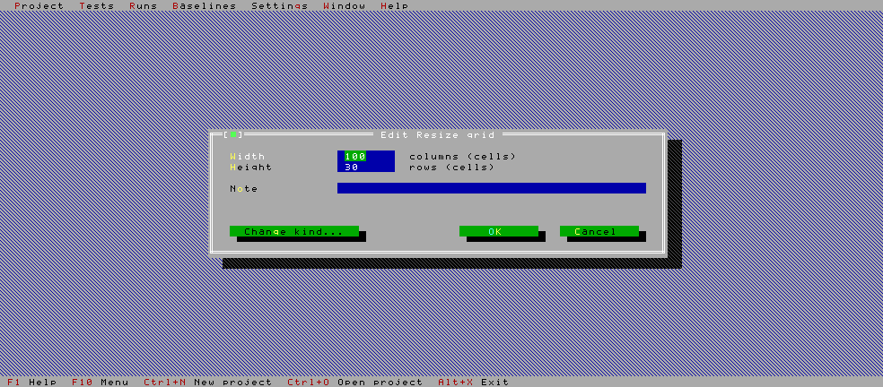

Do **Width** zadejte počet sloupců a do **Height** počet řádků. Obě hodnoty musí být kladná celá čísla a odpovídat podporovanému rozsahu scénáře. Tímto krokem otestujete reakci aplikace na změnu velikosti. Za Resize přidejte checkpoint, například s kontrolou within-screen a not-clipped.

### 5.11 Fixture action — akce fixture (`action`)

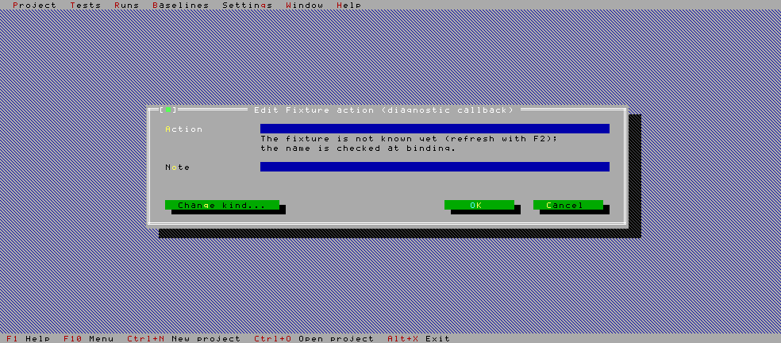

Tento druh je určen pro **White-Box** scénáře. **Action** obsahuje název akce, kterou fixture skutečně nabízí. Pokud je katalog k dispozici, lze název vybrat ze seznamu. Pokud chybí, obnovte jej pomocí F2 a ověřte vazbu na fixture. Akce může například připravit konkrétní stav aplikace; její význam určuje implementace fixture.

### 5.12 Checkpoint — zachycení a ověření (`checkpoint`)

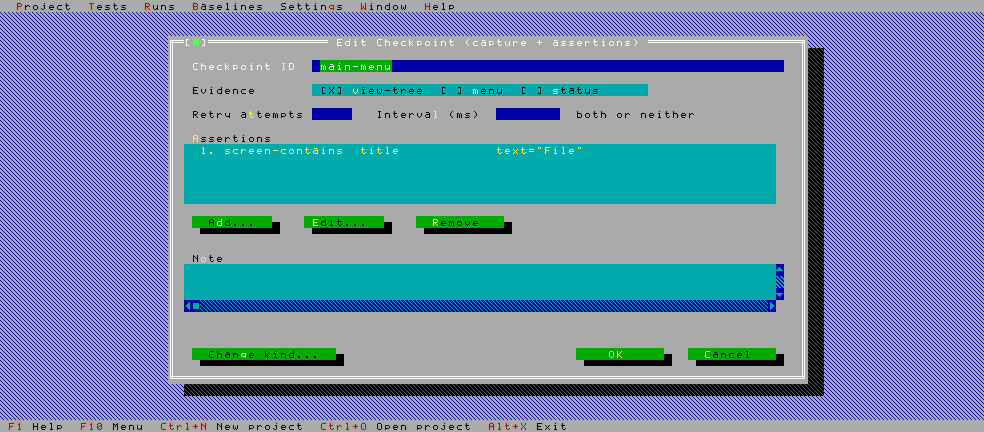

Checkpoint vložte za kroky, jejichž výsledek chcete ověřit.

1. Zadejte stabilní **Checkpoint ID**, jedinečné v daném scénáři, například `main-menu-open`.
2. Podle kontrol zvolte doplňkovou **Evidence**: view-tree, menu nebo status.
3. Případně upravte **Retry attempts** a **Interval (ms)**.
4. Přes **Add…** přidejte jednu nebo více assertions. **Edit…** upraví vybranou a **Remove** ji odebere. V seznamu fungují také Ins, Enter a Del.
5. Do víceřádkového **Note** popište účel kontrolního bodu a potvrďte **OK**.

V Black-Box může ID označovat libovolný stabilní stav obrazovky. U kontraktové White-Box fixture vybírejte z jí nabízených checkpointů, pokud je dialog zobrazuje.

Obě pole opakování ponechte prázdná pro výchozích **5 pokusů s intervalem 250 ms**. Při vlastním nastavení vyplňte obě: počet pokusů **1–20**, interval **0–30000 ms**. Opakování pomáhá počkat na dosažení očekávaného stavu.

Prázdný seznam **No assertions (capture only)** znamená samotné zachycení bez explicitních kontrolních podmínek. Assertions se automaticky nepřidávají. Note zachovává řádky textu; Enter v něm vloží nový řádek a Tab přesune fokus.

## 6. Checkpoint a kontrolní podmínky — assertions

### 6.1 Přidání a společná pole

V editoru Checkpoint zvolte **Add…**, vyberte druh podmínky a vyplňte jeho formulář. Existující assertion otevřete přes **Edit…** nebo Enter. Všechny druhy mají:

- **Assertion ID**: stabilní identifikátor, jedinečný v rámci checkpointu; například `dialog-title`.
- **Severity**: **error** pro chybu nebo **warning** pro upozornění. Závažnost se zaznamená spolu s výsledkem kontroly.
- Vlastní parametry daného druhu.

**OK** přijme assertion do rozepsaného checkpointu. Poté potvrďte i checkpoint a uložte scénář. **Cancel** v kterékoli vnořené editaci zahodí její rozepsané změny.

### 6.2 Evidence a výběr prvků

| Co ověřujete | Potřebné podklady |
| --- | --- |
| Text a atributy buněk | Logická obrazovka checkpointu. |
| Prvky, fokus, modalitu a geometrii | **view-tree**. |
| Menu a jeho položky | **menu**. |
| Stavový řádek | **status**. |

Workbench si potřebné druhy evidence vyžádá také podle zadaných assertions; zaškrtávací volby v checkpointu umožňují požadovat další podklady i samostatně. Pokud potřebné podklady nejsou dostupné, kontrola může skončit **UNSUPPORTED**. Tento stav znamená, že podmínku nebylo možné vyhodnotit.

**View selector** vybírá prvek pomocí alespoň jednoho z polí **type**, **id**, **text**, **path**. Hodnoty vycházejí ze zachyceného stromu prvků testované aplikace. Type určuje typ prvku, id jeho diagnostickou identitu, text přesný text modelu a path cestu ve stromu. Vyplněná kritéria se kombinují; pro kontroly jednoho prvku použijte dostatečně přesný výběr. Více shod může znamenat nejednoznačnost. **Other view** vybírá druhý nebo referenční prvek u vzájemných vztahů.

Souřadnice X/Y jsou od nuly a vzdálenosti se udávají v buňkách. Nejprve zachyťte skutečný stav aplikace a z něj odvoďte stabilní selektory a očekávané hodnoty.

### 6.3 Text a vzhled buněk

#### screen-contains — text na obrazovce

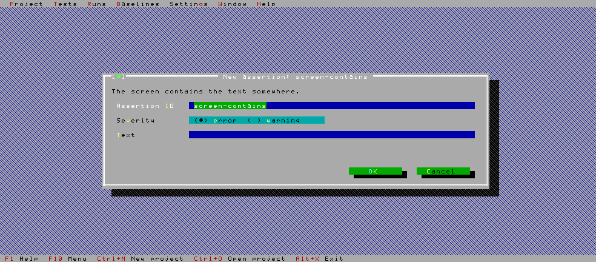

Do **Text** napište očekávaný text. Kontrola jej hledá na logické obrazovce bez pevné souřadnice. Použijte například pro ověření názvu otevřeného dialogu nebo hlášení po provedené operaci.

#### text-at — text na konkrétní pozici

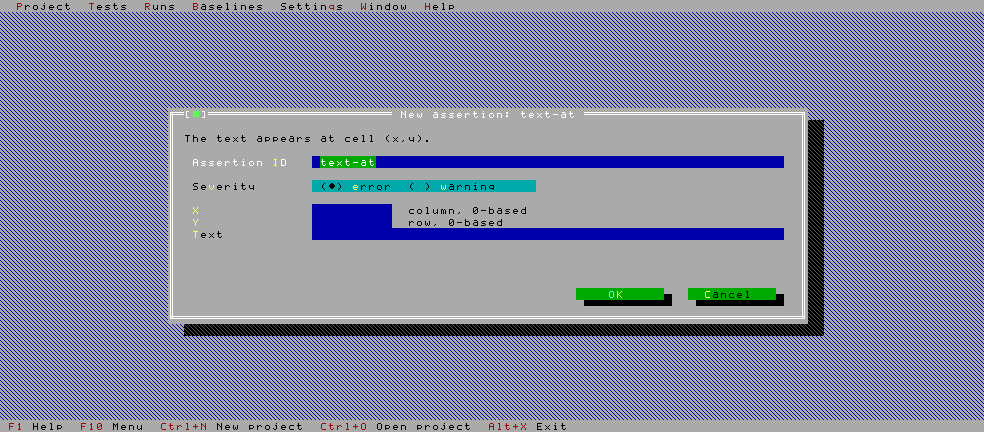

Vyplňte **X**, **Y** a **Text**. Očekávaný text musí začínat v uvedené buňce. Tato kontrola se hodí pro pevné rozložení; při změně velikosti okna zvažte, zda se ověřovaný text nepřesune.

#### attribute-at — barevný atribut buněk

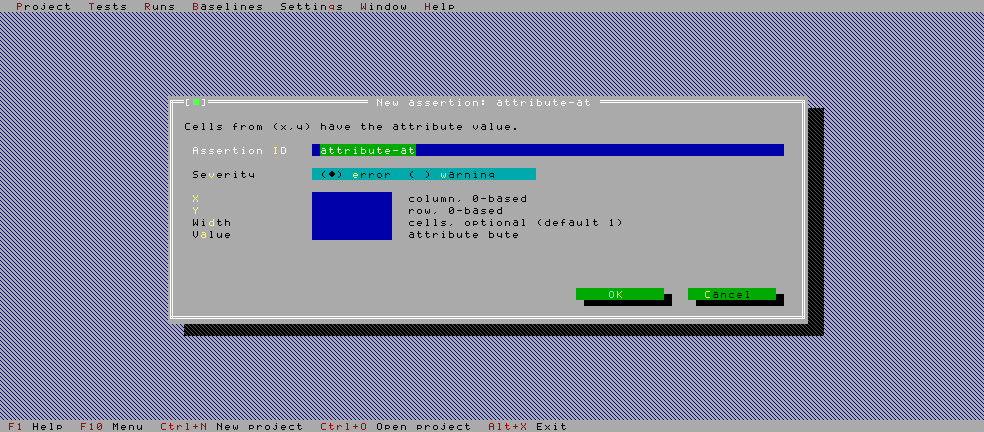

**X/Y** určuje začátek úseku, **Width** počet buněk na daném řádku a **Value** očekávaný logický barevný atribut. Prázdná Width znamená jednu buňku. Atribut kombinuje barvu pozadí a popředí; používejte hodnotu odpovídající testované aplikaci. Kontrola je vhodná například pro zvýraznění vybrané položky.

### 6.4 Existence, viditelnost a fokus prvků

#### view-exists — prvek existuje

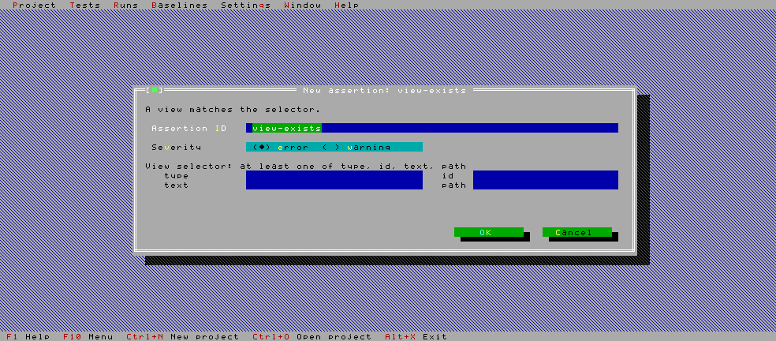

Vyplňte **View selector**. Kontrola projde, pokud se ve stromu najde alespoň jeden odpovídající prvek. Existence sama neověřuje jeho viditelnost.

#### view-absent — prvek neexistuje

Selektorem určete prvek, který se ve stromu nesmí nacházet. Použijte například po zavření dialogu nebo odstranění ovládacího prvku.

#### view-visible — prvek je viditelný

Ověří, že vybraný prvek má viditelnou alespoň část plochy a není skrytý včetně svých vlastníků. Pro úplnou viditelnost bez oříznutí přidejte not-clipped.

#### view-focused — prvek má fokus

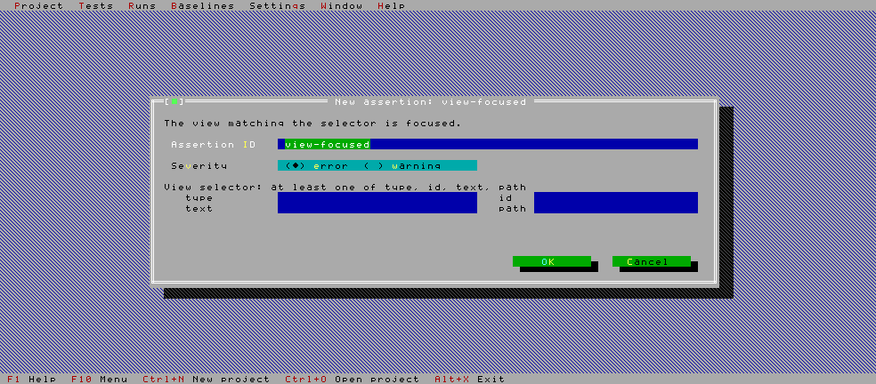

Ověří, že fokus patří přesně vybranému prvku. Je vhodná například po otevření formuláře nebo po přechodu pomocí Tab.

#### modal — aktivní modální okno

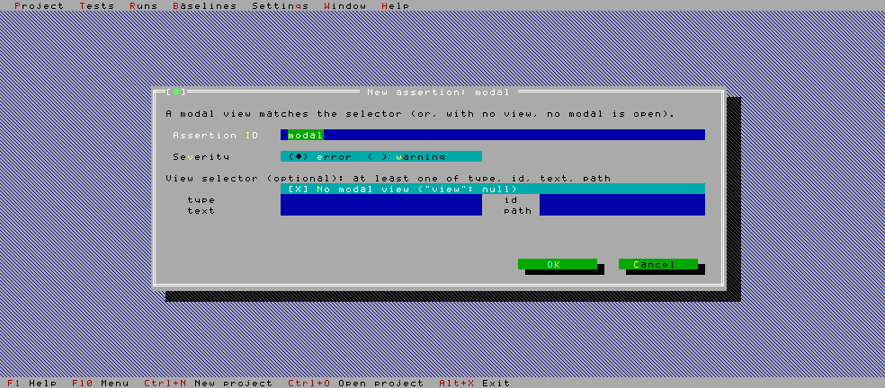

Vyplněným selektorem určíte očekávané vykonávané modální okno. Zaškrtnutí **No modal view** naopak ověří, že žádné modální okno není otevřené. Hodí se pro kontrolu potvrzovacích dialogů i návratu do běžné práce.

### 6.5 Rozložení a geometrie

#### within-screen — uvnitř obrazovky

Ověří, že celý obdélník vybraného prvku leží v hranicích obrazovky. Je užitečná po Resize nebo při přesunu okna k okraji.

#### not-clipped — bez oříznutí

Ověří, že viditelná plocha prvku odpovídá jeho celému obdélníku. Odhalí oříznutí obrazovkou nebo některým vlastníkem i skrytí prvku.

#### within-view — uvnitř jiné plochy

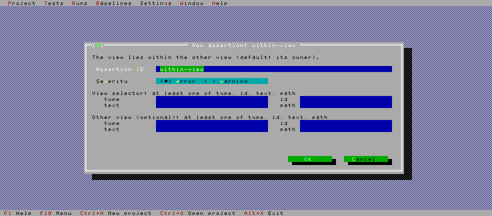

**View selector** určuje kontrolovaný prvek, **Other view** obklopující prvek. Celý první obdélník musí ležet uvnitř druhého. Při nevyplněném Other view používá vyhodnocení pracovní plochu desktopu. Použijte například pro ověření umístění dialogu v pracovní oblasti.

#### disjoint — prvky se nepřekrývají

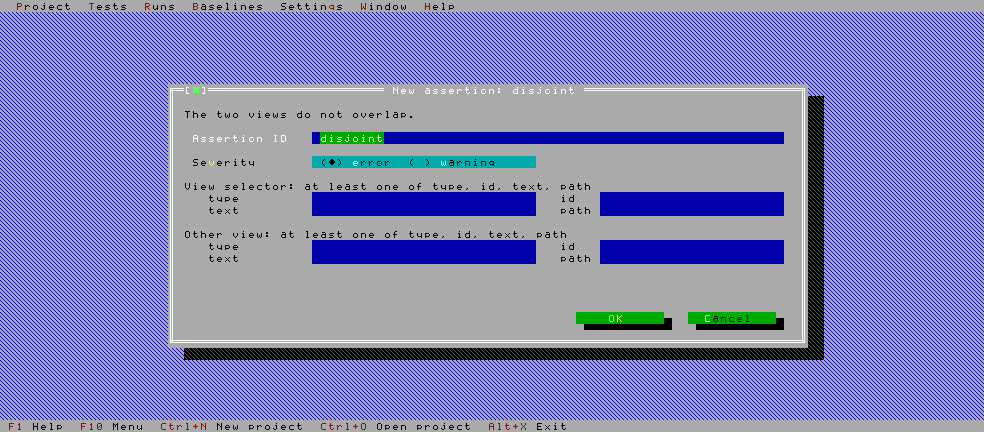

Zadejte oba selektory. Kontrola ověří, že jejich obdélníky nemají společnou plochu. Hodí se pro vztah sousedních polí, panelů nebo tlačítek.

#### aligned — společné zarovnání

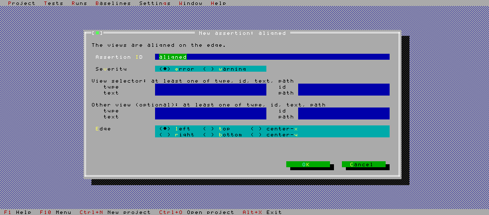

V **Edge** zvolte levou, pravou, horní či dolní hranu nebo střed v ose X/Y. Prvky vybrané View selector musejí mít tuto souřadnici shodnou s referencí **Other view**. Bez reference se porovnávají mezi sebou. Zkontrolujete tak například společný levý okraj vstupních polí.

#### spacing — mezera mezi prvky

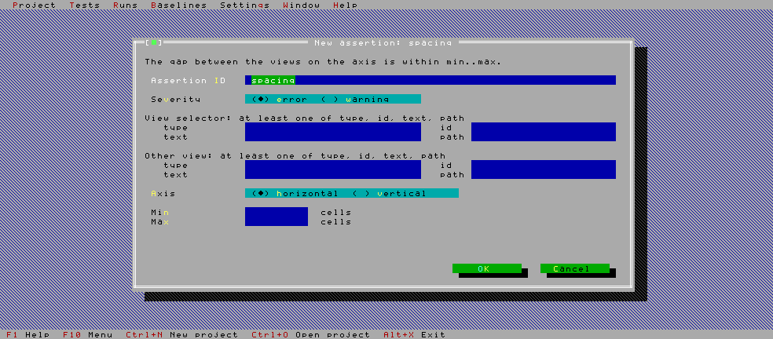

Vyberte dva prvky, v **Axis** vodorovný nebo svislý směr a v **Min/Max** povolenou mezeru v buňkách. Min nesmí být větší než Max. Záporná vzdálenost znamená překryv v dané ose. Například Min = Max = 1 vyžaduje přesně jednu volnou buňku mezi obdélníky v příslušném směru.

#### shadow — stín prvku

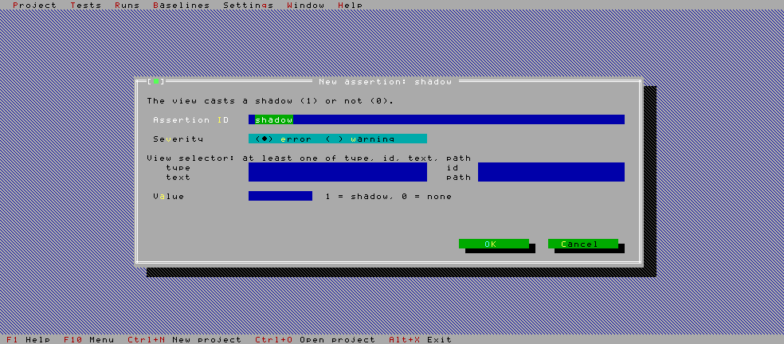

Vyberte prvek vrhající stín. Vyhodnocení kontroluje příznak stínu i atribut buněk v jeho pravém a spodním pásu. **Value** je očekávaný barevný atribut těchto buněk. Ve snímku je u pole zjednodušující popisek `1 = shadow, 0 = none`; při zadávání hodnoty se řiďte skutečným atributem stínu testované aplikace. Překrytí stínu jiným prvkem může vést k rozdílu.

### 6.6 Kontroly menu

Pro tyto podmínky musí být dostupné podklady **menu**. V polích **Text** zadávejte text položky. Volitelné **Level** určuje úroveň: `0` je hlavní lišta, prázdná hodnota používá nejhlubší otevřenou úroveň.

#### menu-depth — počet otevřených úrovní

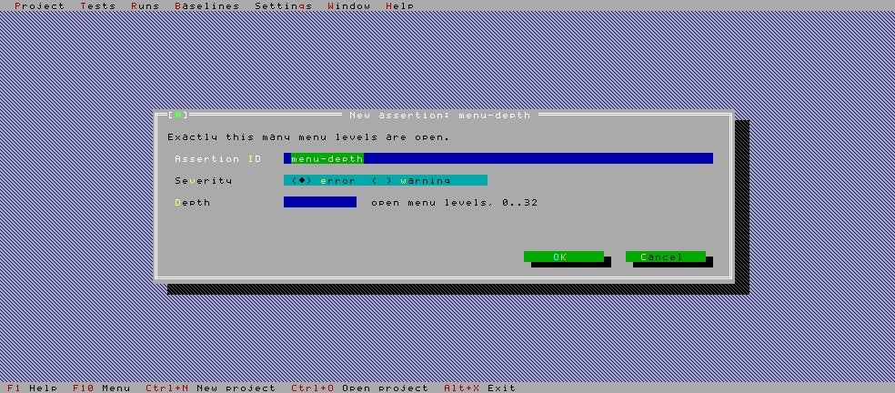

**Depth** obsahuje očekávaný počet otevřených úrovní menu v rozsahu 0–32. Použijte pro ověření, zda se submenu otevřelo nebo menu zavřelo.

#### menu-selected — vybraná položka

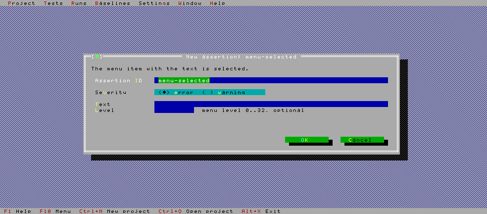

Vyplňte **Text** a případně **Level**. Ověří vybranou položku a její zvýraznění. Hodí se po navigaci šipkami nebo mnemonikou.

#### menu-item-state — dostupnost položky

Zadejte **Text**, případně **Level**, a v **State** zvolte **enabled** nebo **disabled**. Ověříte tak například, že příkaz Save je v požadovaném stavu dostupný.

#### submenu-open — otevřené submenu

Do **Text** zadejte název rodičovské položky. Kontrola ověří, že submenu patřící této položce je otevřené.

### 6.7 Kontroly stavového řádku

Tyto kontroly potřebují podklady **status**.

#### status-item — položka stavového řádku

Zadejte **Text** a stav **visible**, **absent**, **enabled** nebo **disabled**. Ověříte přítomnost, viditelnost nebo dostupnost konkrétního příkazu stavového řádku.

#### status-context — kontext stavového řádku

Do **Context** zadejte očekávané číslo kontextu nápovědy. Kontrola se hodí pro aplikace, kde se nabídka stavového řádku mění podle aktivního okna nebo pole.

#### status-hint — text nápovědy

Do **Text** zadejte text, který má obsahovat aktuální hint stavového řádku. Použijte například po změně fokusu na prvek s vlastní nápovědou.

## 7. Vytvoření testu a výběr testů

### 7.1 Test Explorer

Jakmile máte scénář a prostředí, otevřete **Tests → Test Explorer…** nebo **Window → Test Explorer**.

**Query**, **Group** a **Mode** omezují zobrazené testy. Po změně použijte **Apply filter**. Režim rozlišuje Black-Box a White-Box. Řádky ukazují název testu, režim, počet prostředí a stav.

- **New** vytvoří test, **Edit** nebo dvojklik otevře vybraný test k editaci.
- **Delete** odstraní vybraný test; scénář je samostatná položka projektu.
- **Scenario** otevře přiřazený scénář.
- Kliknutí na `[ ]` nebo Space přepne označení testu pro běh na `[X]` a zpět.
- **Mark All / Clear Marks** označí nebo odznačí testy v celém projektu, včetně testů skrytých filtrem.
- **Configure** nebo F5 otevře výběr kombinací k vykonání.

Zvýraznění aktuálního řádku a označení `[X]` mají rozdílný účel: zvýraznění určuje položku pro editaci, značka výběr pro běh.

### 7.2 New Test / Edit Test

1. Zadejte **Title**, například `Otevření dialogu O aplikaci`.
2. Do **Description** napište, co případ ověřuje.
3. Do **Preconditions** zaznamenejte předpoklady, například požadovaný vstupní soubor. Toto pole předpoklady dokumentuje; samo je neprovádí.
4. V **Scenario** vyberte jeden scénář. Popisek obsahuje také jeho stabilní ID.
5. V **Environments** kliknutím na řádek nebo pomocí Space označte jedno či více prostředí. Počet vybraných profilů se zobrazuje v nadpisu.
6. Potvrďte **Save** nebo **Alt+S**.

Description a Preconditions jsou víceřádková pole. Enter vkládá řádek a Tab přechází do dalšího pole. **Cancel**, **Alt+C** nebo Esc změny zahodí. Stejný formulář se otevře přes **Link Test** v Scenario Manageru, kde už je scénář předvolený.

### 7.3 Přiřazení, odmítnutá změna a odstranění testu

**Test Needs Assignments** upozorňuje, že pro vytvoření nebo použití testu chybí potřebná přiřazení. Nejprve připravte scénář a alespoň jedno prostředí, potom test vytvořte nebo doplňte.

**Test Not Changed** uvádí důvod odmítnutého uložení, například již existující název testu. Opravte uvedenou hodnotu; neúspěšné uložení samo nevytváří druhý test.

**Remove Test** se zobrazí po odstranění testu z Test Exploreru. **Remove** odebere vybraný test, jeho scénář zůstane dostupný. **Cancel** odstranění zruší.

## 8. Nahrávání scénářů — Record Interaction

Recorder převede interakci ve skutečném okně targetu na vstupní kroky scénáře. Je užitečný, když chcete nejprve ručně projít úlohu a teprve potom její záznam doplnit kontrolami. Výsledkem záznamu je návrh posloupnosti, kterou před spuštěním testu prohlédnete a upravíte.

### 8.1 Příprava záznamu

1. V projektu nastavte existující target a ověřte jeho připravenost přes **Target Diagnostics**. Nasazená podpora Proxy musí umět nahrávání.
2. Vytvořte nebo otevřete editovatelný **Black-Box** scénář. Nahrávání je určeno pro běžnou aplikaci přes Proxy; kompilovaná diagnostická fixture ani dokument pouze pro čtení nejsou vhodným cílem.
3. V Scenario Editoru zvolte **Record…**. Současně může být otevřený jeden záznam.
4. Zkontrolujte target, počáteční mřížku a viditelný ovladač: **Console window**, **SDL window** nebo **SDL GPU window** podle podpory targetu. Headless NullDriver nemá okno pro ruční vstup. Fyzické nahrávání je v současné implementaci dostupné na Windows.

### 8.2 Zahájení, pozastavení a ukončení

1. Zvolte **Start**. Workbench spustí target v jeho samostatném okně.
2. Přepněte se do okna targetu a proveďte úlohu: například otevřete dialog, vyplňte pole a potvrďte tlačítko. Vstupy v okně Workbenche se nezaznamenávají.
3. Pro ovládání záznamu se vraťte do Workbenche kliknutím nebo Alt+Tab. **Pause** pozastaví zaznamenávání a **Resume** je obnoví. Během pauzy může target dál přijímat vstupy, ale tyto vstupy nebudou součástí scénáře; změny jeho stavu proto při následném přehrávání mohou chybět.
4. Po dokončení zvolte **Stop**. Workbench záznam ukončí a target zavře. Teprve potom prohlédněte návrh kroků a rozhodněte o jeho vložení. Relace má limit 30 minut.

### 8.3 Co se zaznamená a co musíte doplnit

| Oblast | Chování recorderu |
| --- | --- |
| Klávesy a text | Převádí podporované fyzické vstupy doručené targetu na kroky kláves a textu; souvislé psaní může sdružit do textových kroků. |
| Myš | Převádí podporované stisky a uvolnění, kliknutí, dvojklik, pohyb s drženým tlačítkem a kolečko na kroky se souřadnicemi buněk. |
| Změna velikosti | Zaznamenaná změna mřížky se převádí na Resize. |
| Samostatná uvolnění kláves a přechody modifikátorů | Nezapisují se jako samostatný úplný záznam držení. Potřebné Key down, Key up nebo Modifiers případně zkontrolujte a doplňte ručně. |
| Pohyb myši bez drženého tlačítka a automatické opakování myši | Tyto události se samostatně nezaznamenávají. |
| Vstupy ve Workbenchi, v jiných aplikacích nebo během Pause | Nejsou součástí zaznamenané posloupnosti. Interní události vložené samotnou aplikací se také nepovažují za ruční záznam. |
| Délka prodlev mezi vstupy | Časové pauzy se nepřevádějí na čekací kroky. Záznam proto neslibuje přehrání stejným tempem. |
| Checkpointy, assertions a baselines | Smart Capture navrhuje checkpointy a assertions podle zachyceného stavu ke kontrole. Baselines stále vyžadují výslovné schválení. |

Smart Capture je ve výchozím nastavení zapnutý a může navrhnout checkpointy pro zachycené dialogy a další významné stavy. Návrhy zkontrolujte a doplňte kontroly, které chybějí. Při vypnutém Smart Capture přidávejte checkpointy ručně. Pro čekání na požadovaný stav při přehrávání použijte retry checkpointu. Podrobnosti uvádí [průvodce Smart Recorderem](../recorder.md) v angličtině.

### 8.4 Kontrola a vložení do scénáře

V dialogu **Review Proposals** zkontrolujte umístění checkpointů, podklady, míru jistoty a navržené assertions. Před vložením záznamu je přijměte, odmítněte nebo upravte. Projděte návrh od začátku. Ověřte názvy kláves, souřadnice, změny mřížky a případná upozornění na nezaznamenané vstupy nebo prodlevy. Odstraňte omyly z ručního ovládání a podle potřeby doplňte chybějící kroky v editoru.

| Akce | Kam vloží zaznamenané kroky |
| --- | --- |
| **Append** | Na konec scénáře. |
| **Insert at selection** | Do místa aktuálního výběru v editoru. |
| **Replace selection** | Namísto vybraného rozsahu kroků. Před potvrzením zkontrolujte výběr. |
| **Discard** | Nepoužitý záznam zahodí. |

Pokud záznam obsahuje kroky, které jste dosud nevložili, při zahození se může zobrazit **Discard Recording?**.

**Cancel** v potvrzení umožní vrátit se k záznamu a použít jej. Vložení kroků do scénáře ještě nenahrazuje uložení dokumentu a projektu.

### 8.5 Od záznamu ke spustitelnému testu

1. **Vložte záznam** do scénáře a prohlédněte výsledné pořadí v Scenario Editoru.
2. **Zkontrolujte navržené checkpointy a doplňte chybějící kontroly** za důležité změny stavu. Například za otevření dialogu vložte checkpoint `about-open` a assertion kontrolující jeho titulek. Použijte stabilní jedinečná ID.
3. **Doplňte potřebné podklady a synchronizaci.** Pro selektory prvků potřebujete view-tree; pro čekání na očekávaný stav použijte retry checkpointu. Zkontrolujte také stav po posledním kroku záznamu.
4. **Proveďte Validate a Save** v editoru. Opravte hlášené problémy dokumentu a vazeb.
5. **Vytvořte test** přes Link Test nebo Test Explorer → New. Přiřaďte zaznamenaný scénář a alespoň jedno podporované prostředí. Pro první ověření použijte stejnou mřížku jako při záznamu; souřadnice myši mohou být na rozložení závislé.
6. **Označte test a spusťte F5 → Start.** Přehrajte jej z počátečního stavu, který scénář skutečně vytváří, a zkontrolujte Results.
7. **Při vizuální regresi prohlédněte kandidáta a případně schvalte baseline.** Funkční kontrolu nejprve opravte tak, aby ověřovala zamýšlené chování. Potom spusťte nový běh a uložte projekt.

Příklad: zaznamenáte otevření dialogu a jeho zavření. Před krok zavírající dialog ručně vložíte checkpoint s kontrolou titulku. Scénář tak při přehrání nejen zopakuje vaše kliknutí, ale také ověří, že se dialog opravdu otevřel.

## 9. Running Tests — spouštění testů

### 9.1 Výběr kombinací a spuštění

1. V Test Exploreru označte požadované testy.
2. Stiskněte **F5**, zvolte **Configure** nebo **Runs → New Run…**.
3. V **Configure Test Run** zkontrolujte kombinace test × prostředí. Space nebo kliknutí přepíná jejich výběr.
4. Zvolte **Start**.

Spouštějí se jen vybrané kombinace. Nevybraná kombinace není přeskočený běh. Vybraný profil cizího operačního systému může být zaznamenán jako **Skipped** s vysvětlením, proč jej nelze lokálně vykonat.

### 9.2 Run Explorer — průběh a historie běhů

**Runs → Run Explorer…** nebo **Alt+3** otevře přehled běhu. Sledujte aktuální kombinaci, dokončené položky a celkový výsledek. **Cancel Run** požádá o zrušení a úklid spuštěného targetu. Zavření přehledu samo běh nezastaví.

Sloupce oddělují **Overall**, **Functional** a **Visual**. Jeden test tak může funkčně projít, ale celkově vykazovat vizuální problém. **Test / Environment** identifikuje provedenou kombinaci.

| Akce | Kdy ji použít |
| --- | --- |
| **Open run…** | Vybrat externí report `run.json` na disku a otevřít jej v Results; viz oddíl 10.5. |
| **Previous / Next** | Přejít mezi dostupnými běhy. |
| **Details**, Enter | Přečíst detail vybraného provedení. |
| **Re-run…** | Připravit nové spuštění příslušného testu. |
| **Show in Scenarios** | Najít související scénář. |
| **New run…** | Připravit další běh. |
| **Cancel run** | Požádat o zastavení právě probíhajícího běhu. |

Po dokončení uložte projekt, aby historie a evidence zůstaly v jeho archivu.

### 9.3 Zrušení a neočekávané ukončení

Při ukončování aplikace během běhu se může zobrazit **Tests Are Running**.

**Keep running** zruší zamýšlený odchod a ponechá testy běžet. **Cancel run and exit** požádá o zastavení, vyčká na úklid targetu a potom aplikaci ukončí. Již dokončená provedení mohou zůstat v adresáři běhu; při dalším otevření ověřte, co bylo uloženo.

**Run Ended Unexpectedly** hlásí přerušení před řádným dokončením a zapsáním výsledků.

Přečtěte **Cause**, **Kept** a **Next**: uvádějí příčinu, skutečně zachované podklady a další krok. **Show messages** otevře technické podrobnosti, **Refresh scenarios** obnoví katalog po změně targetu. Opravte příčinu a teprve potom běh zopakujte.

V podrobnostech chyb se můžete setkat také s oknem **Technical Details**. Obsahuje diagnostický text, případně zásobník volání; pro konkrétní příčinu čtěte začátek zprávy a navazující údaje.

### 9.4 Run Tests — přímé opakování scénáře

Tento postup je pokročilou funkcí pro externí výsledky. V **Run Exploreru** nebo **Results** zvolte **Open run…**, načtěte externí `run.json`, vyberte provedení a zvolte **Re-run…**. Pokud výsledek není přiřazený k archivovanému projektovému provedení testu, otevře se konfigurace přímého běhu scénáře. Katalog aktuálního targetu musí obsahovat odpovídající scénář; podle potřeby jej obnovte F2.

Pro běžné projektové testy nadále používejte označení testů a **F5 → Configure Test Run**. Rozhoduje vazba výsledku na projektový test a prostředí, nikoli vzhled okna Results. Při přímém opakování zkontrolujte předvyplněný scénář, mřížku a nastavení původního provedení.

**What to run** vybírá označené scénáře, skupinu nebo všechny spustitelné scénáře. **Screen sizes** určuje mřížky, **Target display** ovladač a **Test mode** druh běhu. Souhrn ukazuje počet provedení a připravenost. **Run** spustí nakonfigurovanou sadu, **Target details…** otevře diagnostiku a **Advanced** rozšířené nastavení. Volba **Save these settings as project defaults** ukládá nastavení jako výchozí, pokud ji potvrdíte.

Při Re-run se používá zvláštní rozsah pro původní scénář; dostupné volby proto závisejí na kontextu. Opakování externího výsledku vytváří nový běh a samo nepřepisuje výchozí nastavení projektu ani původní report. Snímek zachycuje tentýž formulář v zachované scénářové větvi s obecnou nabídkou rozsahu.

### 9.5 Run Configuration — rozšířená konfigurace přímého běhu

Kromě výběru scénářů a rozměrů umožňuje nastavit práci s kandidáty, časové limity, inspekci a nativní evidence. V souhrnu před spuštěním přečtěte výslednou kombinaci možností. **Basic** vrátí základní formulář, **Run** spustí běh a **Cancel** konfiguraci zavře bez spuštění.

Mezi základní a rozšířenou podobou přecházíte přes **Advanced / Basic**. Aplikace si pamatuje naposledy zvolenou podobu, takže při dalším přímém opakování se může otevřít rovnou Run Configuration. Přepnutí podoby zachovává rozepsané nastavení.

### 9.6 Run Monitor — průběh a dokončení přímého běhu

Po **Run** v některé z předchozích konfigurací se otevře **Run Monitor**. Je určen této cestě spouštění; projektové kombinace test × prostředí sledujte v Run Exploreru.

Monitor ukazuje aktuální scénář, mřížku, počty dokončených a neúspěšných provedení, vizuální souhrn a adresář výsledků. **Cancel run** požádá o zastavení; Esc vrátí pracovní plochu a běh pokračuje na pozadí.

Po dokončení zkontrolujte výsledný stav a otevřete **Results**. V příkladu funkční část prošla, ale vizuální část postrádá referenci.

## 10. Results — výsledky testů

### 10.1 Functional, Visual a Overall — jak číst výsledek

Výsledek má několik vrstev. Vždy nejprve zjistěte, **kterou vrstvu daný stav popisuje**:

| Vrstva | Co vyjadřuje | Příklad |
| --- | --- | --- |
| **Functional** | Zda provedení a funkční kontroly odpovídají očekávanému výsledku scénáře. Pro běžný scénář je cílem Passed; úmyslně chybový scénář musí mít správně nastavené Expected. | Dialog se otevřel a kontrola titulku prošla. |
| **Visual** | Zda zachycený vzhled odpovídá použitelné schválené referenci, pokud bylo porovnání požadováno. | Titulek je správný, ale tlačítko je proti referenci posunuté. |
| **Overall** | Souhrnný verdikt zohledňující funkční i požadovanou vizuální část. | Functional Passed + Visual Mismatch vede k Overall Visual failed. |

**Functional Passed samo o sobě nezaručuje Overall Passed.** Když je požadováno vizuální porovnání, chybějící nebo neodpovídající reference brání úspěšnému celkovému vizuálnímu výsledku. Pokud vizuální porovnání požadováno není, stav Visual Not requested funkční úspěch neblokuje.

| Stav v rozhraní | Kde se s ním setkáte | Význam | Doporučený další postup |
| --- | --- | --- | --- |
| **Passed / PASS** | Provedení, funkční výsledek nebo jednotlivá assertion | V dané vrstvě je očekávání splněno. U assertions PASS znamená splněnou podmínku. | Zkontrolovat i ostatní vrstvy a případná upozornění; uložit projektové výsledky. |
| **Failed / FAIL** | Provedení, funkční výsledek nebo assertion | Požadavek nebyl splněn, případně provedení nedopadlo podle očekávání. | Otevřít neúspěšný checkpoint a jeho Expected/Actual, zprávu a evidence; rozlišit chybu aplikace od chybného scénáře. |
| **Skipped / SKIPPED** | Kombinace test × prostředí nebo položka výsledku | Kombinace či kontrola nebyla provedena; důvod je v detailu. Profil cizího OS je typický příklad. | Přečíst důvod, zvolit podporované prostředí nebo splnit uvedenou podmínku a spustit znovu. Nevybraný pár v konfiguraci není Skipped. |
| **Unsupported / UNSUPPORTED** | Assertion nebo nepodporovaná kontrola | Podmínku nelze vyhodnotit, například chybí strom prvků nebo požadovaná diagnostická podpora. | Ověřit požadovanou evidence, schopnosti targetu a parametry kontroly. Tento stav není potvrzením správnosti aplikace. |
| **Missing / MISSING / BaselineMissing** | Vizuální porovnání | Pro konkrétní slot není použitelná schválená reference. | Ověřit identitu prostředí a úložiště; zachovat a prohlédnout kandidáta a správný stav výslovně schválit. Pak provést nový běh. |
| **Mismatch / MISMATCH** | Vizuální porovnání | Zachycení se liší od schválené reference ve znacích nebo atributech buněk. | Otevřít Compare, projít Diff/Expected/Actual; chybu opravit, záměrnou změnu po kontrole schválit jako novou referenci. |
| **Match / MATCH** | Vizuální porovnání | Zachycení odpovídá použité referenci podle pravidel porovnání. | Ještě zkontrolovat Functional a Overall. |
| **Visual failed / VISUAL FAILED** | Overall nebo souhrn běhu | Funkční část může projít, ale požadovaná vizuální část nemá úspěšný výsledek. | Přečíst konkrétní Visual stav, například Missing nebo Mismatch, a pokračovat jeho řešením. |
| **Not requested** | Visual | Pro tento běh nebylo požadováno vizuální porovnání. | Pokud potřebujete vizuální regresi, ověřit nastavení projektu, úložiště a režim běhu. Jinak posoudit funkční výsledek. |
| **Error / Blocked** | Provedení nebo souhrn | Běhu zabránila chyba či nesplněná podmínka, například problém při spuštění nebo připravenosti. | Přečíst konkrétní důvod v Execution Details a Messages; nejprve odstranit překážku spuštění. |
| **Cancelled** | Průběh nebo konečný stav běhu | Běh byl zrušen. Již dokončená provedení mohou mít vlastní výsledky. | Ověřit zachované položky, dokončení úklidu targetu a podle potřeby spustit nový běh. |

V příkladu s dialogem může assertion titulku skončit PASS a Functional Passed, zatímco Visual bude MISSING. Overall potom upozorní na vizuální neúspěch. Schválení správného kandidáta vytvoří referenci pro **budoucí** porovnání; původní výsledek zůstává historickým záznamem.

### 10.2 Od celkového výsledku ke konkrétní chybě

**Results**, **F6** nebo **Alt+4** zobrazí výsledky. Nejdříve vyberte provedení v horním seznamu. Potom přejděte do seznamu checkpointů a do podrobností vybraného checkpointu nebo jeho evidence.

Přepínač **All / Problems only** pomáhá omezit přehled na problémové položky. Enter otevře podrobnosti vybrané položky, Tab přechází mezi panely. Prohlédněte skutečnou a očekávanou hodnotu assertions a zachycené podklady.

Rozlišujte funkční výsledek, výsledek vizuálního porovnání a celkový **Overall**. Úspěšné provedení kroků při chybějící nebo odlišné vizuální referenci ještě nemusí znamenat Overall Passed. **UNSUPPORTED** znamená nedostatek potřebných podkladů či podpory; **Skipped** znamená neprovedenou kombinaci s uvedeným důvodem.

Podle dostupných podkladů použijte:

- **Open image** pro obrazový podklad vybraného checkpointu.
- **Native** pro dostupnou nativní evidence.
- **Compare** pro rozdíl proti schválené referenci.
- **Review candidate…** pro posouzení kandidáta nové reference.
- **Copy path** nebo **Run folder** pro cestu k podkladům a adresář vybraného běhu.

Neaktivní tlačítko znamená, že pro aktuální výběr příslušná akce nebo podklad nejsou dostupné. Logický PNG je vykreslený ze znakových buněk; nativní snímek zachycuje konkrétní zobrazovací cestu.

### 10.3 Execution Details — detail jedné kombinace

Zkontrolujte ID a název testu, scénář, požadované a skutečně použité prostředí, počáteční mřížku a vysvětlení výsledku. U přeskočené kombinace zde najdete důvod. **Open results** otevře report, pokud byl pro provedení vytvořen; **Close** vrátí přehled běhu.

### 10.4 Opakování běhu a práce s historií

#### Re-run — nové provedení testu

**Re-run…** u projektového výsledku vrací konfiguraci kombinací pro nové spuštění. Vyberte prostředí, ověřte označení a zvolte **Start**.

Vznikne nový běh s novým výsledkem. Historický report a jeho původní verdikt zůstávají zachované. Přes **Runs → History…** nebo navigaci v Run Exploreru se vraťte ke starším projektovým běhům; **Open run…** otevírá externí report podle následujícího oddílu. **Runs → Open Output Folder** otevře nastavený kořen výstupů; **Run folder** v Results se vztahuje k vybranému běhu.

### 10.5 Open completed run — výběr externího reportu

Zvolte **Open run…** v **Run Exploreru** nebo **Results**. Otevře se souborový dialog **Open completed run**, který je dostupný i při práci s běžným projektem `.tsw`. Slouží načtení externího reportu z disku; mezi archivovanými projektovými běhy přecházejte přes historii a navigaci běhů.

Přejděte do adresáře příslušného běhu a v **Run metadata** vyberte jeho soubor `run.json`. **Open** načte a ověří report pro zobrazení výsledků. Vybírejte metadata dokončeného běhu, nikoli obrázek checkpointu nebo libovolný jiný JSON. **Cancel** se vrátí bez načtení jiného reportu.

### 10.6 Results externího běhu

Po načtení externího reportu se používá stejné okno **Results** jako pro projektové výsledky. Následující snímek zachycuje jeho stav nad externími daty.

Externí report nemusí obsahovat projektové ID testu ani jeho přiřazení. Poznáte jej podle označení **External run** a detailů. Checkpointy, assertions, obrazy a porovnání prohlížejte stejně jako u projektového výsledku. **Re-run…** výsledku bez vazby na projektové provedení otevře [přímou konfiguraci scénáře](#primy-beh), tedy Run Tests nebo Run Configuration. Nový přímý běh nenahrazuje přiřazení testu a prostředí v projektu.

## 11. Visual Baselines — vizuální reference

### 11.1 Baseline Explorer — vyhledání vizuální reference

Otevřete **Baselines → Baseline Explorer…**. **Search** filtruje scénář, checkpoint, rozměr nebo zachycenou identitu prostředí; po zadání použijte **Apply filter**. Vyberte příslušný řádek a přes **Details** pokračujte k jeho informacím nebo kontrole kandidáta.

Řádek **Missing** značí chybějící schválenou referenci, **Candidate** dostupný zachycený podklad ke kontrole. Slot reference používá skutečný systém, ovladač, druh capture a mřížku. U scénářů měnících velikost záleží také na počáteční mřížce; samotný název profilu Environment slot nevybírá.

#### Převzetí existujícího úložiště

**Adopt store…** umožní vybrat manifest a převzít existující reference. Následuje potvrzení **Adopt Baseline Store**.

V poli **Manifest** vyberte existující manifest referencí a zvolte **Open**. Jde o výběr zdroje, jehož obsah se má převzít do projektu. Po výběru ještě následuje samostatné potvrzení kopírování:

**Adopt** kopíruje manifest a schválené podklady do projektu. Zdroj zůstává zachovaný; budoucí projektové běhy používají převzaté úložiště. **Cancel** převzetí zruší. Po dokončení uložte projekt.

#### Baseline Details — důvod stavu

Detail pomáhá rozlišit chybějící, neplatnou nebo jinak nepoužitelnou referenci. Pokud reference chybí, proveďte běh se zachováním kandidátů, zkontrolujte zachycený stav a projděte jeho schválením.

### 11.2 Baseline Comparison — kontrola rozdílů

Přes **Compare** ve Results nebo **Baselines → Compare…** otevřete porovnání vybraného checkpointu. Horní část identifikuje scénář, checkpoint, úložiště a stav. Vlevo je obrazová plocha a vpravo souřadnice, očekávaná i skutečná hodnota vybrané buňky a seznam rozdílů.

**Diff** zvýrazní rozdíly, **Expected** ukáže schválený stav a **Actual** aktuální zachycení. Šipkami a PgUp/PgDn posouváte obraz; **Next / Previous** nebo N/P přechází mezi rozdíly. **Alt+D/E/A** přepíná zobrazení.

Stav **MISMATCH** může znamenat odlišný znak, atribut buňky nebo obojí. Posuďte, zda jde o chybu aplikace, nebo úmyslnou změnu očekávaného vzhledu.

Při **MISSING** není proti čemu porovnávat. Prázdný seznam rozdílů v tomto stavu neznamená shodu. Lze prohlédnout Actual a pokračovat přes **Review candidate…**, pokud je kandidát dostupný.

### 11.3 Schválení nové reference a nahrazení existující

#### Approve Baseline Candidate — první schválení

Přes **Review candidate…** nebo výběr kandidáta v Baseline Exploreru otevřete podrobnosti.

1. Ověřte scénář, checkpoint, mřížku, prostředí, úložiště a zdrojový běh.
2. Prohlédněte **Open candidate image**, případně porovnání v Results.
3. Pokud zachycení odpovídá požadovanému stavu, zaškrtněte potvrzení **I inspected this candidate…**.
4. Zvolte **Approve** a potvrďte závěrečné **Approve Baseline?**.

**Cancel** v kterémkoli kroku schvalování úložiště nezmění. Schvalovat lze podporované logické buněčné reference; nativní snímky zůstávají podklady.

#### Replace Approved Baseline — změna reference

Pokud již slot má schválený stav, zobrazí se **Replace Approved Baseline**.

Porovnejte původní a nový stav. Dialog uvádí, která reference bude nahrazena a jak to ovlivní další běhy. Po zaškrtnutí potvrzení zvolte **Replace**.

Závěrečné potvrzení uvádí konkrétní úložiště a kandidáta. U externího úložiště věnujte pozornost upozornění, že se nezachovává kopie nahrazeného souboru. Schvalujte změnu podle požadovaného chování aplikace; při skutečné chybě opravte aplikaci a test zopakujte.

Po schválení či převzetí referencí **uložte projekt a spusťte nový běh**. Schválení zpětně nepřepočítává verdikt historického výsledku.

### 11.4 Schvalování v externím úložišti

V **Results** externího běhu vyberte checkpoint s dostupným kandidátem a zvolte **Review candidate…**. Používá se stejný schvalovací postup jako u projektových výsledků, ale dialog uvádí externí cestu **Store**. Cílové úložiště určuje načtený výsledek a jeho reference.

Při schválení kandidáta z externího výsledku zkontrolujte zejména cestu **Store**. Změna se týká tohoto úložiště. Prohlédněte obraz, zaškrtněte potvrzení a zvolte **Approve**.

Závěrečné potvrzení ještě jednou uvádí slot a manifest. Schválení zapisuje do uvedeného externího úložiště; uložení otevřeného projektu samo tento externí obsah nepřebírá. Další běh musí používat stejné odpovídající úložiště, aby mohl nově schválenou referenci využít. Chcete-li reference spravovat uvnitř projektu, použijte **Adopt store…** podle oddílu 11.1. Po schválení vždy proveďte nové porovnání.

## 12. Uložení práce, řešení problémů a nápověda

### 12.1 Uložení scénáře a projektu

**Save / Ctrl+S v Scenario Editoru** ukládá pracovní dokument scénáře. **Project → Save / Ctrl+S v projektovém kontextu** ukládá projektový archiv včetně spravovaných dokumentů, uložených výsledků a převzatých referencí. Po dokončení úprav proto uložte i projekt. **Project → Save As…** uloží projekt pod novou cestou a přepne na něj.

Při zavírání projektu s neuloženými změnami vyberte **Save**, **Discard** nebo **Cancel**. Cancel umožní pokračovat v práci. Pokud při otevření zůstaly obnovitelné pracovní změny, dialog recovery nabízí jejich obnovení; nejprve ověřte, zda je chcete zachovat.

Při použití **External editor** pracujte s otevřenou externí kopií, změny v externím editoru uložte a zavřete a potom je výslovně importujte zpět. Neplatný zdroj se může otevřít pouze pro čtení. Při souběžné změně souboru použijte nabízené znovunačtení nebo Save As.

#### Save project as — pojmenování a kopie projektu

Zvolte cílovou složku a do **Project name** napište jméno, například `MujProjekt.tsw`. **OK** potvrdí cestu k uložení; bez přípony se doplní `.tsw`. Po úspěšném Save As pracujete s projektem na nové cestě. **Cancel** toto uložení neprovede.

#### Save new scenario as — první uložení nového scénáře

Pokud vytváření scénáře požaduje souborovou cestu, vyberte složku a ponechte nebo upravte předvyplněný název, například `new-scenario.scenario.json`. **OK** přijme cestu. Jméno souboru a Scenario ID jsou samostatné údaje; pro pojmenování souboru je vhodná přípona `.scenario.json`. Po uložení může následovat nabídka připojení k projektu.

#### Save scenario as — uložení dokumentu pod jinou cestou

Přes **Save as…** v Scenario Editoru zadejte jiný název či cestu a potvrďte **OK**. Tuto volbu použijte také k uchování rozepsané verze při souběžné změně původního souboru. Zadání jiného názvu souboru samo nemění stabilní ID scénáře; před případným připojením dalšího dokumentu do projektu zkontrolujte jedinečnost jeho ID. Pokud cíl existuje, může následovat potvrzení přepsání.

#### Unsaved Project Changes — změny projektu

Dialog vypisuje změněné části a cíl uložení. **Save** je uloží a pokračuje v požadované operaci, **Discard** je zahodí a **Cancel** operaci opustí, abyste mohli dál pracovat. Před rozhodnutím zkontrolujte i změny nastavení a připojených scénářů.

#### Unsaved Scenario — změny scénáře

Toto potvrzení se vztahuje ke konkrétnímu rozepsanému scénáři. **Save** uloží dokument, **Discard** jeho neuložené úpravy zahodí a **Cancel** ponechá editor otevřený. Uložení pracovního scénáře následně doplňte uložením projektu.

#### File Changed on Disk — souběžná změna souboru

Když se otevřený soubor změní mimo editor, zvolte podle toho, kterou práci potřebujete zachovat:

| Volba | Důsledek |
| --- | --- |
| **Reload** | Načte verzi z disku a zahodí rozepsané úpravy v tomto editoru. |
| **Save as…** | Zachová rozepsané úpravy uložením do jiného souboru. |
| **Cancel** | Přeruší rozhodnutí a vrátí vás do editoru. |

#### Replace File — existující cílový soubor

Pokud cílová cesta již existuje, **Replace** potvrdí její přepsání novým obsahem. Před potvrzením ověřte úplnou cestu. Pro zachování původního souboru zvolte **Cancel** a použijte jiný název.

#### Import External Scenario — návrat z externího editoru

Nejprve uložte změny a zavřete externí editor. Potom přes **Import** potvrďte převzetí pracovní kopie z uvedené cesty. **Cancel** import neprovede; externí pracovní kopie zůstává zachovaná. Po převzetí zkontrolujte validaci scénáře a uložte projekt.

### 12.2 Messages — podrobnosti problémů

Otevřete **Window → Messages** nebo **Alt+6**.

Horní seznam obsahuje čas, závažnost a stručnou zprávu. Vyberte řádek a dole přečtěte detail, například důvod nedostupného scénáře, chybu validace nebo problém při spuštění targetu. **Copy details** zkopíruje detail; **Clear** vyčistí seznam zpráv aktuální relace.

| Situace | Doporučený postup |
| --- | --- |
| Nejsou dostupné scénáře | Zkontrolovat target, připojené soubory a filtry; obnovit katalog F2 a přečíst Messages. |
| Scénář není připravený | Spustit Validate a opravit konkrétní dokument, vazbu na fixture nebo přípravu targetu. |
| Assertion má UNSUPPORTED | Ověřit dostupnost požadované evidence a podpory v testované aplikaci. |
| Selektor je nejednoznačný | Zpřesnit jej podle zachyceného view-tree. |
| Test je Skipped | Přečíst důvod, zejména systém a podporu vybraného ovladače. |
| Chybí baseline nebo obraz nesouhlasí | Prohlédnout Results a Compare; schválit pouze správný očekávaný stav. |
| Scénář nelze uložit | Ověřit read-only stav a případnou externí změnu; využít Reload nebo Save As. |

### 12.3 Praktické řešení nejčastějších problémů

Postupujte od konkrétní zprávy k příčině. Po opravě opakujte příslušné ověření nebo běh; samotné zavření hlášení problém neřeší. Význam výsledkových stavů shrnuje [kapitola Results](#vysledky).

#### Target nelze spustit nebo se hned ukončí

1. Otevřete **F4 → Project Properties** a ověřte cestu Executable, argumenty a Process env JSON. Soubor musí existovat a odpovídat aplikaci, kterou chcete testovat.
2. Přes **Settings → Target Diagnostics…** přečtěte konkrétní nálezy: chybějící závislosti, podporu Proxy nebo nekompatibilní framework. Připravte podporu přes Prepare Target Copy nebo podle plánu Fix Issues a nastavte správnou výslednou cestu targetu.
3. Spusťte **Verify target** a přečtěte výsledek. Při dalším selhání otevřete **Messages** a detail chyby spuštění; pokud se aplikace ukončila vlastní chybou, opravte její start a závislosti. Teprve potom obnovte katalog a opakujte test.

#### Fixture není v katalogu nebo ji scénář nemůže použít

1. Zkontrolujte, že projekt míří na správnou diagnostickou aplikaci, a obnovte katalog **F2**. V Messages ověřte, zda se načtení podařilo.
2. V **Scenario Metadata** ověřte White-Box režim a přesné ID fixture. Vyberte ji z nabízeného katalogu, pokud je dostupný; používejte názvy akcí a checkpointů, které fixture skutečně inzeruje.
3. Je-li položka jen fixture-only registrací, připojte nebo vytvořte externí scénář, který na ni navazuje, a doplňte její skutečné akce a checkpointy. Proveďte **Validate**. Pokud registrace chybí i po úspěšném načtení správného targetu, musí ji poskytovat testovaná aplikace.

#### Scénář má stav Not ready

1. Vyberte scénář v **Scenario Manageru**, zvolte **Validate** a otevřete **Messages**. Not ready je souhrnný stav; příčinu určuje konkrétní zpráva.
2. Opravte uvedený problém dokumentu nebo vazby: například neplatný JSON, duplicitní ID, chybějící checkpoint, neznámou fixture či akci nebo nepodporovaný rozsah mřížky. U chyby deploymentu použijte diagnostiku targetu.
3. Uložte dokument, po změně souborů či targetu obnovte katalog a znovu validujte. Poté ověřte přiřazení scénáře a prostředí u testu. Pouhá změna filtru seznamu připravenost neopraví.

#### U checkpointu chybí evidence

1. V **Results** otevřete příslušný checkpoint a přečtěte, který podklad chybí a zda vůbec došlo k jeho zachycení. Zkontrolujte také skutečně použitý ovladač a capture.
2. V editoru checkpointu zkontrolujte volby **view-tree**, **menu**, **status** a požadavky assertions. Workbench si potřebné podklady vyžádá i podle assertions, target je však musí umět dodat. Pro nativní obraz ověřte podporu zvoleného prostředí a druhu capture.
3. Ověřte podporu Proxy/diagnostiky targetu a případnou chybu zachycení v Messages. Po opravě proveďte **nový běh**; chybějící evidence se do historického reportu zpětně nedoplní.

#### Assertion končí UNSUPPORTED

1. Otevřete detail assertion a přečtěte vysvětlení. Rozlište chybějící evidence, nepodporovanou schopnost targetu a neúplné parametry kontroly.
2. U selektorů a geometrie ověřte view-tree, u menu podklady menu a u stavového řádku status. Zkontrolujte také povinná pole zvoleného druhu assertion. Pokud zpráva hlásí více shod selektoru, zpřesněte jej podle zachyceného stromu.
3. Opravte parametry nebo podporu targetu a test opakujte. Pokud target požadovaný stav neposkytuje, zvolte smysluplnou podporovanou kontrolu nebo upravte target; přepnutí severity na warning nedodá chybějící podklady.

#### Neexistuje schválená baseline

1. Otevřete **Baseline Explorer** a **Baseline Details**. Ověřte manifest, scénář, checkpoint, skutečný OS, ovladač, logický capture a mřížku včetně počáteční mřížky u resize scénářů. Reference pro jiný slot nemusí být použitelná.
2. Máte-li odpovídající úložiště, převezměte jej přes **Adopt store…**. Jinak vytvořte běh se zachováním kandidátů, prohlédněte zachycený stav a přes **Review candidate…** schvalte správného kandidáta. Je-li výsledek aplikace chybný, nejprve opravte aplikaci či scénář.
3. Uložte projekt a spusťte test znovu. Očekávejte nové vizuální porovnání; původní stav MISSING a jeho Overall se schválením zpětně nezmění.

#### Nahrávání není dostupné nebo se záznam přehrává jinak

Ověřte editovatelný Black-Box dokument, podporovaný systém, viditelný ovladač a aktuální Proxy s podporou nahrávání. Rozdíl přehrání často způsobí jiná mřížka, změna stavu během Pause nebo chybějící čekání na výsledek operace. Projděte záznam podle [kapitoly Nahrávání scénářů](#nahravani) a doplňte kontrolní body, které ověří stav před dalším vstupem.

### 12.4 Kontextová nápověda

**F1** otevře téma související s aktivním oknem. Přes **Help → Index** otevřete rozcestník témat.

V nápovědě posouvejte text šipkami a PgUp/PgDn. Tab a Shift+Tab vybírá odkazy, Enter je otevře. Backspace se vrací na předchozí téma, F1 nebo Alt+I na index a Esc nápovědu zavře.

#### Help unavailable — nedostupná nápověda

Hlášení uvádí chybějící, poškozený nebo nekompatibilní soubor. Obnovte úplnou instalaci Workbenche včetně `Help/TSharpWorkbench.hlp` a jeho souboru `.sha256`; samotné zkopírování spustitelného souboru nestačí. Ostatní projektové operace zůstávají dostupné.

#### About TSharpWorkbench — verze aplikace

**Help → About TSharpWorkbench** zobrazí verzi Workbenche a TSharpVision, autora a licenční informaci.

Při popisu problému si poznamenejte obě verze a připojte detail z Messages. Verze na snímku je ilustrativní; pro konkrétní instalaci používejte údaje z jejího vlastního dialogu About.

### 12.5 Přehled hlavních zkratek

| Zkratka | Funkce |
| --- | --- |
| Ctrl+N / Ctrl+O | Nový projekt / otevření projektu. |
| Ctrl+S | Uložit v aktivním kontextu projektu nebo editoru. |
| F1 / F10 | Kontextová nápověda / menu. |
| F2 | Obnovit katalog scénářů tam, kde je příkaz dostupný. |
| F3 / Alt+1 | Project Information. |
| F4 | Project Properties. |
| F5 / F6 | Konfigurace nového běhu / Results. |
| Alt+2 / Alt+3 / Alt+4 | Scenario Manager / Run Explorer / Results. |
| Alt+6 | Messages. |
| Alt+F3 | Zavřít aktivní pracovní okno. |
| Alt+X | Ukončit aplikaci. |

Místní význam Enter, Space, Ins a Del závisí na aktivním seznamu. Vždy sledujte stavový řádek a zvýrazněné mnemoniky aktuálního dialogu.

## 13. První test od začátku do konce

Následující příklad ověří otevření menu klávesou F10. Očekávaný text přizpůsobte vlastní testované aplikaci.

1. **Založte projekt** na Start Page a uložte jej jako `.tsw`.
2. **Nastavte target** přes F4 a ověřte jeho připravenost. Podle potřeby připravte kopii s podporou Workbenche.
3. **Zkontrolujte prostředí** v Settings → Environments. Začněte jedním podporovaným místním profilem a mřížkou `80x25`.
4. **Vytvořte Black-Box scénář** v Scenario Manageru, například s ID `menu/open-main`.
5. **Přidejte Key press** s hodnotou `kbF10`.
6. **Přidejte Checkpoint** s ID `main-menu-open`. Přes Add vytvořte `screen-contains` a do Text napište stabilní text, který vaše aplikace po otevření menu zobrazuje. Pro strukturované kontroly menu zvolte také potřebnou evidence a příslušnou menu assertion.
7. **Přidejte Key press** s `kbEsc`, pokud má scénář menu na konci zavřít.
8. **Proveďte Validate** a uložte scénář.
9. **Vytvořte test** přes Link Test nebo New v Test Exploreru. Vyberte scénář a označte připravené prostředí.
10. **Označte test a stiskněte F5**. Zkontrolujte kombinaci a zvolte Start.
11. **Prohlédněte Results**: výsledek checkpointu, assertion a zachycenou obrazovku. Případnou vizuální referenci nejprve zkontrolujte a teprve potom schvalte.
12. **Uložte projekt**. Pro další rozměr přidejte prostředí nebo rozšiřte scénář o Resize a odpovídající kontroly rozložení.

## Příloha A. Legacy — starší projektová větev

Tato příloha zachovává dokumentaci větve bez nativního projektového archivu. Současný běžný vstup aplikace používá Start Page a projekty `.tsw`; níže uvedené okno v něm nahrazuje Baseline Explorer. Nejde o další krok, který byste při běžné práci měli vyhledat v menu. Snímek pochází z přímého vyvolání zachované starší projektové větve.

Přímé opakování externího výsledku je naproti tomu stále dostupné. Jeho konfiguraci a Run Monitor najdete v kapitole Running Tests, otevření externího reportu v Results a schválení jeho reference ve Visual Baselines.

### A.1 Baseline Store Status

**Baseline Store Status** shrnuje manifest, platnost úložiště a stav jednotlivých klíčů. U neplatného či chybějícího manifestu nejprve přečtěte důvod; jeho pouhá existence neznamená dostupnou referenci pro každý checkpoint.

---

Příručka odpovídá běžnému workflow projektů `.tsw`; externí výsledky, jejich opakování a reference jsou popsané v kapitolách 9–11. Příloha A dokumentuje pouze zachovanou starší projektovou větev. Snímky pocházejí ze složek `main-windows`, `editor-dialogs`, `target-windows`, `runs-windows`, `shared-dialogs` a `file-pickers` vedle tohoto souboru. Některé zachycují prázdný projekt, rozpracovaný formulář nebo ukázkovou chybu; jména, cesty a výsledky na nich přizpůsobte vlastnímu projektu. Pořadí výkladu sleduje pracovní postup.
