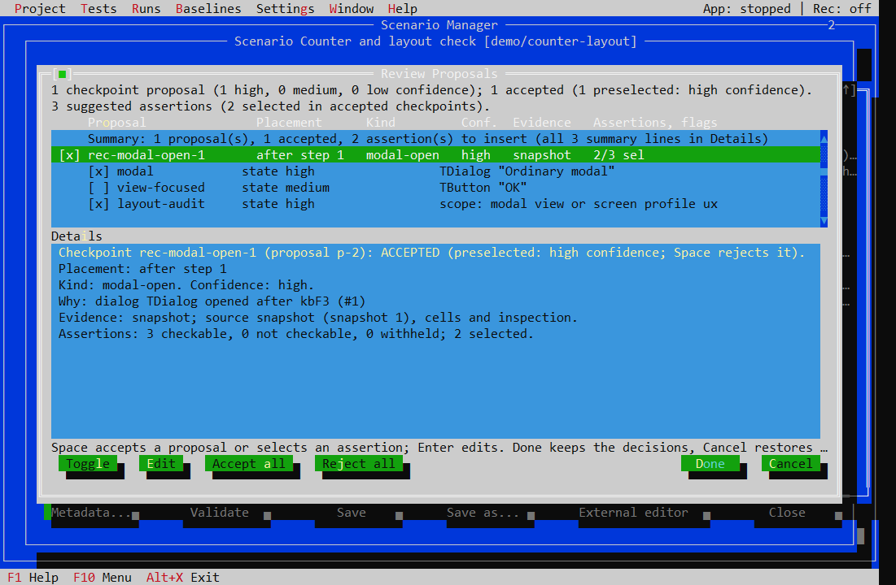

# Smart Recorder

Smart Recorder records delivered input in an ordinary TSharpVision application and proposes checkpoints from meaningful captured states. Recording uses a visible target window and is currently qualified on Windows; it is unavailable for a headless NullDriver target or a compiled diagnostic fixture.

## Record and review

1. Prepare a compatible target copy using Target Diagnostics and open an editable Black-Box scenario.
2. In Scenario Editor, choose **Record**, select a supported visible backend, and leave **Smart capture** enabled for checkpoint suggestions.
3. Choose **Start**, switch to the target, and perform a short interaction such as opening a dialog.
4. Return to Workbench and choose **Stop**. The owned target closes, and Review Proposals presents captured checkpoints and suggested assertions.
5. Review placement, confidence, evidence, and selected assertions. Accept, reject, or edit proposals, then append or insert the recording in the editor. Validate and save the scenario before replay.

## Evidence and picking

Smart Capture is enabled by default unless explicitly disabled in preferences or by configuration. A stale Proxy must be updated before Smart Capture can supply evidence. Missing evidence and unsupported proposals remain visible.

Use Ctrl+Shift+click/drag to pick controls or regions where supported. If a terminal host intercepts these gestures, use Pick Mode. A suggestion reflects captured state; it does not establish that the intended behavior is correct or approve a baseline.

Input recorded during a pause is omitted, and pauses between actions are not converted to waits. Add checkpoint retry when replay must wait for a condition. Additional checks can be written manually with Smart Capture on or off.

See the [manual recording workflow](manual/Manual.md#nahravani), [scenario format](scenarios.md), and [platform status](../README.md#platform-status).
